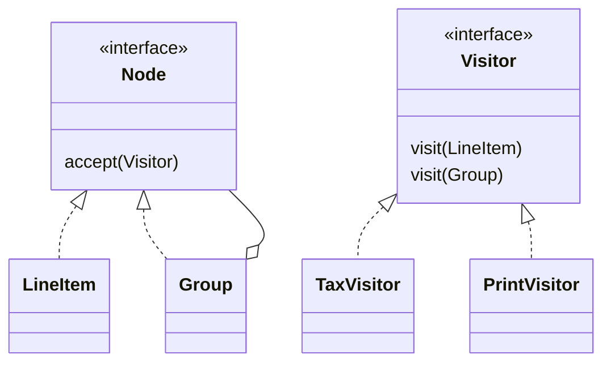

# Design Patterns

## 🟢 Fundamentals

### Creational patterns

#### Q1. What problem does Singleton actually solve, and how do you implement it thread-safely in Java? {#problem-singleton-solve-implement-thread}
**Answer:** Singleton guarantees a class has exactly one instance and gives a single global access
point to it — appropriate for something that is genuinely unique in the process: a logging
facade, a configuration registry, a connection pool wrapper. A naive `if (instance == null)
instance = new Foo();` is not thread-safe: two threads can both pass the null check before either
assigns, producing two instances. The idiomatic thread-safe Java implementations are (1) an
**eager** `static final` field (JVM class-loading guarantees are the safety net, at the cost of
always constructing it even if never used), (2) the **Bill Pugh / static inner holder class**
idiom (lazy, thread-safe, no synchronization overhead — the holder class is only loaded on first
access), or (3) a single-element **enum** (Joshua Bloch's recommendation — the JVM guarantees
enum instances are created exactly once and it's serialization-safe for free).

**Example:**

```java
// Bill Pugh idiom: lazy, thread-safe, no synchronized block on every call.
public class ConfigRegistry {
    private ConfigRegistry() {}
    private static class Holder {
        static final ConfigRegistry INSTANCE = new ConfigRegistry();
    }
    public static ConfigRegistry getInstance() { return Holder.INSTANCE; }
}

// Enum idiom: shortest correct form, immune to reflection and serialization attacks.
public enum ConfigRegistryEnum {
    INSTANCE;
    public void reload() { /* ... */ }
}
```

**Why it's a trap:** double-checked locking without `volatile` on the field is a classic wrong
answer that "looks" correct — without `volatile`, another thread can observe a partially
constructed object due to instruction reordering. If double-checked locking is used at all, the
field must be `private static volatile Foo instance;`.

*See also:* [Java Q28](java-core-jvm.md#name-thread-safe-singleton-implementation) for the JVM mechanics: class loading, and why `enum` also survives reflection and deserialization.

#### Q2. What's the actual difference between Factory Method and Abstract Factory? {#factory-method-abstract-factory}
**Answer:** **Factory Method** is a single method — often overridden in a subclass — that creates
one kind of object, letting subclasses decide which concrete type to instantiate while the caller
depends only on the return type's interface. **Abstract Factory** is a step up: an interface
exposing *several* factory methods that together produce a **family of related objects** meant to
be used together, guaranteeing the caller never accidentally mixes objects from incompatible
families. The distinguishing question in an interview isn't "which one creates objects" (both do)
but "does the caller need one product, or a consistent family of several products together."

**Example:**

```java
// Factory Method: one product, decided by the subclass.
abstract class DocumentExporter {
    abstract Exporter createExporter();
    void export(Document d) { createExporter().write(d); }
}
class PdfDocumentExporter extends DocumentExporter {
    Exporter createExporter() { return new PdfExporter(); }
}

// Abstract Factory: a whole family of related products, guaranteed compatible.
interface UiFactory {
    Button createButton();
    Checkbox createCheckbox();
}
class DarkThemeFactory implements UiFactory {
    public Button createButton() { return new DarkButton(); }
    public Checkbox createCheckbox() { return new DarkCheckbox(); }
}
```

**Why it's a trap:** reciting the definitions without the "family of related products" distinction
is the tell that a candidate memorized the names rather than understood why Abstract Factory
exists — the actual bug it prevents is a caller ending up with a `DarkButton` next to a
`LightCheckbox` because two independent Factory Methods were called with mismatched themes.

#### Q3. When does a Builder beat a telescoping constructor or plain JavaBean setters? {#builder-beat-telescoping-constructor-plain}
**Answer:** A telescoping constructor (`new Pizza(size)`, `new Pizza(size, cheese)`, `new
Pizza(size, cheese, pepperoni)`, ...) becomes unreadable and error-prone past 3-4 parameters,
especially when several share a type (which `boolean` is which?). Plain setters fix readability
but sacrifice immutability and leave the object in an inconsistent state between construction and
the last setter call — dangerous if it's read by another thread mid-construction, or if
validation needs "all required fields present" before the object is usable at all. Builder
supplies named, chainable setter-like methods that accumulate state and only construct the real
(optionally immutable) object in a final `build()` call, which is the one place invariants across
multiple fields can be validated together.

**Example:**

```java
Pizza pizza = new Pizza.Builder()
    .size(Size.LARGE)
    .cheese(true)
    .pepperoni(false)
    .build(); // validation across fields happens here, and the result can be fully immutable

class Pizza {
    private final Size size;
    private final boolean cheese;
    private Pizza(Builder b) { this.size = b.size; this.cheese = b.cheese; }
    static class Builder {
        private Size size; private boolean cheese;
        Builder size(Size s) { this.size = s; return this; }
        Builder cheese(boolean c) { this.cheese = c; return this; }
        Pizza build() {
            if (size == null) throw new IllegalStateException("size is required");
            return new Pizza(this);
        }
    }
}
```

**Why it's a trap:** reaching for Builder on a 2-field class is the opposite mistake — it's
boilerplate for boilerplate's sake. The pattern earns its cost specifically when there are several
optional parameters, some cross-field validation, and a desire for the final object to be
immutable.

#### Q4. When does the Prototype pattern (cloning) beat calling `new`? {#prototype-pattern-cloning-beat-calling}
**Answer:** Prototype creates new objects by copying an existing, fully-configured instance rather
than building one from scratch, which is worth it when construction is expensive (a costly
database read, network call, or heavy computation to arrive at the initial state) or when the
exact concrete class to instantiate isn't known at compile time and only an existing instance is
available to copy. Java's `Cloneable`/`clone()` is the textbook mechanism but is famously
awkward (shallow-copy by default, no constructor call, easy to get wrong with mutable fields); in
practice, a copy constructor or a static factory method that explicitly deep-copies mutable state
is usually the safer choice over implementing `Cloneable`.

**Example:**

```java
class Report implements Cloneable {
    private List<String> sections = new ArrayList<>();
    @Override
    public Report clone() {
        Report copy = new Report();
        copy.sections = new ArrayList<>(this.sections); // explicit deep copy of the mutable field
        return copy;
    }
}
// A cheaper alternative avoiding Cloneable's pitfalls entirely:
class ReportCopy {
    static Report copyOf(Report r) { /* explicit field-by-field deep copy */ return new Report(r); }
}
```

**Why it's a trap:** relying on `Object.clone()`'s default shallow copy when a field is a mutable
collection or nested object — both the original and the "copy" then share the same underlying
list, and a mutation through one silently corrupts the other's supposedly independent state.

### Structural patterns

#### Q5. How does Adapter reconcile two incompatible interfaces, and what's the object-vs-class adapter distinction? {#adapter-reconcile-two-incompatible-interfaces}
**Answer:** Adapter wraps an existing class behind the interface a client actually expects,
translating calls without changing either side — the classic use case is integrating a
third-party library whose API doesn't match the interface the rest of the codebase depends on. An
**object adapter** holds an instance of the adaptee via composition and delegates to it (works in
any language, including Java, and can adapt subclasses too). A **class adapter** uses multiple
inheritance to inherit from both the target interface and the adaptee directly — not possible in
Java for two concrete classes (single inheritance), so Java code is effectively always the object
adapter form.

**Example:**

```java
interface MediaPlayer { void play(String file); }

class LegacyThirdPartyDecoder {
    void decodeAndPlay(String path) { /* incompatible API shape */ }
}

class LegacyDecoderAdapter implements MediaPlayer { // object adapter: composition, not inheritance
    private final LegacyThirdPartyDecoder decoder = new LegacyThirdPartyDecoder();
    public void play(String file) { decoder.decodeAndPlay(file); }
}
```

**Why it's a trap:** reaching for Adapter to paper over a genuinely wrong abstraction inside your
*own* codebase (rather than at a real third-party boundary) just hides a design problem behind an
extra layer of indirection instead of fixing the interface that shouldn't have diverged in the
first place.

#### Q6. How does Decorator differ from just subclassing to add behavior? {#decorator-differ-just-subclassing-add}
**Answer:** Subclassing adds behavior at compile time, statically, and multiplies combinatorially —
`CoffeeWithMilk`, `CoffeeWithSugar`, `CoffeeWithMilkAndSugar`, one subclass per combination.
Decorator wraps an object of the same interface at *runtime*, adding behavior before/after
delegating to the wrapped instance, so any combination is achieved by nesting decorators instead
of declaring a new class per combination — the number of classes stays linear in the number of
behaviors, not exponential in their combinations.

**Example:**

```java
interface Coffee { double cost(); }
class SimpleCoffee implements Coffee { public double cost() { return 2.0; } }

abstract class CoffeeDecorator implements Coffee {
    protected final Coffee wrapped;
    CoffeeDecorator(Coffee c) { this.wrapped = c; }
}
class MilkDecorator extends CoffeeDecorator {
    MilkDecorator(Coffee c) { super(c); }
    public double cost() { return wrapped.cost() + 0.5; }
}
class SugarDecorator extends CoffeeDecorator {
    SugarDecorator(Coffee c) { super(c); }
    public double cost() { return wrapped.cost() + 0.2; }
}

Coffee order = new SugarDecorator(new MilkDecorator(new SimpleCoffee())); // any combo, no new class
```

**Why it's a trap:** Decorator preserves the *same* interface at every layer — if the added
behavior genuinely needs new methods callers must invoke, Decorator is the wrong tool; that's a
signal for Strategy or plain composition instead, not a decorator with an interface it doesn't
honor.

#### Q7. What specific problem does Facade solve for a complex subsystem? {#specific-problem-facade-solve-complex}
**Answer:** A subsystem with many interacting classes (a video conversion library with codecs,
buffers, bitrate management, etc.) forces every caller to learn and correctly sequence that
internal complexity. Facade introduces one simplified, higher-level interface exposing the common
use cases, without removing or restricting access to the underlying subsystem for callers who
still need fine-grained control. It's a usability/coupling improvement, not a security boundary —
the subsystem classes remain directly reachable.

**Example:**

```java
class VideoConversionFacade {
    public File convertToMp4(File video) {
        Codec codec = CodecFactory.extract(video);
        BitrateReader.read(video, codec);
        AudioMixer mixer = new AudioMixer();
        return mixer.fix(video); // caller never touches Codec, BitrateReader, AudioMixer directly
    }
}
```

**Why it's a trap:** treating the facade as the *only* allowed entry point and then bending it to
expose every subsystem knob "just in case" defeats the purpose — a facade that grows parameters
for every underlying option has become the subsystem's full API again, just renamed.

#### Q8. What are Proxy's variants, and how does it differ from Decorator? {#proxy-variants-differ-decorator}
**Answer:** Proxy controls **access** to an object by standing in for it behind the same interface:
a **virtual proxy** defers expensive construction until first real use (lazy loading), a
**protection proxy** adds authorization checks before delegating, a **remote proxy** hides the
fact that the real object lives in another process/machine, and a **logging/caching proxy**
records or short-circuits calls. The structural shape is identical to Decorator (wrap the same
interface, delegate, add behavior around the call) — the difference is *intent*: Decorator adds
new *responsibilities/behavior* the client explicitly wants layered on; Proxy controls *access* to
an object the client believes it's talking to directly, often transparently.

**Example:**

```java
interface Image { void display(); }
class RealImage implements Image {
    RealImage(String path) { loadFromDisk(path); /* expensive */ }
    public void display() { /* ... */ }
}
class VirtualProxyImage implements Image { // same interface, defers the expensive construction
    private final String path;
    private RealImage real;
    VirtualProxyImage(String path) { this.path = path; }
    public void display() {
        if (real == null) real = new RealImage(path); // loaded only on first actual display()
        real.display();
    }
}
```

**Why it's a trap:** claiming Proxy and Decorator are "the same pattern with different names" —
Spring's own `@Transactional`/security proxies are a real, load-bearing example of *access
control* (should this call even be allowed to proceed, and under what transaction?), not of
adding a new decorative capability; see `spring-architecture.md` Q11/Q13 for how that specific
proxy interacts with self-invocation.

### Behavioral patterns

#### Q9. What does Strategy buy you over a large `if`/`switch` on behavior? {#strategy-buy-large-switch-behavior}
**Answer:** Strategy extracts an algorithm (or one of several interchangeable variants) behind a
common interface, so the algorithm can be selected and swapped at runtime — often via
dependency injection — without the class using it knowing which concrete implementation it holds.
It directly follows the Open/Closed Principle: adding a new strategy means adding a new class, not
editing every branch of an existing conditional.

**Example:**

```java
interface DiscountStrategy { double apply(double price); }
class NoDiscount implements DiscountStrategy { public double apply(double p) { return p; } }
class PercentageDiscount implements DiscountStrategy {
    private final double pct;
    PercentageDiscount(double pct) { this.pct = pct; }
    public double apply(double p) { return p * (1 - pct); }
}

class Checkout {
    private final DiscountStrategy discount; // injected, swappable, no if/switch inside Checkout
    Checkout(DiscountStrategy discount) { this.discount = discount; }
    double total(double price) { return discount.apply(price); }
}
```

**Why it's a trap:** naming the pattern without naming the actual payoff (Open/Closed compliance,
independent testability of each strategy) is the shallow half of the answer — see Q17 for when
this indirection isn't worth it.

#### Q10. How does Observer decouple publishers from subscribers, and what's the classic pitfall to flag up front? {#observer-decouple-publishers-subscribers-classic}
**Answer:** A subject maintains a list of observers and notifies all of them on a state change,
without knowing anything about what each observer does with that notification — publishers and
subscribers depend only on a thin `Observer`/`Listener` interface, not on each other's concrete
types, which is what enables adding new subscribers with zero changes to the publisher. The
pitfall to flag immediately (detailed with a concrete failure scenario in Q18/S2): if a subscriber
is never explicitly unregistered, the subject's list keeps a live reference to it forever, which
is a textbook memory leak in a long-running process.

**Example:**

```java
interface OrderListener { void onOrderPlaced(Order o); }

class OrderService {
    private final List<OrderListener> listeners = new ArrayList<>();
    void subscribe(OrderListener l) { listeners.add(l); }
    void unsubscribe(OrderListener l) { listeners.remove(l); } // easy to forget to call this
    void place(Order o) { listeners.forEach(l -> l.onOrderPlaced(o)); }
}
```

**Why it's a trap:** describing Observer purely as "pub/sub" without mentioning the unregistration
responsibility is incomplete — see Q18 for the memory-leak trap this creates in practice.

#### Q11. What does Template Method fix, and how does it differ from just calling helper methods in order? {#template-method-fix-differ-just}
**Answer:** Template Method defines the *fixed skeleton* of an algorithm in a base class method
(often `final`, so subclasses can't reorder or skip steps), while deferring specific steps to
abstract or overridable "hook" methods that subclasses implement. Unlike a caller manually calling
helper methods in the right order every time (easy to reorder or forget a step by mistake), the
sequencing itself lives in one place and can never be gotten wrong by a subclass — subclasses can
only fill in the customizable steps, not the order they run in.

**Example:**

```java
abstract class DataImporter {
    final void run(File f) {           // the algorithm's fixed skeleton — final, can't be reordered
        Data raw = read(f);
        Data valid = validate(raw);
        persist(valid);
    }
    abstract Data read(File f);
    Data validate(Data d) { return d; } // default hook, overridable but not mandatory
    abstract void persist(Data d);
}
class CsvImporter extends DataImporter {
    Data read(File f) { /* CSV-specific */ return null; }
    void persist(Data d) { /* ... */ }
}
```

**Why it's a trap:** making the skeleton method non-`final` invites a subclass to override the
whole sequence, silently reintroducing exactly the "steps run in the wrong order" bug the pattern
exists to prevent.

#### Q12. What does Command buy you beyond "just call the method directly," and what are its main use cases? {#command-buy-beyond-just-call}
**Answer:** Command turns a request (a method call plus its arguments) into a standalone object
implementing a common interface (typically one `execute()` method), which decouples the object
that *invokes* an action from the object that *knows how to perform* it, and lets that request be
stored, queued, logged, or reversed. Direct method calls can't be queued for later, retried,
serialized, or trivially undone — a `Command` object can be all of those, because the request
itself is now data, not just a stack frame in flight.

**Example:**

```java
interface Command { void execute(); void undo(); }

class AddTextCommand implements Command {
    private final Document doc; private final String text;
    AddTextCommand(Document doc, String text) { this.doc = doc; this.text = text; }
    public void execute() { doc.append(text); }
    public void undo() { doc.removeLast(text.length()); }
}

class CommandHistory {
    private final Deque<Command> history = new ArrayDeque<>();
    void run(Command c) { c.execute(); history.push(c); }
    void undoLast() { if (!history.isEmpty()) history.pop().undo(); }
}
```

**Why it's a trap:** reaching for Command on a simple, immediate, one-shot action that will never
need to be queued, logged, retried, or undone is pure ceremony — the pattern earns its cost
specifically when one of those cross-cutting needs (undo, a job queue, an audit log of executed
actions) is actually present.

#### Q13. How does State differ from Strategy, given that their class diagrams are almost identical? {#state-differ-strategy-given-class}
Both delegate behavior to an interchangeable object behind an interface; the difference is *who chooses and why*. With **Strategy** the client picks an algorithm from outside and it rarely changes during the object's life (a pricing rule, a sort order).

With **State** the object's own behavior changes as its internal state changes, and the state objects themselves usually trigger the transitions (`Order` goes `NEW -> PAID -> SHIPPED`; `ship()` is legal in one state and an error in another).

State replaces a growing `switch (status)` repeated in every method with one class per state, so illegal transitions become impossible by construction instead of being guarded by scattered `if`s.

The cost is more classes: for two or three states with trivial rules, an enum with a `switch` is simpler (the same over-engineering test as Q22).

Flag shared mutable state objects as the usual pitfall: stateless state objects can be singletons, but ones holding per-order data cannot.

**Example:**

```java
interface OrderState {
    OrderState pay(Order o);
    OrderState ship(Order o);
}
class New implements OrderState {
    public OrderState pay(Order o)  { o.charge(); return new Paid(); }
    public OrderState ship(Order o) { throw new IllegalStateException("pay first"); }
}
class Paid implements OrderState {
    public OrderState pay(Order o)  { throw new IllegalStateException("already paid"); }
    public OrderState ship(Order o) { o.dispatch(); return new Shipped(); }
}
// Order: this.state = state.pay(this);   <- the state decides the next state
```

#### Q14. When is Chain of Responsibility the right fit, and where do you already use it without naming it? {#chain-responsibility-right-fit-already}
Chain of Responsibility passes a request along a sequence of handlers, each of which either handles it, modifies it, or forwards it to the next one; the sender doesn't know which handler will act.

It fits pipelines where steps are independent, ordered, and added or removed by configuration: servlet filters and Spring Security's filter chain, HTTP middleware, validation or approval rules ("under 1k: team lead; under 10k: director"), logging levels.

The benefits are decoupled steps that can be reordered or tested alone; the traps mirror stacked Decorators (Q16): order is a hidden contract, a handler that forgets to call `next` silently swallows the request, and with no handler matching you need an explicit default (fail or reject) rather than a silent no-op.

Compared to Decorator, a handler may *stop* the chain; a decorator always delegates.

**Example:**

```java
interface Handler { void handle(Request r, Runnable next); }

Handler auth  = (r, next) -> { if (!r.hasToken()) throw new UnauthorizedException(); next.run(); };
Handler rate  = (r, next) -> { if (limiter.tooMany(r.ip())) throw new TooManyRequests(); next.run(); };
Handler audit = (r, next) -> { log.info("{} {}", r.method(), r.path()); next.run(); };
// order matters: authenticate before rate-limiting by user, audit last. Forgetting next.run() swallows the request.
```

## 🟡 Senior traps

### Questions

#### Q15. Why do many senior engineers treat Singleton as an anti-pattern despite it being the "easiest" pattern to implement correctly? {#many-senior-engineers-treat-singleton}
**Answer:** The implementation being easy to get right (Q1) isn't the problem — the *design*
consequence is. A Singleton is global mutable state with a static access point, which means any
class using it has a hidden dependency invisible in its constructor signature, making the
dependency graph harder to reason about and impossible to substitute for a test double without
reaching for heavier tools (static mocking, classloader tricks). Worse, in a test suite, a
Singleton's state can leak between tests that run in the same JVM/classloader — a test that
mutates it and doesn't clean up can make an unrelated, later-run test fail nondeterministically,
often only under parallel test execution. The senior alternative in most cases: dependency
injection with a framework-managed singleton *scope* (e.g. a Spring `@Bean` with default scope) —
same "one instance" guarantee, but the dependency is explicit in the constructor and trivially
replaceable with a mock in a test.

**Example:**

```java
// Hand-rolled Singleton: hidden dependency, hard to substitute in a test.
class ReportGenerator {
    void generate() {
        String key = ConfigRegistry.getInstance().get("api.key"); // invisible dependency
    }
}

// DI equivalent: same "one instance in the app" guarantee, explicit and swappable.
class ReportGenerator {
    private final Config config;
    ReportGenerator(Config config) { this.config = config; } // trivially mockable in a test
}
```

**Why it's a trap:** "Singleton is fine, I implemented it thread-safely" answers the wrong
question — thread-safety was never the objection; testability and hidden coupling are, and a
correct implementation doesn't fix either.

#### Q16. When does stacking Decorators become worse than the inheritance explosion it was meant to avoid? {#stacking-decorators-become-worse-inheritance}
**Answer:** Decorator trades an exponential *class* explosion for a potentially deep, order-
sensitive *runtime* chain — five or six nested decorators, each silently depending on running
before or after another (a logging decorator that must wrap a caching decorator, not the reverse,
or the cache key is computed on stale data), turns "which combination is this?" into a debugging
problem at construction sites scattered across the codebase instead of a fixed, visible class
hierarchy. The chain also makes stepping through a debugger noticeably harder — one logical call
now traverses N proxy-like layers.

**Example:**

```java
// Order matters and is easy to get backwards with no compiler help either way:
Coffee a = new LoggingDecorator(new CachingDecorator(new MilkDecorator(new SimpleCoffee())));
Coffee b = new CachingDecorator(new LoggingDecorator(new MilkDecorator(new SimpleCoffee())));
// a logs the (correct) cached result; b logs a cache-bypassing call every time — same classes, different bug
```

**Why it's a trap:** treating "any number of decorators, freely combined" as the pattern's
selling point without acknowledging ordering constraints — past a handful of layers with real
sequencing dependencies, a builder or an explicit small pipeline class documenting the required
order is often more debuggable than the theoretically-infinite decorator composition.

#### Q17. When does introducing Strategy add more complexity than a plain `if`/`switch` would? {#introducing-strategy-add-more-complexity}
**Answer:** Strategy pays off when the number of variants is genuinely open-ended (plugins,
runtime configuration, per-tenant behavior) or when each variant has enough internal logic and
its own test surface to deserve its own class. It's the wrong call for 2-3 stable, simple
branches that will rarely change — a `switch` is more readable in one place, requires no extra
indirection to trace, and doesn't force a reader to jump across files to see what each option
actually does.

**Example:**

```java
// Plain switch: three stable options, trivial bodies — perfectly readable as-is.
double shipping(String method) {
    return switch (method) {
        case "STANDARD" -> 5.0;
        case "EXPRESS" -> 15.0;
        case "OVERNIGHT" -> 30.0;
        default -> throw new IllegalArgumentException(method);
    };
}
// Strategy here would be three tiny classes and an injected interface for logic this simple.
```

**Why it's a trap:** applying Strategy reflexively to "avoid conditionals" as a rule, rather than
because new variants are actually expected to arrive over time, is pattern-for-its-own-sake — the
Open/Closed benefit from Q9 only matters if the closed set of cases is realistically going to open.

#### Q18. What happens when Observer subscribers are never unregistered, concretely? {#happens-observer-subscribers-never-unregistered}
**Answer:** The subject's listener list holds a strong reference to every subscriber it was ever
given — if a subscriber is, say, a UI component or a request-scoped object that should have been
garbage collected once its owning screen/request ended, that reference alone keeps it (and
everything it transitively holds) alive for the lifetime of the *subject*, which is often the
whole application. In a long-running service, this shows up as slow, steady memory growth that
becomes an OutOfMemoryError days or weeks into uptime — hard to attribute to Observer specifically
without a heap dump, because nothing has crashed or errored along the way.

**Example:**

```java
class ScreenController implements OrderListener {
    ScreenController(OrderService svc) { svc.subscribe(this); }
    // if close()/unsubscribe is never called, OrderService.listeners keeps this alive forever
    void onOrderPlaced(Order o) { /* update UI */ }
}
```

**Why it's a trap:** the leak produces no exception and no immediately wrong behavior — it's
discovered as a slow memory-growth curve in production monitoring, at which point tracing it back
to a specific forgotten `unsubscribe()` call requires a heap dump and dominator-tree analysis, not
a stack trace.

#### Q19. What's the "anemic domain model" trap, and how does uncritical pattern application feed it? {#anemic-domain-model-trap-uncritical}
**Answer:** An anemic domain model is a set of classes that are pure data holders (fields plus
getters/setters) with all actual behavior pulled out into separate "service" or "manager"
classes — it looks organized (clean separation of data and logic) but actually violates
encapsulation: nothing stops a service from putting an object into an invalid state, because the
object itself enforces no invariants. Patterns get blamed for enabling this when Strategy,
Factory, or a Builder become an excuse to keep pushing behavior *out* of the domain object rather
than modeling the invariant directly on it — the patterns aren't the cause, but reaching for one
reflexively, instead of asking "should this object just enforce this rule itself," is how a
codebase drifts there.

**Example:**

```java
// Anemic: nothing stops OrderService from setting an impossible state.
class Order { List<Item> items; String status; } // pure data, no behavior, no protection
class OrderService {
    void markShipped(Order o) { o.status = "SHIPPED"; } // no check that items is non-empty, etc.
}

// Rich: the invariant lives where the data does — can't be bypassed by a careless caller.
class Order {
    private List<Item> items; private Status status;
    void markShipped() {
        if (items.isEmpty()) throw new IllegalStateException("cannot ship an empty order");
        this.status = Status.SHIPPED;
    }
}
```

**Why it's a trap:** "I used the Strategy pattern so the logic is decoupled from the entity" can
describe either a genuinely good decoupling of an interchangeable *algorithm*, or a symptom of
having stripped an entity of every invariant it should itself be responsible for — the pattern's
presence doesn't tell you which one happened; the question is always "who can put this object into
an invalid state," not "is the logic in a separate class."

#### Q20. What's the concurrency trap with a shared, mutable Builder instance? {#concurrency-trap-shared-mutable-builder}
**Answer:** A Builder accumulates mutable state across chained calls before a final `build()` —
that's fine for the common case of one builder used by one thread to construct one object. It
breaks the moment the *same builder instance* is shared or reused across threads (e.g. cached and
reused "for efficiency," or passed to a shared configuration step): concurrent calls to its
`with...()` methods race on the same mutable fields, and one thread's `build()` can observe a
half-updated combination of fields that no single caller ever intended, with no exception thrown.

**Example:**

```java
// Unsafe if `builder` is shared across threads/requests:
RequestBuilder builder = new RequestBuilder(); // NOT thread-safe by design
// Thread A:
builder.header("X-Tenant", "acme");
// Thread B, concurrently:
builder.header("X-Tenant", "other");
Request r = builder.build(); // could observe either tenant, or a state neither thread set alone
```

**Why it's a trap:** Builder's usual immutability of the *final built object* gets mentally
conflated with the builder itself being safe to share — the builder is a mutable, single-use,
typically single-threaded object, and reusing one instance across requests to "save an
allocation" reintroduces exactly the race conditions immutability was supposed to eliminate
downstream.

## 🔴 Expert / Open

### Questions

#### Q21. Design a plugin architecture using Strategy, Factory, and a registry — walk through the pieces. {#design-plugin-architecture-using-strategy}
A plugin system needs three things: a common contract every plugin implements (**Strategy** — so
the host code depends only on the interface, never a concrete plugin class), a way to obtain the
right plugin instance for a given name/type without the caller hardcoding a class name
(**Factory**), and a place new plugins register themselves without editing the host's source
(**Registry**, often populated via Java's `ServiceLoader`, a Spring `Map<String, Strategy>`
auto-wired from all beans of that type, or explicit registration on startup). The Factory becomes
thin here — it's really just "look up the registered strategy by key" — but keeping it as a
separate step still isolates callers from the registry's internal representation. The open design
question worth raising unprompted: what happens for an unknown plugin key at runtime (fail fast
vs. a documented no-op default), and whether plugins can depend on each other's presence/ordering,
which a flat registry doesn't express.

**Example:**

```java
interface PaymentPlugin { PaymentResult process(Payment p); }

class PaymentPluginRegistry {
    private final Map<String, PaymentPlugin> plugins;
    PaymentPluginRegistry(Map<String, PaymentPlugin> plugins) { this.plugins = plugins; } // Spring auto-wires all beans
    PaymentPlugin get(String key) {
        PaymentPlugin p = plugins.get(key);
        if (p == null) throw new IllegalArgumentException("no plugin registered for " + key); // fail fast, decided explicitly
        return p;
    }
}
```

#### Q22. When is a design pattern over-engineering versus the right call, and how do you decide that in a code review? {#design-pattern-engineering-right-call}
The pattern itself is never the risk — the mismatch between the pattern's promise (flexibility for
future change) and the actual, evidenced likelihood of that change is. The practical review
heuristic: is there a second, real, near-term case this abstraction needs to serve, or is it
speculative ("we might need another payment provider someday")? YAGNI-driven code review asks for
the concrete second case before approving an interface with one implementation, a Factory
producing one product, or a Strategy with one strategy — not because patterns are bad, but because
an abstraction paid for before it's needed adds a layer every future reader must first understand
and then discover was never actually exercised. Conversely, refusing a pattern that clearly
matches an already-repeating shape (three near-identical `if` branches doing structurally the same
thing with different data) just delays the same refactor to when it's more entangled with new
code.

**Example:**

```java
// Over-engineered: speculative abstraction
interface PaymentProvider { Receipt charge(Money m); }   // 1 implementation
class PaymentProviderFactory { ... }                    // creates that 1 implementation
// Right-sized: the plain class, until a second case exists
class StripeClient { Receipt charge(Money m) { ... } }  // extract the interface when provider #2 is real
```

#### Q23. How do GoF creational/structural patterns relate to DDD tactical patterns like Repository, Factory, and Aggregate? {#gof-creational-structural-patterns-relate}
DDD's tactical patterns are largely GoF patterns re-scoped to a specific job in a domain model
rather than a new set of ideas. A DDD **Factory** is exactly the GoF Factory (Method or Abstract)
constrained to producing a valid Aggregate — it exists specifically to keep an Aggregate's
invariants intact at construction time, not just to hide a `new`. A DDD **Repository** is closer
to a Facade/Proxy hybrid over persistence — it presents a simple, collection-like interface
(`findById`, `save`) while hiding the actual query/ORM machinery behind it, and can add a
protection- or caching-proxy-like layer transparently. An **Aggregate** itself isn't a GoF pattern
at all — it's a consistency-boundary concept — but the objects composing it are frequently built
using Builder (for complex construction) and Strategy (for pluggable policies inside the
aggregate, e.g. a pricing strategy). Recognizing this mapping matters practically: a candidate who
can only recite GoF names by rote, disconnected from where they actually show up in an
architecture the codebase already uses, hasn't internalized *why* each pattern exists.

**Example:**

```java
class Order {                                   // Aggregate root: enforces its own invariants
    private final List<OrderLine> lines = new ArrayList<>();
    void addLine(Product p, int qty) { if (qty <= 0) throw new IllegalArgumentException(); lines.add(new OrderLine(p, qty)); }
}
interface OrderRepository { Optional<Order> findById(OrderId id); void save(Order o); }   // Repository: collection-like facade over persistence
class OrderFactory { Order create(Customer c, Cart cart) { ... } }                     // Factory: builds a valid Aggregate
```

#### Q24. Composite plus Visitor over a tree-shaped domain (e.g. nested billing rules or a file system) — what's the actual trade-off against adding methods directly to the tree nodes? {#composite-plus-visitor-tree-shaped}
Composite lets leaf and composite nodes share a uniform interface, so client code can treat a
single item and a group of items identically (`node.total()` works whether `node` is a line item
or a folder of line items). Adding a *new operation* over that whole tree (serialize to XML,
compute tax, render for print) can be done two ways: add a new method to every node class
(simple, but every node class must be touched and recompiled for each new operation — violates
Open/Closed for operations), or implement **Visitor**, where each node accepts a visitor object
and the operation's logic lives entirely in the visitor, added without touching any node class at
all. The trade-off is symmetric with Strategy's Q17/Q9 tension but flipped along a different axis:
Visitor makes adding a new *operation* free but adding a new *node type* expensive (every existing
visitor must gain a new `visit(NewNodeType)` overload) — exactly the reverse of the
methods-on-nodes approach. The right call depends on which axis of the tree changes more often in
practice: stable node types with frequently added operations favor Visitor; frequently added node
types with a stable, small set of operations favor keeping the logic on the nodes themselves.

**Example:**



```java
class TaxVisitor implements Visitor {                         // the operation lives in the visitor; Node classes are untouched
    public void visit(LineItem i) { total += i.price() * 0.2; }
    public void visit(Group g)    { g.children().forEach(n -> n.accept(this)); }
}
```

## 🎯 Real-world scenarios

### S1. Integration tests pass in isolation but fail intermittently when the full suite runs {#integration-tests-pass-isolation-but}
- **Symptoms:** A test that asserts on some computed value fails only when run alongside other
  tests, and only sometimes — rerunning just that test in isolation always passes.

> 🧠 **Try first:** Before opening the answer, write your first three hypotheses and the command or metric you would check for each.

<details markdown="1">
<summary>Show diagnosis, resolution & prevention</summary>

- **Diagnosis:** Grep for a hand-rolled Singleton (Q1/Q15) touched by more than one test — a
  static field retaining state (a cache, a counter, a "current tenant" holder) set by an earlier
  test and never reset before the next one runs in the same JVM.
- **Example:**

  ```java
  public enum TenantContext { INSTANCE; private String tenantId; /* set by test A, read by test B */ }
  ```

- **See also:** [Testing S6](testing.md#test-passes-alone-but-fails), the general method for order-dependent tests (random order, bisection).
- **Resolution:** Add an explicit reset/teardown for the Singleton's mutable state between tests,
  or — the more durable fix — replace the Singleton with an injected, per-test-constructible
  instance so each test naturally gets a fresh one with no shared static state at all.
- **Prevention:** Treat any hand-rolled Singleton holding *mutable* state (not just a stateless
  service) as a code-review flag; prefer DI-managed instances that tests can trivially construct
  fresh (Q15).

</details>

### S2. Heap usage climbs steadily over days of uptime with no obvious spike {#heap-usage-climbs-steadily-days}
- **Symptoms:** Memory grows roughly linearly with uptime (not with traffic volume specifically),
  eventually ending in an `OutOfMemoryError`, with nothing in the logs pointing at a specific
  request or feature.

> 🧠 **Try first:** Before opening the answer, write your first three hypotheses and the command or metric you would check for each.

<details markdown="1">
<summary>Show diagnosis, resolution & prevention</summary>

- **Diagnosis:** A heap dump's dominator tree shows one Observer/listener list (Q10/Q18) holding
  thousands of references to objects that should have been short-lived — each one kept alive
  purely by never having called `unsubscribe()`.
- **Example:**

  ```text
  Dominator tree: OrderService.listeners -> List<OrderListener> (48,203 entries, 1.2 GB retained)
  ```

- **See also:** [Java Core S5](java-core-jvm.md#heap-usage-climbs-steadily-never), same symptom with a different cause (an unbounded `static` map).
- **Resolution:** Add the missing `unsubscribe()` call at the subscriber's actual end-of-life
  (request completion, component teardown), or switch to weak references for listeners whose
  lifecycle genuinely can't be tracked precisely by the subject.
- **Prevention:** Pair every `subscribe()` call site with a corresponding `unsubscribe()` in
  review, and add a periodic metric on listener-list size in production so unbounded growth is
  caught long before it reaches an OOM.

</details>

### S3. A one-line behavior change requires touching a five-layer decorator chain, and nobody is confident about the order {#one-line-behavior-change-requires}
- **Symptoms:** A request to "log this before caching, not after" turns into a change nobody wants
  to review, because the actual runtime order only exists implicitly, at each construction call
  site, spread across the codebase.

> 🧠 **Try first:** Before opening the answer, write your first three hypotheses and the command or metric you would check for each.

<details markdown="1">
<summary>Show diagnosis, resolution & prevention</summary>

- **Diagnosis:** The decorator chain (Q16) has grown past the point where its composition order
  is self-evident from reading any single file — the order is a convention nobody wrote down.
- **Example:**

  ```java
  return new AuthDecorator(new RetryDecorator(new CachingDecorator(new LoggingDecorator(
      new MetricsDecorator(realService)))));
  // which of these five actually needs to run first, and why? not documented anywhere.
  ```

- **Resolution:** Extract the chain's construction into one named factory method with an inline
  comment stating the required order and why, or replace the ad hoc nesting with an explicit,
  ordered pipeline class that makes the sequence a visible list rather than nested constructor
  calls.
- **Prevention:** Cap decorator depth by convention (a review flag past 3-4 layers) and always
  centralize the composition in one place instead of letting each call site assemble its own
  ordering.

</details>

### S4. A "flexible" plugin abstraction has exactly one implementation a year after it shipped {#flexible-plugin-abstraction-has-exactly}
- **Symptoms:** Code review flags an interface, a Factory, and a Strategy scaffold for "future
  payment providers" — a year later, only the original provider was ever added.

> 🧠 **Try first:** Before opening the answer, write your first three hypotheses and the command or metric you would check for each.

<details markdown="1">
<summary>Show diagnosis, resolution & prevention</summary>

- **Diagnosis:** The abstraction (Q22) was built for a speculative second case that never
  materialized; every reader since has had to understand the indirection to make a change that,
  in practice, only ever affects the one existing implementation.
- **Resolution:** Collapse the interface and Factory back into the single concrete
  implementation, keeping the code that's actually used simple; reintroduce the abstraction if
  and when a second real case actually shows up, informed by what that second case actually
  needs (which is often not what the original speculative interface guessed).
- **Example:**

  ```diff
  // Collapsing the speculative layer (before -, after +)
  - interface PaymentProvider { Receipt charge(Money m); }
  - class PaymentProviderFactory { static PaymentProvider forName(String n) { return new StripeProvider(); } }
  + class StripeProvider { Receipt charge(Money m) { ... } }
  - PaymentProvider p = PaymentProviderFactory.forName("stripe");
  + StripeProvider p = new StripeProvider();
  ```

- **Prevention:** Require a concrete, named second use case — not a hypothetical one — before
  approving an interface with a single implementation in review (Q22).

</details>

### S5. A new payment method requires editing a 300-line `switch` in five places {#new-payment-method-requires-editing}
- **Symptoms:** Each release adds a payment type and every release breaks an unrelated one.

> 🧠 **Try first:** Before opening the answer, write your first three hypotheses and the command or metric you would check for each.

<details markdown="1">
<summary>Show diagnosis, resolution & prevention</summary>

- **Diagnosis:** Behaviour that varies by type is scattered across `switch`/`if` chains: an open-closed violation. Count the switches on the same type.
- **Resolution:** Introduce a `PaymentMethod` interface (Strategy) with one class per type, selected by a map or Spring bean lookup; move each branch into its class, behind characterization tests first. With sealed types, keep `switch` only where it is exhaustive.
- **Prevention:** Review rule: a second `switch` on the same type is the signal to extract a strategy.

</details>

## 🗣️ Commonly asked questions

Questions that come up often in interviews on this topic (a typical set, not tied to one specific interview). Each has a short model answer: expand it with the sections above and say it aloud.

#### R1. Strategy vs State: what is the difference? {#strategy-state}
**Answer:** Both swap behaviour behind an interface. Strategy is chosen by the client and the algorithms are independent (sort order, pricing); State changes by itself as the object moves through its lifecycle, and states know about transitions (order: NEW → PAID → SHIPPED).

#### R2. Factory Method vs Abstract Factory. {#factory-method-abstract-factory-2}
**Answer:** Factory Method is one creation method that subclasses or a config decide (one product). Abstract Factory creates a family of related products that must go together (e.g. UI widgets for one theme). Do not add either until you have two real variants.

#### R3. Observer vs publish/subscribe. {#observer-publish-subscribe}
**Answer:** Observer: the subject holds direct references to its observers and calls them in-process, synchronously. Pub/sub: a broker or event bus sits between publishers and subscribers, so they are decoupled in time and location (Spring `ApplicationEvent`, Kafka). Observer is simpler; pub/sub scales and survives restarts if the broker persists.

## 🎤 Oral quiz

Ten questions picked across the levels. Answer each **aloud in 2–3 minutes** without looking, structuring it as context → options → decision → trade-offs. Then open the linked question and score yourself: **0** blank · **1** definition only · **2** plus an example · **3** plus trade-offs and a pitfall. Below 24/30, redo the weak ones after two weeks. Questions and scenarios are in the sections above.

1. Q1. What problem does Singleton actually solve, and how do you implement it thread-safely in Java?
2. Q7. What specific problem does Facade solve for a complex subsystem?
3. Q12. What does Command buy you beyond "just call the method directly," and what are its main use cases?
4. Q15. Why do many senior engineers treat Singleton as an anti-pattern despite it being the "easiest" pattern to implement correctly?
5. Q17. When does introducing Strategy add more complexity than a plain `if`/`switch` would?
6. Q20. What's the concurrency trap with a shared, mutable Builder instance?
7. Q21. Design a plugin architecture using Strategy, Factory, and a registry — walk through the pieces.
8. Q24. Composite plus Visitor over a tree-shaped domain (e.g. nested billing rules or a file system) — what's the actual trade-off against adding methods directly to the tree nodes?
9. S1. Integration tests pass in isolation but fail intermittently when the full suite runs
10. S4. A "flexible" plugin abstraction has exactly one implementation a year after it shipped

## 📌 Cheat-sheet

### Creational patterns (how objects get created)

**Start here:** Singleton is usually a trap; Builder fixes long constructors; Factory hides which class you create; Prototype copies instead of building.

- **Singleton** — one instance of a class with global access. *Use the Bill Pugh holder (a static inner class that creates it lazily) or an `enum` for thread-safety.*
- **Singleton is an anti-pattern for real dependencies or mutable state** — it hides coupling and is hard to test. *Prefer a DI-managed scope instead (e.g. a Spring singleton bean).*
- **Factory Method** — one product, created by a method that a subclass decides. *E.g. `createParser()` returns a `JsonParser` or `XmlParser` depending on the subclass.*
- **Abstract Factory** — creates a whole *family* of related products guaranteed to be compatible with each other. *E.g. a "dark theme" factory gives you a matching dark Button + dark Checkbox.*
- **Builder** — named, chainable construction with cross-field validation at `build()`, e.g. `new Pizza.Builder().size(12).cheese(true).build()`. *Earns its keep past ~3-4 optional parameters.*
- **Builder is mutable** — the builder object itself changes as you chain calls. *Don't share one between threads (not thread-safe).*
- **Prototype** — clone an expensive-to-build instance instead of calling `new`. *Prefer an explicit copy constructor over `Cloneable`, whose default is a shallow copy (the copy shares nested objects with the original).*

### Structural patterns (how objects are wired together)

**Start here:** Adapter converts, Facade simplifies, Decorator adds behavior, Proxy controls access — the last two look identical in code, the intent differs.

- **Adapter** — reconcile an incompatible interface (a "plug converter"). *Use it at a real boundary, usually a third-party library.*
- **Object adapter** — the adapter holds the other object (composition) rather than extending it. *Java is always this form, since it has no multiple inheritance of classes.*
- **Decorator** — same interface as the wrapped object, stacking extra behavior at runtime, e.g. `new BufferedInputStream(new FileInputStream(f))`. *Gives linear classes instead of an exponential subclass explosion.*
- **Decorator ordering** — the order of wrapping changes the result (compress-then-encrypt differs from encrypt-then-compress). *It's a real constraint that is undocumented by default once you have more than a few layers.*
- **Facade** — one simplified entry point over a complex subsystem. *Don't remove direct access to the subsystem for callers who need it.*
- **Proxy** — same shape as Decorator, different intent: it controls *access* (virtual = lazy loading, protection = permission checks, remote = stands in for a distant object, logging). *See `spring-architecture.md` Q11/Q13 for `@Transactional`'s proxy in practice.*

### Behavioral patterns (how objects collaborate)

**Start here:** Strategy swaps an algorithm, Observer broadcasts events, Template Method fixes a skeleton, Command turns a request into an object.

- **Strategy** — interchangeable algorithms behind one interface, swappable at runtime (e.g. several `PaymentMethod` implementations). *Pays off for an open-ended or independently-testable set of variants, not 2-3 stable branches.*
- **Observer** — decoupled publish/subscribe: subscribers get notified when something happens. *The trap: a subscriber that never calls `unsubscribe()` causes a slow, hard-to-attribute memory leak, not an exception.*
- **Template Method** — a fixed algorithm skeleton (marked `final`) with overridable steps. *Subclasses customize behavior but can never reorder or skip the sequence.*
- **Command** — a request wrapped as an object. *Earns its cost when something must be queued, logged, retried or undone; ceremony for a simple one-shot call otherwise.*
- **State vs Strategy** — same shape, different driver: Strategy is chosen from outside by the client; State changes with the object's own lifecycle and its states trigger the transitions. *An `enum` + `switch` is enough for 2-3 trivial states.*
- **Chain of Responsibility** — ordered handlers that may stop the chain (filters, middleware, approval rules). *Order is a hidden contract, and a forgotten `next` call swallows the request.*

### Design judgment and architecture

**Start here:** a pattern must earn its place; ask for a concrete second use case before adding an abstraction.

- **Over-engineering test** — require a concrete second use case before approving an interface, Factory or Strategy with a single implementation. *A hypothetical future one doesn't count.*
- **Anemic domain model** — behavior is stripped out into services while entities (e.g. `Order`) enforce no rules themselves. *Ask "who can put this object into an invalid state?", not "is the logic decoupled?"*
- **Plugin architectures** — Strategy (the contract) + Factory/registry (lookup by key). *Decide unknown-key behavior (fail fast vs default) explicitly up front.*
- **DDD tactical patterns** *(advanced)* — DDD (Domain-Driven Design) has its own building blocks that map onto GoF patterns. Repository ≈ Facade/Proxy over persistence. *Factory ≈ GoF Factory, scoped to keeping an Aggregate's invariants (its consistent cluster of objects) valid at construction.*
- **Composite** *(advanced)* — treat a tree of objects (folder → files) uniformly through one interface.
- **Visitor** *(advanced)* — moves an operation out of the node classes into a separate "visitor" object. *Adding operations becomes free but adding node types becomes expensive — the reverse of methods-on-nodes. Pick based on which axis actually changes more often.*
