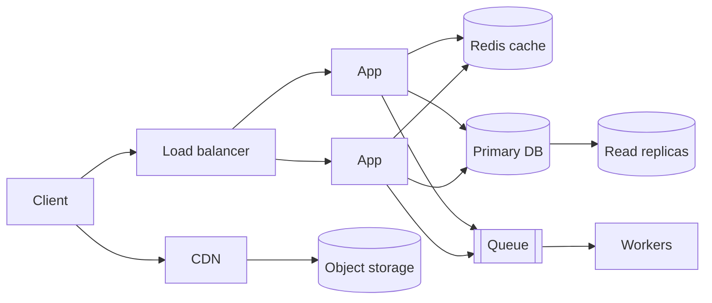
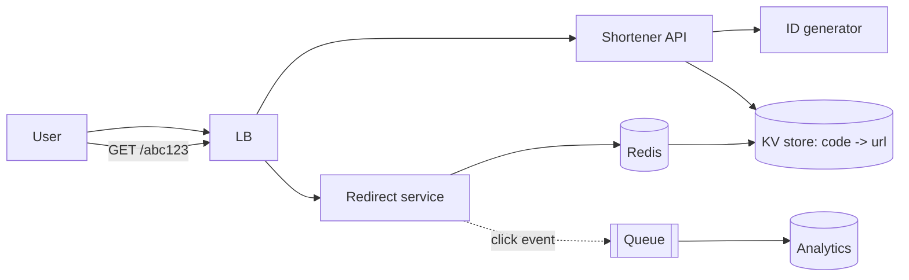
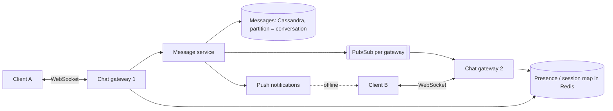
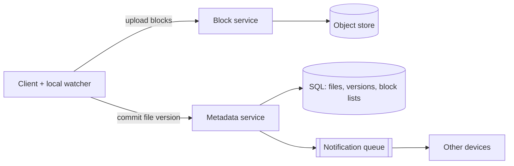
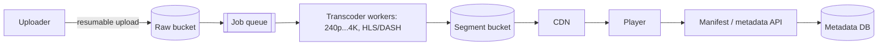
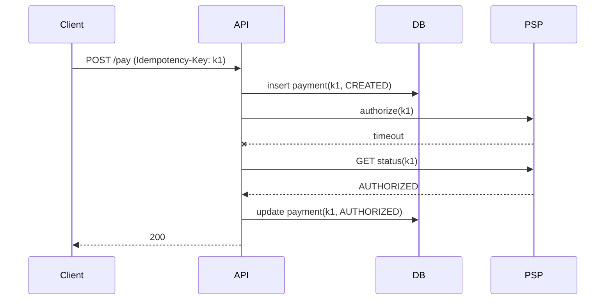
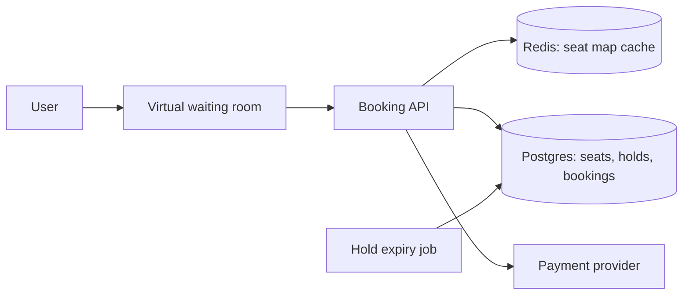
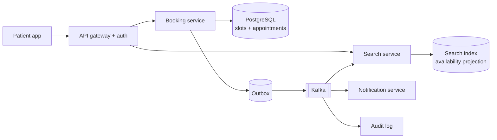
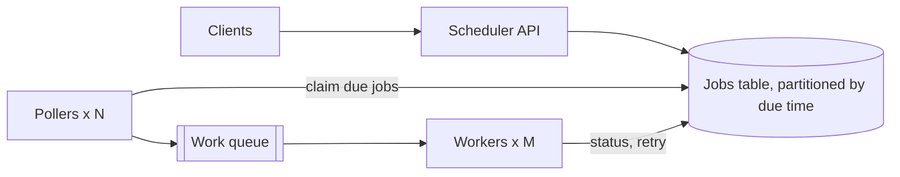

# System Design

> Interview method, numbers, building blocks, consistency, scaling, reliability, security, full design walk-throughs and incident scenarios. People and team topics live in [Leadership](leadership-behavioral.md).

## 🟢 Fundamentals

### Method

#### Q1. What steps do you follow in a system design interview, and how do you split the 45 minutes?

Requirements → estimation → API → data model → high-level design → deep dive → bottlenecks and trade-offs.
Roughly: 5 min clarify functional and non-functional requirements (scale, latency, consistency, availability),
5 min back-of-envelope numbers, 5 min API and data model, 10 min high-level boxes-and-arrows, 15 min deep dive on
the one or two components the interviewer cares about, 5 min failures, bottlenecks and what you would do next.
State assumptions out loud ("I assume 100M DAU, read-heavy 100:1") so the interviewer can correct you early,
and drive the conversation — the point is to show a method, not to recite a memorised architecture.

Example (a feed design, first 10 minutes):

```text
Clarify:  "100M DAU, read-heavy 100:1, p99 < 300 ms, a few seconds of staleness OK?"   <- non-functional requirements first
Numbers:  100M x 10 views/day = 10^9/day ~ 12k req/s avg, ~50k peak   <- numbers decide cache/sharding
API:      GET /feed?cursor=...&limit=20      POST /posts   <- cursor pagination (Q11)
Data:     posts(id, author, body, ts), follows(follower, followee)   <- then boxes and arrows (Q3), then deep dive
```

#### Q2. Which back-of-envelope numbers should you know by heart?

You need orders of magnitude, not precision.

| Quantity                          | Value                                   |
|-----------------------------------|-----------------------------------------|
| Seconds in a day                  | ~86,400 (≈ 10⁵)                         |
| 1M requests/day                   | ≈ 12 req/s average                      |
| Peak factor                       | 2–10× the average                       |
| RAM read                          | ~100 ns                                 |
| SSD random read                   | ~100 µs                                 |
| Same-datacenter round trip        | ~0.5 ms                                 |
| Cross-continent round trip        | ~100–150 ms                             |
| Single Postgres node              | ~1–10k simple queries/s, ~TBs of data   |
| Single Redis node                 | ~100k ops/s                             |
| Typical app server (stateless)    | ~1–5k req/s                             |
| Text record / image / video min.  | ~1 KB / ~200 KB / ~50 MB                |

**Example:** 100M DAU × 10 reads/day = 10⁹ reads/day ≈ 12k reads/s average, ~50k at peak → a few dozen app servers
plus a cache; 100M × 1 post/day × 1 KB ≈ 100 GB/day ≈ 36 TB/year of text only → needs sharding or object storage.

#### Q3. A single server runs out of CPU and RAM. Walk through how the architecture evolves.

Each step solves the one bottleneck you actually observe: (1) **vertical scale** first — cheapest, has a ceiling;
(2) **load balancer + N stateless app servers** — needs sessions externalised; (3) the database is now the
bottleneck → **cache** hot reads (Redis) and add **read replicas** for read scaling; (4) static and media files
move to **object storage (S3) + CDN**; (5) slow or bursty work goes to a **queue + workers**; (6) when a single
primary can't take the writes → **partition/shard**. The failure to avoid is jumping to step 6 on day one.



#### Q4. What's the difference between high-level design (HLD) and low-level design (LLD)?

HLD is the zoomed-out view — the big pieces of the system (app servers, database, cache, queue,
CDN) and how requests move between them. Designing Instagram at HLD level asks: where does a
user's request go, where is data stored, what happens as traffic grows, what breaks first and
how is that component scaled or made resilient. LLD zooms into one specific feature and asks the
implementation-level questions: for a "like" feature specifically — what happens when the user
taps like, which function/service handles it, how do you check whether the user already liked
the post, how is the like persisted, how is the like count updated without double-counting the
same user. An interview (and a real design doc) typically moves from HLD to a deep dive into one
or two components at LLD depth, rather than staying entirely at one level throughout.

**Example ("like" button):** HLD says *where* likes live (app → DB → cache); LLD decides the exact mechanics.

```sql
-- LLD: the primary key makes a double like impossible, the counter moves only on a real insert
WITH ins AS (
  INSERT INTO likes (post_id, user_id) VALUES (:post, :user)
  ON CONFLICT DO NOTHING RETURNING 1
)
UPDATE posts SET like_count = like_count + 1
WHERE id = :post AND EXISTS (SELECT 1 FROM ins);
```

### Building blocks

#### Q5. What is a load balancer, and what specific problem does it solve?

When a single server runs out of CPU/RAM to handle growing traffic, adding another server only
helps if requests are actually distributed across both — a load balancer sits in front of
multiple servers and decides which one handles each incoming request (round-robin, least-
connections, or more sophisticated algorithms), turning "one server that's now overloaded" into
"N servers sharing the load," and also removing a failed server from rotation so traffic doesn't
keep flowing to something down. It's the first component most horizontally-scaled designs
introduce, because without it, adding more servers doesn't actually help — nothing routes traffic
to them.

**Example:**

```nginx
upstream app {
    least_conn;   # send to the instance with fewest active connections
    server 10.0.1.11:8080 max_fails=3 fail_timeout=10s;   # 3 failures -> out of rotation for 10 s
    server 10.0.1.12:8080 max_fails=3 fail_timeout=10s;
}
server { listen 80; location / { proxy_pass http://app; } }
```

#### Q6. What does it mean for a service to be stateless, and why does it matter for scaling and resilience?

A stateless service keeps no request-specific or user-specific state **in its own memory or local disk between
requests**: everything needed to handle a request arrives with it (parameters, a token) or is fetched from an external store (a
database, a cache like Redis, object storage). Any instance can then serve any request, so a load balancer can distribute traffic with
plain round-robin (Q5) — no sticky sessions — and you can add instances to scale out, replace a crashed instance without
losing anyone's data, deploy with rolling updates and autoscale up and down freely. The state doesn't disappear; it moves to the
tier designed to hold it, which is where replication, backups and consistency are handled deliberately. Typical places
where statefulness sneaks in: HTTP sessions stored in the app server's memory (move them to a shared session store or use a signed token), files written to the local
disk (use object storage), in-process caches that differ between instances (accept that, or use a shared cache), scheduled jobs that run on every replica (run them under a lock or a leader, Q30) and WebSocket connections, which are inherently stateful and need a shared pub/sub backplane to route messages to the right instance.
Statelessness is a property to preserve wherever it is cheap, not an absolute: caches, connection pools and warmed-up state are fine as long as losing them only costs performance,
never correctness.

**Example:**

```text
Stateful:   POST /login  -> session kept in app-1's memory
            next request lands on app-2 -> 401, user logged out   <- sticky sessions needed, a crash loses every session
Stateless:  POST /login  -> signed JWT (or session id stored in Redis)
            any instance validates it -> kill app-1 at any time, nobody notices
```

#### Q7. What is caching, and what's the basic idea behind cache invalidation?

Caching keeps a copy of frequently-requested or expensive-to-compute data in a faster-access
layer (in-memory, closer to the client) so repeated requests for the same data don't repeat the
expensive underlying work (a slow query, a heavy computation, a network call) every time.
Invalidation is the harder half: once cached data is served instead of the source of truth, the
cache has to be updated or expired when the underlying data changes, or clients get stale data
indefinitely — the basic strategies (TTL-based expiry, explicit invalidation on write, and the
read/write patterns in Q26) all exist because "cache it and forget it" silently trades
correctness for speed unless invalidation is deliberately designed.

**Example:**

```text
SET product:42 '{"price":19.9}' EX 300   # cached for 5 min: the TTL bounds staleness
GET product:42   # hit: no DB query
-- price changes in the DB (source of truth)
DEL product:42   # explicit invalidation on write; next read refills
```

#### Q8. How do you choose between a relational (SQL) database and a NoSQL store when designing a system?

Start from the **access patterns and consistency needs**, not from fashion. A relational database is the default for
data with relationships and invariants — orders, payments, inventory — because it gives you ACID
transactions, constraints, joins and ad-hoc queries you didn't plan for, and modern PostgreSQL handles a very large
scale on one primary plus replicas (Q23, Q20). NoSQL is a family, and each kind answers a specific pressure: a
**key-value/document** store (DynamoDB, MongoDB, Redis) for simple lookups by key at a huge scale and predictable
latency, with a flexible schema; a **wide-column** store (Cassandra) for very high write throughput across regions with
tunable consistency; a **search engine** (Elasticsearch/OpenSearch) for full-text and faceted queries; a **graph** store for deeply
connected data; a **time-series** store for metrics. What you give up is usually the ability to query on
anything except the designed access path, multi-row transactions and referential integrity, and you must model data *around the
queries* (denormalize, duplicate) and handle the resulting inconsistency yourself. A pragmatic answer: begin with a relational
database as the system of record, add a specialized store (a cache, a search index, a time-series DB) as a *derived* copy when a measured
requirement demands it, and choose a NoSQL primary only when you can name the specific reason — a write volume or data size a
single relational cluster can't carry, a key-based access pattern that will never need joins, or global multi-region writes. "Schema-less" is not
a benefit by itself: the schema still exists, in your application code, and you now enforce it there.

**Example:**

```text
orders, payments, inventory     -> PostgreSQL (ACID, FK, joins, ad-hoc reports)
session by token, rate counters -> Redis (key lookup, sub-ms)
product search with facets      -> Elasticsearch (derived copy of the SQL data)
10M writes/s of device events   -> Cassandra / DynamoDB (partition key = device_id)   <- only here do you give up joins and transactions
```

#### Q9. When do you put a message queue in a design, and what does it buy you?

When the producer must not wait for the consumer: **decoupling** (the sender is up even if the receiver is down),
**load levelling** (a spike becomes a backlog instead of an outage), **retry and fan-out** (several consumers,
dead-letter queue for poison messages). The price is eventual consistency, ordering and duplicate-delivery
questions (at-least-once ⇒ consumers must be idempotent) and one more thing to operate. Use a queue for
emails, thumbnails, indexing, analytics; do not hide a synchronous user-facing answer behind one.

**Example:**

```text
POST /signup -> INSERT user -> publish user.created -> 201 (fast)
consumers: welcome-email | analytics | search-index (independent, each retries then DLQ)
spike: 5k msg/s in, workers do 1k/s -> backlog grows 4k/s during the spike, drains after;
without the queue the same spike hits the email provider directly and times out.
```

#### Q10. How does a search feature fit in a design? Why not just `LIKE '%term%'` on the primary database?

A leading-wildcard `LIKE` can't use a B-tree index and scans the table. Search needs an **inverted index**
(term → document ids, with ranking such as BM25, stemming, typo tolerance) which is what Elasticsearch/OpenSearch
or Postgres full-text provide. The index is a **derived copy**: the SQL database stays the source of truth and
changes flow to the index via an outbox/CDC pipeline, so the index is eventually consistent and can always be
rebuilt. Start with Postgres `tsvector` if the data is small; move to a dedicated engine when relevance tuning,
facets or volume demand it.

**Example:**

```sql
-- scans the whole table: a leading wildcard cannot use a B-tree index
SELECT id FROM products WHERE title LIKE '%laptop%';

-- Postgres full-text: inverted index (GIN) + ranking
ALTER TABLE products ADD COLUMN tsv tsvector GENERATED ALWAYS AS
  (to_tsvector('english', title || ' ' || coalesce(description, ''))) STORED;
CREATE INDEX ON products USING gin (tsv);
SELECT id FROM products WHERE tsv @@ plainto_tsquery('english', 'laptop bag')
ORDER BY ts_rank(tsv, plainto_tsquery('english', 'laptop bag')) DESC LIMIT 20;
```

#### Q11. REST, gRPC or GraphQL — how do you choose, and how do you paginate a large list?

REST for public, cacheable, resource-oriented APIs; gRPC for internal service-to-service calls (binary,
schema-first, streaming, low latency); GraphQL when many different clients need to shape their own payloads and you
accept the cost of query-complexity limiting and harder caching. For lists, prefer **cursor (keyset) pagination**
(`WHERE id < :last ORDER BY id DESC LIMIT 20`) over `OFFSET`: offset is O(n) on deep pages and skips or repeats
rows when data changes between requests.

**Example:**

```text
GET /posts?limit=2            -> {"items":[{"id":98},{"id":97}], "next_cursor":"97"}
GET /posts?limit=2&cursor=97  -> SELECT ... WHERE id < 97 ORDER BY id DESC LIMIT 2   -- index seek, same cost on page 1 and page 10,000
                                 (a post inserted meanwhile does not shift the pages)
```

*See also:* [Persistence Q11](persistence-sql-postgres.md) for why `OFFSET` degrades and how keyset pagination works in SQL.

## 🟡 Senior traps

### Trade-offs

#### Q12. Explain the CAP theorem with a concrete example — why can't a distributed system have all three?

**Answer:** CAP states that during a network partition (P — some communication failure between
nodes, which in any real distributed system *will* eventually happen), a system must choose
between Consistency (every read sees the most recent write, or an error) and Availability (every
request gets a response, even if it might not reflect the latest write) — you cannot have both
during the partition, though you can have either alone plus partition tolerance. A CP system (e.g.
a strongly consistent config store like ZooKeeper/etcd) refuses to serve a read/write on the
minority side rather than risk returning stale or conflicting data — sacrificing availability for
consistency. An AP system (e.g. Cassandra in its typical configuration, or a shopping cart
service) keeps both sides serving requests during the partition, accepting that the two sides may
briefly disagree, to be reconciled once the partition heals — sacrificing strict consistency for
availability. The senior-level point: this is a deliberate trade-off made per system based on what
failure mode is actually worse for that specific use case (a bank ledger leans CP; a "add to cart"
button leans AP), not a universal "correct" answer.

**Example:**

```text
Network link between region A and region B drops for 90 seconds.

CP system (etcd-style):
  region B (minority side) -> write request -> "unavailable: no quorum" (fails loudly)
  region A (majority side) -> keeps serving, single source of truth preserved

AP system (Cassandra-style, quorum relaxed to ONE):
  region A -> accepts writes locally
  region B -> also accepts writes locally
  partition heals -> both sides' writes get reconciled/merged, possibly with conflicts
```

**Why it's a trap:** candidates recite "CAP means pick two of three" as a blanket rule, but
partition tolerance isn't optional in a real distributed system — the actual choice being made,
every time, is C vs A during the partition specifically, and a senior answer names *which specific
failure mode* (a stale read vs a rejected request) is worse for *this* system, not just the
theorem's name.

#### Q13. CAP gets quoted in every interview — what does PACELC add?

**Answer:** CAP only talks about behaviour *during* a partition. PACELC adds the everyday case: if there is a
**P**artition choose **A** or **C**; **E**lse (normal operation) choose **L**atency or **C**onsistency. Replicating
synchronously to another region gives consistency but adds a cross-region round trip to every write; replicating
asynchronously is fast but readers may see stale data. Most real decisions are the "ELC" half, because partitions
are rare and latency is paid on every request.

**Example:**

```text
DynamoDB (default)  : PA/EL  -> available in a partition, low latency, eventually consistent reads
Spanner / CockroachDB: PC/EC  -> consistent always, pays commit-wait / cross-region latency
```

**Why it's a trap:** candidates label a database "CP" or "AP" as if it were fixed; most systems let you tune it per
operation (quorum reads, strongly consistent reads), and the senior answer names the latency cost of each choice.

#### Q14. Fan-out on write or fan-out on read for a feed — and what breaks at celebrity scale?

**Answer:** *Fan-out on write* (push) precomputes each follower's timeline when a post is created: reads are a
single cache lookup, but a user with 50M followers causes 50M writes. *Fan-out on read* (pull) merges the followed
accounts' posts at request time: cheap writes, expensive and slow reads. Production systems use a **hybrid**: push
for normal users, pull for celebrities, merged at read time.

**Example:**

```text
read(timeline):
  ids = redis.lrange("tl:" + user, 0, 100)            # pushed posts
  ids += recent_posts(celebrities_followed(user))      # pulled at read time
  return hydrate(sort_by_rank(ids))[:20]
```

**Why it's a trap:** picking pure push "because reads dominate" ignores the write amplification of high-follower
accounts and inactive users — you pay to build timelines nobody reads.

#### Q15. Compare rate-limiting algorithms. Which one would you pick and where do you store the counters?

**Answer:** *Fixed window* is simplest but allows 2× bursts at the window edge. *Sliding window log* is exact but
stores every timestamp. *Sliding window counter* approximates with two counters — cheap and good enough. *Token
bucket* allows controlled bursts and is what most gateways use; *leaky bucket* smooths output to a constant rate.
Counters live in Redis, updated **atomically** (Lua script or `INCR` + `EXPIRE`), keyed by user/API key/IP.

**Example:**

```text
-- token bucket in Redis (Lua, atomic)
tokens = min(capacity, tokens + (now - last) * refill_rate)
if tokens >= 1 then tokens = tokens - 1; allow else reject(429, Retry-After) end
```

**Why it's a trap:** a read-then-write from the app server races under concurrency, and a central Redis on the hot
path becomes a single point of failure — decide whether the limiter **fails open** (availability) or **closed**
(protection) when Redis is down.

#### Q16. How do you update the database *and* publish an event without losing one of them?

**Answer:** Covered in [Messaging Q27](messaging-rabbitmq-kafka.md) (transactional outbox) and [Messaging Q31](messaging-rabbitmq-kafka.md) (dual write vs polling outbox vs CDC).
In short: write the business row and an `outbox` row in the same local transaction, let a relay publish at-least-once, and make consumers idempotent.

#### Q17. How do you invalidate a cached entry, and what race hides behind invalidate-on-write?

**Answer:** (1) **TTL only** — simple, bounded staleness; (2) **invalidate on write** (delete the key after the DB
commit) — fresher, but a race between a reader refilling an old value and the delete can leave stale data until TTL;
(3) **event-driven invalidation** via CDC; (4) **versioned keys** (`user:42:v17`) — never invalidate, just read a new
key. Always keep a TTL as a safety net.

**Example:**

```text
T1 reader: cache miss, reads DB (old value)
T2 writer: updates DB, deletes cache key
T1 reader: writes OLD value into cache   <- stale until TTL
```

**Why it's a trap:** "update the cache on write" has the same race plus ordering problems; deleting is safer than
updating, and neither is a substitute for a TTL.

#### Q18. Why not use auto-increment IDs or random UUIDs everywhere in a distributed system?

**Answer:** Primary-key choice (`bigint` vs UUIDv4 vs UUIDv7) is covered in [Persistence Q40](persistence-sql-postgres.md); the distributed generator (Snowflake, ULID, clock skew) is covered in Q40.
In short: auto-increment needs a coordinator and leaks volume, while random UUIDs scatter B-tree inserts. Prefer time-ordered ids.

### Consistency & replication

#### Q19. Give a concrete, practical example of choosing eventual consistency over strong consistency, and explain why it's the right call there.

**Answer:** A social media "like count" or "follower count" is the textbook case: showing a count
that's a few seconds stale is completely acceptable to users, and the alternative — strongly
consistent, requiring a coordinated read/write across every replica for every single like — would
add real latency and reduce availability for a piece of data where staleness has essentially zero
real-world cost. Contrast with an account balance or an inventory count at checkout, where the same
staleness could mean double-spending or overselling a limited-stock item — those operations
justify the latency/availability cost of stronger consistency (or at minimum a consistency check
at the exact moment of the transaction) precisely because the cost of being wrong there is real
and immediate, unlike a like count.

**Example:**

```text
Like count:       read from any replica, cached, off by a few -> nobody notices
Checkout balance:  read must reflect the latest committed write, or two concurrent
                    checkouts can both succeed against the same last unit of stock
```

**Why it's a trap:** "eventual consistency everywhere for scale" and "strong consistency
everywhere to be safe" are both wrong defaults — the senior answer picks per data type based on
the actual cost of staleness for that specific field, not a blanket policy for the whole system.

#### Q20. What's the difference between synchronous and asynchronous database replication, and what does each trade off?

**Answer:** Synchronous replication waits for the replica(s) to confirm they've received and
applied a write before acknowledging it to the client — guarantees the replica is never behind the
primary, at the cost of added write latency (bounded by the slowest replica) and reduced
availability (if the replica is unreachable, does the write block or fail?). Asynchronous
replication acknowledges the write once the primary has it, without waiting for replicas — lower
write latency, better availability, but introduces replication lag: a replica can be measurably
behind the primary, and a failover to that replica after the primary dies can lose the most
recent, not-yet-replicated writes. Most large-scale systems choose async by default for the
latency/availability benefit, accepting the lag as a known, monitored trade-off, reserving
synchronous replication for the specific data where losing even a few seconds of recent writes on
failover is genuinely unacceptable.

**Example:**

```text
Sync:  client -> primary -> [wait for replica ack] -> ack to client   (higher latency, no lag)
Async: client -> primary -> ack to client -> (replica catches up later)  (lower latency, lag window)

Primary fails during the lag window -> failover promotes the replica ->
any write the replica hadn't yet applied is gone.
```

**Why it's a trap:** candidates often present async replication as strictly worse ("you might lose
data!") without naming what it buys in return — the trap runs the other way too: defaulting
everything to synchronous "to be safe" quietly imposes a latency and availability cost on data
that never needed that guarantee (see Q19).

#### Q21. Why does read-your-own-writes break under asynchronous replication, and how do you fix it for the data that needs it?

**Answer:** With async replication (Q20), a write lands on the primary and is acknowledged before
every replica has applied it. If the very next request from the *same user* is a read routed to a
lagging replica — a common setup, since reads are usually load-balanced across replicas for
throughput — it can return the pre-write state, making it look like the user's own action didn't
take effect. This is a genuinely confusing bug for the user ("I just saved this, where did it
go?"), distinct from another user seeing stale data, which is usually tolerable. Fixes: route a
user's reads to the primary (or a replica known to be caught up) for a short window right after
their own write; pass a "read-your-own-writes" token/timestamp the read path checks against
replica lag before answering from a replica; or, for the specific fields affected, have the client
optimistically show what it just wrote rather than re-fetching immediately.

**Example:**

```text
t=0.00  user PATCHes /profile {bio: "new bio"} -> primary commits, acks -> client shows "saved"
t=0.05  client re-fetches /profile to confirm -> load balancer routes to replica-3
t=0.05  replica-3 hasn't applied the write yet -> returns bio: "old bio"
        user sees their own save appear to have been silently reverted
```

**Why it's a trap:** this is easy to conflate with Q19's "eventual consistency is fine for
low-stakes data" — but the stakes here aren't about the data's importance, they're about *whose*
read is affected: staleness a different user sees is usually invisible and fine, staleness the
*writer* sees immediately after their own write reads as a broken feature.

#### Q22. Two-phase commit vs sagas — how do you keep data consistent across several services without a shared database?

**Answer:** **Two-phase commit (2PC)** coordinates a single atomic transaction over several resources: a coordinator asks every participant to
*prepare* (vote yes, holding locks), and only if all vote yes tells them to *commit*. It gives strong atomicity but at a
price: participants hold locks during the protocol, so throughput and availability drop; the coordinator is a single point whose failure between the phases leaves
participants **blocked in doubt**; and it needs every participant to support it (XA), which most message brokers, SaaS APIs and NoSQL stores don't.
A **saga** replaces one distributed transaction with a sequence of local transactions, each publishing an event or command that triggers the next; if a
step fails, previously completed steps are undone by **compensating actions** (refund the payment, release the reserved stock) rather than rolled back. It can be
**choreographed** (services react to each other's events — simple for few steps, hard to follow as it grows) or **orchestrated** (a coordinator holds the workflow state — easier to
reason about, monitor and time out). The consequences to design for: sagas are **eventually consistent**, with intermediate states visible to other requests (an order that is "pending" for a while); compensations must be
**idempotent** and can themselves fail (retry, then alert a human); some actions can't be undone (an email sent, a parcel shipped), so order steps to put the
irreversible ones last; and each step and its event must be published reliably with an outbox (Q16) so a crash between "write" and "publish" doesn't stall the saga. In practice: prefer to avoid the
distributed transaction altogether by keeping tightly coupled data in one service (Q32), use sagas for genuine cross-service business processes, and use 2PC only inside one
trusted platform where all participants support it and the latency is acceptable.

**Example:**

```text
Order saga (orchestrated):
  1. Orders:    create order PENDING                  compensation: mark CANCELLED
  2. Payments:  charge card                            compensation: refund
  3. Inventory: reserve stock                          compensation: release stock
  4. Shipping:  create shipment (irreversible - last)  compensation: n/a
  step 3 fails  ->  refund (2), cancel order (1); each compensation is idempotent and retried
```

**Why it's a trap:** candidates answer "we use distributed transactions" (an availability problem) or "we use a saga" without mentioning compensation failure, idempotency, visibility of intermediate
states or the outbox — and "exactly-once" claims across services almost always hide *at-least-once delivery plus idempotent processing* (Q9, Q28).

*See also:* [Messaging Q26](messaging-rabbitmq-kafka.md) (orchestration vs choreography) and [Messaging Q30](messaging-rabbitmq-kafka.md) (a worked saga).

### Scaling & caching

#### Q23. Horizontal vs vertical scaling — what's the actual trade-off?

**Answer:** Vertical scaling (a bigger machine — more CPU/RAM on the same node) is simpler (no
distributed-systems complexity, no data partitioning to reason about) but has a hard ceiling
(there's a biggest machine money can buy) and a single point of failure. Horizontal scaling (more
machines) has no practical ceiling and improves fault tolerance, but introduces real complexity:
load balancing, data consistency across nodes, network latency between components that used to be
in-process calls, and operational overhead. The practical answer most systems land on: vertical
scale as far as it reasonably goes for genuine simplicity, and reach for horizontal scaling once
vertical's ceiling or single-point-of-failure risk becomes the actual constraint, not by default
from day one for a system that doesn't need it yet.

**Example:**

```text
Vertical: db.small -> db.large -> db.2xlarge -> db.8xlarge -> ... -> biggest instance money buys
          one machine, one failure domain, zero coordination code

Horizontal: 1 node -> 3 nodes -> 20 nodes -> ...
          needs: a load balancer, a partitioning/sharding scheme, replica consistency,
          and monitoring for N failure domains instead of one
```

**Why it's a trap:** "just scale horizontally, it's more modern" is the naive answer — a senior
candidate names the actual complexity horizontal scaling buys (partitioning, consistency, ops
overhead) instead of treating it as a free upgrade, and can say plainly when vertical scaling is
still the right call.

#### Q24. How do you choose a database shard key, and what happens with a bad choice?

**Answer:** A shard key determines which physical shard a given row lives on (commonly via a hash
of the key, or a range partition on it) — the goal is distributing both data volume and, more
importantly, *query/write load* evenly across shards. A bad choice creates a "hot shard": choosing
a low-cardinality key (e.g. sharding by `country` when 80% of users are in one country) or a key
correlated with access pattern skew (a small number of accounts generating a disproportionate
share of all activity) puts most of the real load on one shard regardless of how evenly the
*storage* is distributed. Fixing a bad shard key after the fact (re-sharding a live system with
data already unevenly distributed) is one of the most operationally painful migrations in
distributed systems, which is exactly why the choice deserves real scrutiny before the system is
built around it.

**Example:**

```text
Sharded by `country`: 4 shards, one per region
  shard(US) -> 80% of all users and all traffic  <- hot shard
  shard(NZ), shard(IS), shard(LU) -> nearly idle

Cluster-wide CPU on the main dashboard reads "35% utilized" while shard(US) sits at 95%.
```

**Why it's a trap:** aggregate cluster metrics hide a hot shard completely — a candidate who only
checks "is the cluster over capacity" misses the actual production symptom, which shows up as one
shard's latency degrading while the fleet-wide average still looks healthy.

#### Q25. What is consistent hashing, and why is it used for distributed caches and sharding instead of simple modulo hashing?

**Answer:** Simple modulo hashing (`hash(key) % N` to pick one of N servers) has a severe problem
when N changes (a server is added or removed): nearly every key's assigned server changes too,
because the modulus itself changed — for a distributed cache, this means a node change invalidates
almost the entire cache at once (a "cache stampede" hitting the database simultaneously, S1 and S7).
Consistent hashing maps both servers and keys onto a conceptual ring, and each key is owned by the
next server clockwise from it on the ring — adding or removing one server only remaps the keys
that specifically fell between it and its neighbor, leaving the vast majority of key-to-server
assignments unchanged.

**Example:**

```text
Modulo, N=4->5 servers:  hash(key) % 4  vs  hash(key) % 5  -> ~80% of keys remap

Consistent hashing, ring with a 5th server added:
  only the keys between the new server and its counter-clockwise neighbor move
  -> roughly 1/5 of keys remap, not 4/5
```

**Why it's a trap:** candidates can usually explain modulo hashing's problem but stop short of the
mechanism that fixes it — "consistent hashing helps" without the ring/neighbor mechanics is a name
without an explanation, and an interviewer's follow-up ("why does only that subset move?") exposes
the gap immediately.

#### Q26. Cache-aside, write-through or write-behind — how do you choose a caching write strategy?

**Answer:** **Cache-aside** (lazy loading): the application checks the cache first, and on a miss,
reads from the database and populates the cache — simple, but the first request for any key is
always a slow miss, and there's a real risk of serving stale data until TTL expiry or explicit
invalidation. **Write-through**: every write goes to the cache and the database together,
synchronously — keeps the cache always consistent, at the cost of added write latency and caching
data that might never actually be read. **Write-behind (write-back)**: writes go to the cache
immediately and are asynchronously flushed to the database later — fastest writes, but risks data
loss if the cache fails before the flush. TTL-based expiry is often layered on top of any of these
as a simple safety net, bounding how stale data can get even if explicit invalidation is missed.

**Example:**

```python
# Cache-aside
def get_user(id):
    if (u := cache.get(id)) is not None:
        return u
    u = db.query(id)
    cache.set(id, u, ttl=300)
    return u
```

**Why it's a trap:** "just add a cache" without naming which of these three strategies, and its
specific staleness/latency trade-off, is the actual anti-pattern the classic joke is warning
about — the interview signal is picking a strategy deliberately for the read/write ratio at hand,
not reciting all three as equally fine defaults.

#### Q27. What does a CDN actually solve, and when does it not help?

**Answer:** A CDN caches content at edge locations geographically close to end users, reducing
latency and offloading traffic from the origin server for content that's the same for every user.
It's highly effective for static or infrequently-changing content (images, JS/CSS bundles, video)
and, with the right cache-control configuration, even for semi-dynamic content that's the same
across users for a short window. It does *not* help for genuinely per-user, real-time dynamic
content — caching that at the edge either serves stale/wrong data to the wrong user or requires a
cache key so granular it stops functioning as a shared cache at all.

**Example:**

```text
Cache-Control: public, max-age=86400          # product image — great CDN hit rate
Cache-Control: private, no-store               # "your account balance" — must not be cached
Cache-Control: private, max-age=0, must-revalidate  # personalized feed — edge can't help here
```

**Why it's a trap:** "put a CDN in front of it" is offered as a default performance fix even for
endpoints that are inherently per-user — the trap is treating the CDN as free speed rather than
checking first whether the response is actually shareable across requests.

### Reliability

#### Q28. What's the idempotency-key trap when a client retries a write after a timeout?

**Answer:** A client sends a write (e.g. "place order"), the server processes it and commits, but
the response is lost in transit or the client times out before it arrives — from the client's
point of view the request's outcome is unknown, so a naive client retries the exact same request.
Without an explicit mechanism to recognize "this is the same logical request, not a new one," the
retry executes the write a second time — a second order, a second charge. The fix is an
idempotency key: the client generates a unique key per logical operation (not per HTTP attempt)
and sends it with every attempt; the server persists the key alongside the result of the first
successful execution and, on seeing a repeated key, returns the stored result instead of
re-executing the write. This has to be enforced with a uniqueness constraint at the storage layer,
not just an in-memory check, or a race between two near-simultaneous retries can still slip both
through.

**Example:**

```sql
POST /orders
Idempotency-Key: 7f3a9c21-...   <- same key on every retry of THIS logical request

Attempt 1: times out client-side after the server already committed the order
Attempt 2 (retry, same key): server finds the key already recorded -> returns the
                              original order's result, does NOT insert a new row

CREATE UNIQUE INDEX ON idempotency_keys (key);  -- the actual enforcement point
```

**Why it's a trap:** "just retry on timeout, it's safer than losing the request" is the instinct —
true for reads, false for writes without idempotency, and a candidate who says "just retry"
without naming the duplicate-write risk hasn't actually thought through what "timeout" means: the
request may well have succeeded server-side even though the client never found out.

#### Q29. How do backpressure and load shedding keep an overloaded system alive, and what goes wrong without them?

**Answer:** Every system has a maximum throughput; when the arrival rate exceeds it, work piles up in queues (thread pools, connection
backlogs, message queues), **latency grows without bound**, memory fills, timeouts fire, clients retry, and the retries add *more*
load — a self-reinforcing collapse from which the system often cannot recover even after the original spike ends (a "metastable failure"; see S14). Two
mechanisms prevent it. **Backpressure** pushes the limit upstream: bounded queues that block or reject when full, a consumer that signals how much it can take
(reactive streams demand, TCP windows, Kafka's pull model), and a producer that slows down. **Load shedding** deliberately rejects excess work early and cheaply —
return `429`/`503` with `Retry-After` immediately — so the requests you do accept are served fast; prioritize by importance (health checks and paying customers over batch traffic) and shed
the *least valuable* first. Supporting practices: **timeouts** on every remote call (shorter than the caller's own timeout, a deadline propagated
downstream), **retries with exponential backoff and jitter** and a retry budget, **circuit breakers** to stop calling a failing dependency, **bulkheads**
(separate pools so one slow dependency can't consume all threads), and autoscaling as a *complement* — it reacts in minutes, while overload
arrives in seconds. Unbounded queues are the anti-pattern: they turn overload into invisible latency and finally an out-of-memory crash.

**Example:**

```java
// Bounded work queue: when full, reject immediately instead of queueing forever.
ThreadPoolExecutor pool = new ThreadPoolExecutor(
    16, 16, 0, TimeUnit.SECONDS,
    new ArrayBlockingQueue<>(200),                    // bounded: at most 200 waiting
    new ThreadPoolExecutor.AbortPolicy());            // -> RejectedExecutionException

@PostMapping("/reports")
ResponseEntity<?> create(@RequestBody ReportRequest r) {
    try {
        pool.execute(() -> reports.generate(r));
        return ResponseEntity.accepted().build();
    } catch (RejectedExecutionException e) {
        return ResponseEntity.status(503).header("Retry-After", "5").build();   // shed load early
    }
}
```

**Why it's a trap:** teams treat capacity as "add more servers" and leave every queue unbounded, so the first traffic
spike or slow dependency converts into minutes of latency and an outage that outlasts the trigger. Failing fast under overload looks like a worse
user experience in a demo, but it's what keeps the service available for the requests it can serve.

#### Q30. Why isn't a distributed lock (Redis `SET NX`, ZooKeeper, database row) as safe as it looks, and what are fencing tokens?

**Answer:** A lock is meant to guarantee that only one worker at a time performs an action on a resource. In a distributed system the lock holder
can be *wrong about still holding it*: the lock is acquired with a **TTL** (so a crashed holder doesn't block everyone forever), but a long GC pause, a stalled VM or a
slow network can make the holder continue to work after the lease expired — while a second worker has acquired the lock and is also working. Both then
write, and the guarantee is silently gone. Clock skew and the lock service itself failing over (a Redis primary crashing before
replicating the lock key) create the same effect. Checking "do I still hold the lock?" right before writing does not fix it, because the pause can occur between the check and the write. The robust
fix is a **fencing token**: the lock service hands out a monotonically increasing number with each grant; the worker sends the token with every write
to the protected resource, and the *resource* rejects any write carrying a token lower than one it has already seen. This moves the correctness guarantee from the (unreliable) lock
holder to the (authoritative) resource. Where a fencing token isn't possible, design so that the action is **idempotent** (Q28) or make the write conditional
(`UPDATE ... WHERE version = ?`, optimistic locking), which is often a simpler alternative to a lock. Use locks for *efficiency* (avoid duplicate work) rather than *correctness*
unless you have fencing; for real mutual exclusion prefer the database's own row locks/unique constraints, or a consensus-based system (etcd/ZooKeeper) with fencing.

**Example:**

```text
worker A: acquires lock, token=33   ── long GC pause ──────────────► writes (token=33)  REJECTED
lock TTL expires
worker B: acquires lock, token=34 ──► writes (token=34) OK   (storage remembers max token = 34)

storage rule:  if request.token < max_seen_token: reject
```

```sql
-- Optimistic alternative: the write only succeeds if nobody changed the row meanwhile.
update accounts set balance = :new, version = version + 1
where id = :id and version = :expected_version;      -- 0 rows updated -> conflict, retry
```

**Why it's a trap:** `SET key value NX PX 30000` in a code sample feels like a mutex, and the failure
only appears under the rare pause or failover that never happens in tests — then two workers double-charge a customer or corrupt a file. The defence is to stop
trusting the lock holder's opinion of the lock.

#### Q31. What do RTO and RPO mean in disaster recovery planning, and how do they drive architecture decisions?

**Answer:** **RTO (Recovery Time Objective)**: how long the system can be down before the business
impact is unacceptable — drives decisions about failover automation and standby infrastructure.
**RPO (Recovery Point Objective)**: how much data loss (measured in time) is acceptable — drives
replication and backup frequency decisions. Both are business decisions, not purely technical
ones — an architect's job is translating a stated RTO/RPO into the concrete technical mechanism
that actually achieves it, and pushing back if a stated target (e.g. "zero data loss, zero
downtime") would require cost or complexity disproportionate to the actual business need behind
it.

**Example:**

```text
RTO = 5 min   -> needs automated failover to a hot standby, health checks, auto-promotion
RPO = 0       -> needs synchronous replication for the affected data (Q20), not async
RTO = 4 hours -> a documented manual runbook and a warm (not hot) standby is enough
```

**Why it's a trap:** candidates sometimes propose the most robust possible setup (synchronous
multi-region, automated everything) regardless of the stated targets — over-building against a
looser RTO/RPO than the business actually needs is its own real cost, not a safe default.

### Architecture & security

#### Q32. When is a monolith the better choice over microservices, and what's the real cost of choosing microservices too early?

**Answer:** A monolith is the better default for a small team, an early-stage product with an
evolving/unclear domain model, or a system where the operational overhead of distributed systems
isn't yet justified by an actual organizational or scaling need. The real cost of premature
microservices: splitting a system along boundaries that turn out to be wrong (the actual domain
boundaries weren't understood yet) is far more expensive to undo across network boundaries and
separate deployments than refactoring module boundaries within one codebase — and a small team now
also owns the full operational burden of a distributed system for a scale and organizational
structure that didn't need it yet. Microservices earn their cost specifically when independent
team ownership, independent deployability, and independent scaling become genuine, currently-felt
constraints.

**Example:**

```text
Year 1, 4-person team splits into "user-service", "order-service", "notification-service" —
the actual bounded contexts weren't known yet, so "order" needs "user" data on every
request: a chatty network call replaces what used to be one in-process join, and the team
now debugs 3 deployments instead of 1 for every feature.
```

**Why it's a trap:** "microservices are the scalable/modern choice" is offered as a default — a
senior answer names the *specific*, currently-felt constraint that justifies the split, and is
comfortable saying a monolith is the right answer for a team that doesn't have that constraint yet.

#### Q33. What does an API Gateway centralize, and why put it in front of a microservices architecture?

**Answer:** An API Gateway sits as the single entry point in front of a set of backend services,
centralizing concerns that would otherwise need to be duplicated in every individual service:
authentication/authorization, rate limiting, request routing, protocol translation, and often
response aggregation. The trade-off: it's a new single point that, if it fails, can take down
access to every service behind it — which is why gateway availability/redundancy is treated with
the same seriousness as any other genuinely critical path component, and why gateway logic itself
should stay thin (routing and cross-cutting concerns) rather than accumulating actual business
logic.

**Example:**

```text
client -> [API Gateway: authn, rate-limit, route] -> user-service
                                                    -> order-service
                                                    -> notification-service

Gateway goes down -> every service behind it becomes unreachable, even though each
individual service is still healthy on its own.
```

**Why it's a trap:** candidates propose a gateway as pure upside (auth in one place!) without
naming the SPOF it introduces — the follow-up worth pre-empting is "what happens when the gateway
itself goes down," which is exactly why gateway redundancy gets treated as seriously as the
services it fronts.

#### Q34. Name several OWASP Top 10 risks and how you mitigate each at a system-design level.

**Answer:** **Injection** (SQL, command): parameterized queries/prepared statements, never
string-concatenated input into a query. **Broken authentication**: strong password policies, MFA,
secure session management, not rolling your own crypto/auth. **Sensitive data exposure**: encrypt
data in transit (TLS) and at rest, don't log sensitive fields, minimize what's collected/retained
in the first place. **Broken access control**: enforce authorization server-side on every request
(never trust a client-side check alone), default-deny rather than default-allow. **Security
misconfiguration**: no default credentials, minimal exposed surface, patched dependencies.
**Cross-site scripting (XSS)**: escape/sanitize any user input rendered back into HTML, use a
framework's built-in escaping rather than hand-rolled string interpolation into markup.
**Insecure deserialization**: never deserialize untrusted input into arbitrary types without
strict validation. The system-design-level point: security is a set of deliberate boundary
decisions (where is input validated, where is output escaped, where is authorization enforced)
baked into the architecture, not a checklist applied after the fact.

**Example:**

```java
// Injection — vulnerable:
String sql = "SELECT * FROM users WHERE email = '" + input + "'"; // attacker: ' OR '1'='1

// Fixed — parameterized, input is always data, never concatenated into the query text:
PreparedStatement ps = conn.prepareStatement("SELECT * FROM users WHERE email = ?");
ps.setString(1, input);
```

**Why it's a trap:** candidates list the risks fine but treat them as a checklist to mention, not
boundaries to design around — the follow-up that actually separates a senior answer is "where in
the architecture is this enforced, and can a caller bypass that layer" (a client-side-only
authorization check is the single most common version of this gap in practice).

See also: the [Security](security.md) module for the code-level details (JWT, IDOR, SSRF, CSRF, supply chain).

## 🔴 Expert / Open

### Design exercises

#### Q35. Design a URL shortener (bit.ly). Cover ID generation, storage, redirects and scale.

**Requirements:** create short link, redirect, optional custom alias/expiry, analytics. Non-functional: redirect
p99 < 50 ms, 100:1 read:write, highly available, links never reused.

**Estimation:** 100M new links/month ≈ 40 writes/s; 4B redirects/month ≈ 1.5k reads/s average, ~15k at peak.
500 B per record × 100M × 12 × 5 years ≈ 3 TB — fits comfortably on a sharded key-value store.

**Design:**



- **Code generation:** a 7-character base62 string gives 62⁷ ≈ 3.5 trillion codes. Take a unique integer from a
  range-allocating counter service (each app server leases a block of 1,000 ids) and base62-encode it — no
  collisions, no check-then-insert race. Hashing the URL instead (MD5 truncated) needs collision handling.
- **Storage:** key-value access by code only → DynamoDB/Cassandra or a sharded SQL table keyed by code.
- **Redirect:** `301` is cacheable by browsers (less load, but you lose click analytics); `302` hits you every time.
  Cache the hot ~20% in Redis (long TTL, links are immutable).
- **Analytics:** never on the redirect path — emit an event to a queue, aggregate asynchronously.

**Trade-offs to mention:** sequential codes are enumerable (add a Feistel/permutation step if privacy matters);
custom aliases need a unique constraint; abuse/phishing needs a URL reputation check at creation time.

#### Q36. Design a chat system like WhatsApp or Slack (1:1 and groups, delivery receipts, offline users).

**Requirements:** send/receive in real time, history, group chats, sent/delivered/read, push to offline devices.
Non-functional: low latency, ordering per conversation, no message loss.

**Design:**



- **Connections:** long-lived WebSockets on stateless-ish gateways; a Redis map `user → gateway` tells the message
  service where to deliver. One gateway handles ~100k connections, so 50M concurrent users ≈ 500+ gateways.
- **Flow:** persist first, then route: write to the store → publish to the recipient's gateway → ack to sender
  (`sent`) → recipient ack (`delivered`) → read receipt. Offline users get a push notification and fetch from the
  store on reconnect via `since=last_seen_id`.
- **Ordering and ids:** a per-conversation monotonic sequence number (single writer per conversation partition) —
  not wall-clock time. Clients dedupe by message id because retries are at-least-once.
- **Groups:** small groups fan out on write per member; very large channels store once and let members read.
- **Storage:** write-heavy, append-only, access by conversation + time range → wide-column store partitioned by
  `conversation_id`, clustered by message id.

**Trade-offs:** end-to-end encryption moves key management to clients and breaks server-side search; presence
updates are chatty — throttle and batch them.

#### Q37. Design a file storage and sync service (Dropbox / Google Drive).

**Core idea:** separate **metadata** (small, transactional, SQL) from **blocks** (large, immutable, object storage).



- **Chunking:** split files into ~4 MB blocks, hash each (SHA-256). Upload only blocks the server doesn't have —
  this gives **delta sync** and **deduplication** across versions and users, and resumable uploads.
- **Commit:** a file version is a list of block hashes; the metadata commit is atomic and uses a version check
  (optimistic concurrency) — on conflict, keep both and create a "conflicted copy".
- **Sync:** devices keep a long-poll/WebSocket channel to the notification service, then pull the changes since
  their last cursor.
- **Durability:** object store with cross-AZ replication or erasure coding; garbage-collect unreferenced blocks
  with a delay, because a block may become referenced again by a concurrent upload.

**Trade-offs:** dedup across users leaks "does this file exist" information unless limited to a tenant; bigger blocks
mean fewer requests but worse delta efficiency.

#### Q38. Design video streaming (YouTube / Netflix): upload, processing and playback.



- **Upload path (write, rare):** direct-to-object-storage with pre-signed URLs so the app servers never proxy
  gigabytes; a queue triggers transcoding into several resolutions/bitrates, split into 2–10 s **segments** (HLS/DASH)
  so work parallelises across workers.
- **Playback path (read, enormous):** the player fetches a manifest then segments from the CDN, and **adapts the
  bitrate** to measured bandwidth. >95% of bytes are served from the edge, so the CDN is the real scaling lever.
- **Numbers:** 1 hour of 1080p ≈ 3–5 GB; 1M concurrent viewers × 5 Mbit/s = 5 Tbit/s — no origin can serve this,
  hence CDN plus ISP-embedded caches (Netflix Open Connect). Popular content is pre-positioned off-peak; the long tail
  is pulled on demand.
- **Metadata** (title, views, comments) is a normal sharded DB + cache; view counts use approximate counters
  (batch increments through a queue).

**Trade-offs:** more renditions cost storage and transcode time (encode popular titles more aggressively, rarely
watched ones lazily); DRM and signed URLs add complexity to the CDN path.

#### Q39. Design typeahead / search autocomplete for a search box.

**Requirements:** suggestions within ~100 ms as the user types, top-k by popularity, fresh enough for trends.

- **Data structure:** a **trie** where each node caches its top-k completions; lookup is O(prefix length). In practice
  keep the prefix → top-10 results in a key-value store/Redis, precomputed offline.
- **Pipeline:** query logs → stream/batch aggregation (e.g. hourly counts, with decay for freshness) → rebuild the
  prefix table → publish a new versioned snapshot; the serving layer swaps atomically.
- **Latency tricks:** CDN/browser cache for short prefixes, debounce keystrokes on the client (~100–150 ms),
  cancel in-flight requests, only query from 2–3 characters.
- **Scale:** shard by prefix range, but short prefixes (`a`, `th`) are hot — replicate them rather than shard.
- **Quality:** filter offensive terms, personalise lightly, handle typos with an edit-distance fallback.

**Trade-offs:** real-time updates versus rebuild cost — a small "trending" overlay merged at read time covers fresh
queries without rebuilding the whole structure.

**Example:**

```text
sug:v42:ip   -> ["iphone 15", "iphone case", "ipad", ...]   # top-10 precomputed per prefix, versioned snapshot
GET /suggest?q=iph  ->  GET sug:v42:iph   (one key lookup, no trie walk at request time)
publish sug:v43:* offline, then flip the "current version" pointer atomically
```

#### Q40. Design a distributed unique ID generator (and say what you give up).

Requirements: 64-bit, roughly time-ordered, no central bottleneck, ~100k ids/s per cluster.

- **Snowflake layout:** 1 sign bit | 41 bits timestamp (≈ 69 years) | 10 bits worker id | 12 bits sequence.
  Each worker generates locally; the sequence resets every millisecond.
- **Worker ids** come from ZooKeeper/etcd or a DB lease at start-up; a worker that loses its lease must stop issuing.
- **Clock regression:** if `now < lastTimestamp`, wait or fail — never issue ids. Monitor NTP drift.
- **Alternatives:** DB ticket servers (auto-increment with step N, one per node — simple, a bottleneck), UUIDv7
  (128-bit, no worker registry), a range-allocating counter service (used in Q35).
- **Gives up:** strict global ordering — ids are ordered only to millisecond skew between workers, so never use them to
  decide "which happened first" across machines; use a logical clock or a single writer for that.

**Example:**

```python
def next_id():
    ts = now_ms()
    if ts < last_ts: raise ClockMovedBackwards   # refuse to issue ids rather than risk duplicates
    if ts == last_ts:
        seq = (seq + 1) & 0xFFF   # 4096 ids per ms per worker
        if seq == 0: ts = wait_next_ms()
    else:
        seq = 0
    last_ts = ts
    return ((ts - EPOCH) << 22) | (worker_id << 12) | seq
```

#### Q41. Design a payment flow that must never charge twice. How do you handle timeouts?

Combine three ideas: **idempotency keys** (client generates one per payment attempt; server stores key → result under
a unique constraint — mechanics in Q28), a **state machine** (`CREATED → AUTHORIZED → CAPTURED / FAILED`, transitions only forward,
persisted before and after each external call) and **reconciliation** (a job compares your ledger with the
provider's settlement report). On a timeout from the provider you do **not** know the outcome: never assume failure;
query the provider by your idempotency key, or retry the same key, until you learn the real state.



**Trade-offs:** double-entry ledger rows are append-only (fix errors with compensating entries, never `UPDATE`);
money is an integer of minor units, never a float.

*See also:* [Messaging Q29](messaging-rabbitmq-kafka.md) for the consumer side of the same guarantee.

#### Q42. Design Instagram's feed at a high level, then go deep on one component.

**Answer:** Functional: post a photo, follow users, see a feed, like/comment. Non-functional: read-heavy, fast feed, eventual consistency is fine for like counts and small feed delays.

HLD: a post service (metadata in a database, image in object storage served via CDN), a social graph service for follows, and a feed generator — the deep-dive point.

Use the push/pull/hybrid fan-out from Q14 (push for normal users, pull for celebrities, merged at read); the rest of this answer goes deep on the feed *store*.

**Example (sizing the feed store):**

```text
Feed = Redis list per user, post ids only, capped at 800 (8 B each ~ 6.4 KB)
500M users x 6.4 KB ~ 3.2 TB  -> shard by user_id over ~50 nodes of 64 GB
Normal post (500 followers): 500 LPUSH+LTRIM, done async by workers off a queue
Celebrity (> 1M followers): flagged, skipped by the fan-out, merged at read time
```

**Why it's a trap:** candidates often present fan-out-on-write as simply "the fast option" without
naming the celebrity-account failure mode — a design that doesn't special-case high-follower-count
accounts will visibly fall over (or silently rack up enormous write amplification) the moment a
real celebrity account is modeled in the same system.

#### Q43. Design a rate limiter as a distributed system component. What are the scale considerations?

**Answer:** Pick the algorithm first (token bucket is the usual default; compare options in Q15), then the harder question: where does the state live when the limiter must be correct across many instances of the protected service?

A per-instance in-memory counter is simple but wrong at scale — N instances collectively allow N times the limit. The standard fix is a shared counter store (Redis, atomic operations) that every instance checks.

That store becomes a critical-path dependency (fail open vs fail closed when it is briefly unavailable is a real decision) and adds a network round-trip per check, which must stay fast enough not to become the bottleneck it is meant to protect.

**Example:**

```text
Per-instance counter (wrong at scale):
  instance-1: allows 100/min   instance-2: allows 100/min   instance-3: allows 100/min
  -> a client behind a load balancer effectively gets ~300/min, not the intended 100/min

Shared Redis counter (correct):
  INCR rate:user123:2026-09-16T10:05      # atomic; EXPIRE ... 60 only when the result is 1
  every instance checks the SAME counter -> the limit is 100/min, cluster-wide

Scale: 1M checks/s vs ~100k ops/s per Redis node -> shard counters by key over 10+ nodes,
       or let each instance lease a batch of tokens (e.g. 50) and sync every 100 ms
```

**Why it's a trap:** the algorithm (token bucket vs sliding window) is the part candidates
over-prepare for — the actual scale-breaking bug is almost always the per-instance-state mistake,
which the algorithm choice alone doesn't fix.

#### Q44. Design a notification system (email, SMS, push) that serves many product teams. Then go deep on delivery guarantees.

Clarify first (Q1): channels, volume (say 50 M notifications/day with 10× spikes on marketing campaigns), latency classes (an OTP must arrive in seconds, a
newsletter can take hours), user preferences and opt-outs, and whether ordering or exactly-one delivery matters. **Architecture:** producers (other services) call a
notification API or publish an event; the service validates, applies user preferences, quiet hours and regulatory rules (unsubscribe, consent), renders a template with
localization, and puts a message on a **per-channel, per-priority queue** (separate queues so a bulk marketing burst can't delay OTPs — a bulkhead, Q29). **Channel workers** consume and
call providers (SES/SendGrid, Twilio, APNs/FCM), with **provider abstraction and failover** to a second vendor, per-provider rate limits and backoff. Persist a notification record with a
state machine (`QUEUED → SENT → DELIVERED / FAILED`), and ingest provider webhooks for delivery, bounce and complaint events, which feed a suppression list. **Delivery
guarantees:** end to end it is **at-least-once**: the queue redelivers on worker failure and a provider call may succeed while the response is lost, so
duplicates are possible; reduce them with an **idempotency key** per logical notification (dedupe table with a unique constraint before sending, Q28), use provider-supported
idempotency where it exists, and accept that a rare duplicate is better than a lost OTP — for critical messages prefer duplicates to loss, for marketing prefer the reverse. Failures: retry with exponential
backoff and jitter up to a limit, then a dead-letter queue with alerts; bad addresses and hard bounces stop retries. **Scale and abuse:** shard/partition by user or
tenant, apply per-user and per-tenant rate limits (Q43) so a bug in one producer can't spam every customer, and protect the provider reputation (warm-up, throttling, complaint monitoring).
Observability: queue lag and age per priority, send/delivery latency, bounce and complaint rates. The open trade-offs to discuss: a broker choice (SQS/Kafka/RabbitMQ), synchronous
send for OTPs versus everything through queues, per-user digesting to avoid notification fatigue, and whether to build this or buy it ([Leadership Q7](leadership-behavioral.md)).

**Example (idempotent send):**

```sql
INSERT INTO notifications (id, dedupe_key, channel, status)
VALUES (gen_random_uuid(), 'order-4471:shipped:sms', 'sms', 'QUEUED')
ON CONFLICT (dedupe_key) DO NOTHING;   -- unique constraint = the dedupe point (Q28)
-- 0 rows inserted -> already handled, the worker acks and skips the provider call
```

#### Q45. Design a ticket or seat booking system (concerts, flights) where two people must never get the same seat.

**Requirements:** browse events and seat maps, hold seats for a few minutes during checkout, pay, confirm; huge spikes
when popular sales open. Non-functional: **no double booking** (strong consistency per seat), seat map reads fast,
fair under spikes.

**Estimation:** a big on-sale: 1M users arriving within minutes for 50k seats; reads (seat maps) dwarf writes; writes
are concentrated on very few rows (the same event).

**Design:**



- **Holding a seat:** a conditional update is the source of truth:
  `UPDATE seat SET status='HELD', hold_id=?, held_until=now()+'10 min' WHERE id=? AND status='AVAILABLE'`; 1 row
  updated means you got it, 0 means someone else did. No distributed lock is needed: the database row is the lock,
  with a unique constraint on `(event_id, seat_id)` in bookings as a second guard.
- **Expiry:** holds time out; a job (or a check at read time) releases expired holds. Payment confirmation checks the
  hold is still valid and owned by this user, in the same transaction that creates the booking.
- **Payment:** idempotency key per hold (see Q41); if payment succeeds after the hold expired, refund
  or re-check availability; never silently book.
- **Spikes:** a **waiting room** admits users at a controlled rate; seat maps are served from cache with short TTLs,
  and availability is re-checked only at hold time.
- **General admission** (no seat numbers): an inventory counter, `UPDATE ... SET remaining = remaining - n WHERE
  remaining >= n`.

**Trade-offs to mention:** a hot event means hot rows; shard by event and keep transactions tiny. A cached seat map
can be slightly stale, which is acceptable because the write path is authoritative. Bots and scalpers need rate limits,
queue tokens and per-account caps.

#### Q46. Design a doctor appointment-booking system (like a healthcare booking platform), including double-booking prevention, cancellations and peak load.

**Requirements:**
- Functional: practitioners publish availability; patients search by speciality, place and date, book, cancel and reschedule;
  reminders are sent. Out of scope: payments, video consults.
- Non-functional: **no double booking ever** (a hard invariant), search can be slightly stale, availability high (patients
  get care), privacy (health-related data: GDPR, audit trail), peak load on Monday mornings and after a news event.

**Estimation:** 100k practitioners, 40M patients, 3M bookings/day. Bookings average about 35/s with peaks of 20x, so
roughly 700/s. Search is read-heavy, roughly 100 reads per booking, so about 3.5k/s average and tens of thousands at peak: it must be served from a search/cache layer, not from the booking table.

**Design:**



- **Model**: `practitioner`, `patient`, `slot(id, practitioner_id, start, end, status)` or a *rule + exceptions* model
  (weekly schedule plus absences) that generates slots; `appointment(id, slot_id, patient_id, status, version)`.
  Store times in UTC with the practitioner's time zone and handle DST.
- **Prevent double booking in the database** (the source of truth): unique constraint / exclusion constraint on
  `(practitioner_id, time range) WHERE status = 'CONFIRMED'`, or `UPDATE slot SET status='BOOKED' WHERE id=? AND status='FREE'`
  checking the row count, then `409` for the loser (see [Persistence Q28](persistence-sql-postgres.md)). Make
  `POST /appointments` idempotent with an `Idempotency-Key` so retries do not create a second booking.
- **Short hold** (optional UX): when the patient opens the confirm screen, put a TTL hold (Redis key with `SET NX PX 300000`
  or a `HELD` slot status with expiry) so the slot does not vanish while they type; the hold is a convenience, the
  database constraint remains the guard.
- **Cancel / reschedule**: cancel = status change + free the slot in the same transaction; reschedule = book the new slot and
  cancel the old one atomically (one transaction, new slot first, so the patient is never left with nothing); cancellation
  emits an event that re-offers the slot (waiting list).
- **Search**: a read model (Elasticsearch/OpenSearch or denormalised tables) fed from Kafka events through the
  **outbox pattern** (see [System Design Q16](system-design.md)). It is *eventually consistent*: a stale "available" slot is
  checked again at booking time and the user gets a friendly "just taken, here are alternatives".
- **What to cache**: practitioner profiles, search results for a few seconds, slot lists with short TTL; **never** cache the
  booking decision.
- **Peak load**: stateless booking pods behind an autoscaler; shard or partition by practitioner (hot practitioners are
  the contention point, not the total); queue notifications, never send them inside the booking transaction; rate-limit per user
  and add a virtual waiting room for extreme spikes; protect the DB with a bounded connection pool and load shedding
  (see [System Design Q29](system-design.md)).
- **Privacy**: encrypt in transit and at rest, minimise what search indexes (no diagnosis), per-role access, audit every
  read/write of patient data (see [Security Q19](security.md)).

**Trade-offs to mention:** strong consistency for booking vs eventual for search; hold TTL vs simplicity; one database per
region (data residency) vs global search; outbox complexity vs lost events; pessimistic lock vs constraint (choose the constraint).

#### Q47. Design a distributed job scheduler (cron at scale): run millions of scheduled and delayed jobs reliably.

**Requirements:** schedule one-off jobs ("send reminder at 09:00") and recurring jobs (cron expressions), retries
with backoff, at-least-once execution, visibility (status, history), and cancellation. Non-functional: survive node
failures, run on time (within seconds), and scale horizontally.

**Estimation:** 10M scheduled jobs, 2k due per second at peak (often on round hours: 09:00:00 is a spike).

**Design:**



- **Store:** `jobs(id, due_at, status, payload, attempts, lease_until)` with an index on `(status, due_at)`. For
  recurring jobs, store the cron expression and compute the next `due_at` after each run.
- **Claiming without double runs:** pollers take due jobs with `SELECT ... WHERE status='SCHEDULED' AND due_at <= now()
  ORDER BY due_at LIMIT 500 FOR UPDATE SKIP LOCKED`, mark them `RUNNING` with a lease, and push them to a queue. Several
  pollers work in parallel without a leader.
- **Failures:** a worker that dies leaves the lease to expire, and the job is reclaimed. Execution is therefore
  at-least-once, so jobs must be **idempotent** (use the job id as an idempotency key). Retries use exponential
  backoff up to a limit, then the job goes to a dead/failed state with an alert.
- **Scale:** partition the table by time bucket or shard by job id; spread recurring jobs with jitter to avoid the
  09:00:00 thundering herd; separate queues per priority or tenant so one heavy tenant doesn't delay others.
- **Off-the-shelf:** Quartz (clustered via JDBC), db-scheduler or JobRunr in a Java monolith; Temporal for long
  multi-step workflows; cloud schedulers (EventBridge Scheduler) for simple cases.

**Trade-offs to mention:** exactly-once execution isn't achievable, so design for idempotency; polling is simple
but adds latency (a timing wheel or delayed queue is more precise); time zones and DST for recurring jobs need
explicit handling.

#### Q48. How do you extract a service from a monolith without disrupting users? Cover boundaries, migration steps and data ownership.

**Requirements:** a booking monolith shares one database; the notification (or billing) module changes weekly, scales differently and
blocks releases. Goal: extract it with zero downtime and no big-bang rewrite.

**Design:**
- **First ask whether to extract at all** (see [System Design Q32](system-design.md)): extract when a module has a clear
  business boundary, an independent release cadence or scaling profile, or a team owning it end to end; do **not** extract
  to "be modern". A *modular monolith* (enforced module boundaries, no cross-module table access) is often enough.
- **Find the boundary**: group by business capability and data ownership (DDD bounded context), and look at the coupling
  data: which tables, transactions and calls cross the line? A good seam has few, coarse, asynchronous interactions; a
  bad one needs five joins and a shared transaction.
- **Strangler fig migration**: (1) make the boundary explicit *inside* the monolith (an interface, then a separate
  package/module, own tables behind a repository); (2) put a **facade/router** (API gateway or an adapter in the monolith)
  in front so callers do not change; (3) build the new service and **shadow traffic** to it (compare results, no user impact);
  (4) **dark-launch / canary** by feature flag per tenant or percentage, with instant rollback; (5) switch writes, retire the old
  code. Each step is reversible.
- **Data ownership**: the new service **owns its data**; no other service reads its tables. Migrate in phases: replicate
  (CDC with Debezium or dual-read) → new service becomes the writer → old code reads through the service API → drop the old
  tables. Avoid long-lived **dual writes** (they diverge): write once and propagate via the outbox/CDC (see
  [System Design Q16](system-design.md)).
- **Distributed transactions**: the old single ACID transaction disappears. Replace it with a **saga** (local transactions +
  compensations, see [System Design Q22](system-design.md)), idempotent consumers and an outbox; accept eventual
  consistency where the business allows, and keep strongly consistent invariants *inside one service*.
- **Cross-cutting**: authentication propagation, tracing, versioned contracts (consumer-driven tests, see
  [Testing Q19](testing.md)), observability before the cut-over, and per-service SLOs.

**Trade-offs to mention:** network latency and partial failure replace in-process calls (add timeouts, retries, circuit
breakers); operational cost (pipelines, dashboards, on-call per service); data consistency becomes your problem; the team
must be ready to run it ("you build it, you run it"). A common outcome: extract 1–3 services where the pain is real and keep a well-structured core.

### Multi-region

#### Q49. How would you design a service to run active-active across two regions, and what do you have to give up?

Active-active means both regions serve **live traffic and accept writes**, giving lower latency for users near each region and survival of a whole-region loss with minimal
failover time (RTO close to zero, Q31). The hard part is data. With **asynchronous replication** between regions, a write in region A becomes visible in B some
milliseconds to seconds later (the replication lag is your RPO), and if both regions can write the *same record* you get **conflicts**: last-write-wins by timestamp (simple, silently loses
updates and depends on clock quality), CRDTs or merge functions for data with a natural merge (counters, sets, collaborative text), or application-level
resolution. **Synchronous** cross-region replication (Spanner-style consensus) avoids conflicts but adds a WAN round-trip (tens to hundreds of ms) to every write. The pragmatic designs sidestep the
problem: **partition data by ownership** (each user or tenant has a *home region* that handles their writes, with the other region as a warm replica — "active-active by
shard"), keep strongly consistent, conflict-prone data (balances, inventory) single-writer while allowing multi-region for read-heavy or naturally mergeable data, and route with geo-DNS or
global load balancing. What has to be built and tested: health-checked traffic failover, data-store choices that support multi-region writes (DynamoDB global tables, Cassandra,
CockroachDB/Spanner) or tolerated replication lag with read-your-writes handling (Q21) via sticky routing, **idempotent** event processing because events are replicated and replayed,
unique-ID generation that doesn't collide across regions, and **capacity headroom** — if one region dies the survivor must absorb 100% of traffic, so each runs at under
50% or autoscales fast. Costs: roughly double infrastructure, higher complexity and a bigger blast radius for bad deployments (roll out region by region). Be honest with the interviewer that many
systems are better served by active-passive with a tested failover, and that the requirement (a real RTO/RPO number, Q31) — not the technology — should justify active-active.

**Example:**

```text
user 42, home = eu-west:  writes -> eu-west | reads -> nearest region | us-east holds an async replica
eu-west dies: health check flips geo-DNS -> us-east serves user 42; replication lag was 2 s -> RPO ~ 2 s
capacity: 2 regions x 50% load each; the survivor must absorb 100% -> run below 50% or autoscale fast
```

## 🎯 Real-world scenarios

### S1. After a deploy, every cache entry expires at once and the database falls over

- **Symptoms:** At the top of the hour DB CPU hits 100%, latency spikes from 20 ms to seconds, and the cache hit
  ratio drops from 95% to near zero before slowly recovering.

> 🧠 **Try first:** Before opening the answer, write your first three hypotheses and the command or metric you would check for each.

<details markdown="1">
<summary>Show diagnosis, resolution & prevention</summary>

- **Diagnosis:** A cold cache (restart, flush, or a bulk load with identical TTLs) makes all keys miss together — a
  thundering herd. Check hit ratio over time, key TTL distribution (`TTL` sampling) and the deploy/flush timeline.
- **Example:**

  ```text
  cache hit ratio: 95% -> 3% at 14:00:00 -> 40% at 14:05 -> 94% at 14:20
  db active connections: 40 -> 500 (pool max) at 14:00:05
  ```

- **Resolution:** Shed or rate-limit load to protect the DB, warm the cache from a snapshot or replica before routing
  traffic, and enable single-flight (request coalescing) per key.
- **Prevention:** Add random jitter to TTLs, warm caches before switching traffic, use rolling restarts of cache nodes,
  and load-test with a cold cache.

</details>

### S2. Users see old data for several seconds after writing, only in the evening

- **Symptoms:** "I saved my profile and it shows the old photo"; complaints correlate with peak hours; the primary
  database is healthy.

> 🧠 **Try first:** Before opening the answer, write your first three hypotheses and the command or metric you would check for each.

<details markdown="1">
<summary>Show diagnosis, resolution & prevention</summary>

- **Diagnosis:** Replica lag under peak write load; reads go to replicas. Check `pg_stat_replication` replay lag or
  `Seconds_Behind_Master`, and long-running queries on the replica that block replay.
- **Example:**

  ```sql
  SELECT application_name, replay_lag FROM pg_stat_replication;  -- replay_lag: 00:00:07
  ```

- **Resolution:** Route read-after-write requests (the writer's next reads) to the primary or to a replica that has
  reached the writer's LSN; kill or move heavy reporting queries off the replica.
- **Prevention:** Alert on replica lag, give analytics its own replica, and make read-your-writes routing explicit in the
  data-access layer instead of ad hoc.

</details>

### S3. The message queue backlog grows for hours and consumers look healthy

- **Symptoms:** Queue depth climbs steadily, oldest-message age is 3 hours, consumer CPU is low, no errors in logs.

> 🧠 **Try first:** Before opening the answer, write your first three hypotheses and the command or metric you would check for each.

<details markdown="1">
<summary>Show diagnosis, resolution & prevention</summary>

- **Diagnosis:** Low CPU with a backlog means consumers are *waiting*: a slow downstream (HTTP call, DB lock), too few
  partitions to parallelise, or one slow "poison" message blocking a partition head. Compare consume rate vs publish
  rate, per-message processing time, and per-partition lag.
- **Example:**

  ```text
  publish 1,200 msg/s ; consume 300 msg/s ; processing p99 = 2.4 s (downstream /pricing call)
  one partition lag = 1.8M, the others ~0
  ```

- **Resolution:** Scale consumers up to the partition count, fix or bulkhead the slow dependency, move the poison
  message to a dead-letter queue, and add partitions or a better key if one key is hot.
- **Prevention:** Alert on oldest-message age (not just depth), set processing timeouts and a DLQ with a retry cap, and
  capacity-test consume rate against peak publish rate.

</details>

### S4. A regional outage turns into a global one when traffic fails over

- **Symptoms:** Region A goes down, traffic shifts to region B, and within minutes region B also becomes unavailable.

> 🧠 **Try first:** Before opening the answer, write your first three hypotheses and the command or metric you would check for each.

<details markdown="1">
<summary>Show diagnosis, resolution & prevention</summary>

- **Diagnosis:** Region B was provisioned for its own 50% share, not 100%; failover also sends a retry storm and a cold
  cache. Check B's CPU/connection saturation, autoscaling limits and quota, and request retry rates.
- **Example:**

  ```text
  A: 50k req/s (down)  ->  B: 50k + 50k = 100k req/s, capacity 70k req/s, cache hit 20%
  ```

- **Resolution:** Shed non-critical traffic and degrade features (disable recommendations) to fit capacity, raise quota,
  cap retries with backoff and jitter.
- **Prevention:** Size each region to absorb the loss of another (N+1), regularly run game-day failovers, pre-warm
  caches, and keep pre-approved quotas ready.

</details>

### S5. A single viral item makes one database shard unreachable

- **Symptoms:** One shard sits at 100% CPU while the others idle; requests for a specific product or user time out.

> 🧠 **Try first:** Before opening the answer, write your first three hypotheses and the command or metric you would check for each.

<details markdown="1">
<summary>Show diagnosis, resolution & prevention</summary>

- **Diagnosis:** A hot partition: adding shards cannot split a single key. Find the top keys by request count (proxy
  logs, `pg_stat_statements`, Redis `--hotkeys`).
- **Example:**

  ```text
  GET /products/918 -> 62% of all reads, all routed to shard 3
  ```

- **Resolution:** Serve the item from a local in-process cache and CDN, replicate that key across nodes (read from
  random replicas), and coalesce concurrent loads.
- **Prevention:** Monitor per-key and per-shard skew, design write counters as sharded sub-counters (`key#0..N`) summed
  on read, and load-test with realistic skew rather than uniform keys.

</details>

### S6. A single server outage takes down the entire application

- **Symptoms:** One server crashes or becomes unreachable, and the application is entirely down
  for all users until it's manually restarted or replaced.

> 🧠 **Try first:** Before opening the answer, write your first three hypotheses and the command or metric you would check for each.

<details markdown="1">
<summary>Show diagnosis, resolution & prevention</summary>

- **Diagnosis:** No redundancy exists — a single instance with no load balancer in front of it and
  no standby is a textbook single point of failure; the "cause" isn't really the crash itself
  (servers crash) but the architecture's lack of tolerance for that entirely normal event.
- **Example:**

  ```text
  10:14:02  app-01 (only instance) OOM-killed by the orchestrator
  10:14:02  no other instance registered -> 100% of traffic returns connection refused
  10:19:41  app-01 manually restarted -> service recovers, 5 minutes of full outage
  ```

- **Resolution:** Restore service immediately (restart, replace the instance), then as the actual
  fix, introduce a load balancer with at least two instances behind it, so any one instance's
  failure degrades capacity rather than taking down the whole system.
- **Prevention:** Treat "what happens when this single component fails" as a required design
  question for every component in a production architecture, not an afterthought addressed only
  after the first outage it causes.

</details>

### S7. A cache expiring for a hot key causes a sudden spike in database load

- **Symptoms:** A brief but severe database load spike (and often a corresponding latency spike or
  timeout wave) occurs at a predictable interval, correlating with a popular cached item's TTL
  expiring.

> 🧠 **Try first:** Before opening the answer, write your first three hypotheses and the command or metric you would check for each.

<details markdown="1">
<summary>Show diagnosis, resolution & prevention</summary>

- **Diagnosis:** Cache stampede — many concurrent requests for the same now-expired hot key all
  simultaneously miss the cache and hit the database to recompute/refetch the same value at once,
  rather than one request refreshing it while others wait or serve stale data briefly.
- **Example:**

  ```text
  14:00:00.000  hot key "homepage:featured" TTL expires
  14:00:00.010-14:00:00.300  4,800 concurrent requests all miss cache simultaneously
  14:00:00.310  database connection pool exhausted -> unrelated queries start timing out too
  ```

- **Resolution:** Add request coalescing (only one request actually queries the database on a
  miss for a given key; concurrent requests for the same key wait on that one result), or serve
  slightly stale data while asynchronously refreshing in the background ("stale-while-revalidate"),
  or stagger TTLs with jitter so many keys don't expire at exactly the same instant.
- **Prevention:** For any hot key with a scale where simultaneous cache misses could plausibly
  overwhelm the source-of-truth, request coalescing or TTL jitter should be part of the caching
  design from the start, not a reactive fix after the first stampede-caused incident.

</details>

### S8. A client's retried request after a timeout creates a duplicate order instead of one

- **Symptoms:** A customer is charged twice, or sees two identical orders from a single checkout
  click, and support tickets mention "I only clicked once."

> 🧠 **Try first:** Before opening the answer, write your first three hypotheses and the command or metric you would check for each.

<details markdown="1">
<summary>Show diagnosis, resolution & prevention</summary>

- **Diagnosis:** Trace the request logs for the duplicate pair — check whether both requests came
  from the same client within a short window (a client-side retry after a timeout) and whether the
  API accepted the write without any de-duplication mechanism (Q28).
- **Example:**

  ```text
  10:02:01  POST /orders  (attempt #1) -> server commits order #4471, response lost in transit
  10:02:04  client times out waiting for a response -> automatically retries
  10:02:04  POST /orders  (attempt #2, no idempotency key) -> server has no way to
            recognize this as the same logical request -> commits a second order #4472
  ```

- **Resolution:** Add an idempotency-key requirement to the write endpoint, backed by a unique
  constraint at the database layer, and manually refund/merge the duplicate orders already created
  for affected customers.
- **Prevention:** Require an idempotency key on every client-facing write endpoint from the start,
  specifically flagged in API design review for any endpoint a client might retry (payments, order
  creation, anything triggered by a button a user might double-click or a mobile client might
  retry on flaky connectivity).

</details>

### S9. Two halves of a distributed system independently accept conflicting writes during a network partition

- **Symptoms:** After a network partition between two data centers (or two sets of nodes) is
  resolved, conflicting data is discovered — both sides accepted writes for what should have been
  the same, single logical record, and they disagree.

> 🧠 **Try first:** Before opening the answer, write your first three hypotheses and the command or metric you would check for each.

<details markdown="1">
<summary>Show diagnosis, resolution & prevention</summary>

- **Diagnosis:** This is a "split-brain" outcome, and it's the direct, expected consequence of an
  AP (Availability-favoring) system design choice during a partition (Q12) — both sides kept
  serving requests during the partition (by design, for availability), and reconciling the
  resulting conflict is the cost that choice always deferred to partition-recovery time.
- **Example:**

  ```text
  region A (majority) accepts: UPDATE inventory SET qty = qty - 1 WHERE sku = 'X'  (5 -> 4)
  region B (minority, still serving for availability) accepts the same decrement independently
  partition heals: both sides claim qty = 4, but 2 units actually sold -> real qty should be 3
  ```

- **Resolution:** Apply the system's chosen conflict-resolution strategy (last-write-wins by
  timestamp, a custom merge function, or in genuinely ambiguous cases, surfacing the conflict for
  manual/business-level resolution) — the specific mechanism should have been decided as part of
  choosing AP in the first place, not improvised during the actual incident.
- **Prevention:** If a system is designed AP, conflict resolution needs to be a first-class,
  designed-and-tested part of the architecture from day one, not an assumption that partitions
  "probably won't happen" — they will, eventually, and the system needs a real answer ready.

</details>

### S10. A user immediately re-reads their own just-saved data and sees the old value

- **Symptoms:** A user updates their profile/settings, sees a "saved" confirmation, but on the
  very next page load the old value is back — support gets reports of "my changes aren't saving"
  even though the write clearly succeeded server-side.

> 🧠 **Try first:** Before opening the answer, write your first three hypotheses and the command or metric you would check for each.

<details markdown="1">
<summary>Show diagnosis, resolution & prevention</summary>

- **Diagnosis:** Check whether reads are load-balanced across replicas independently of where the
  preceding write landed (Q21) — confirm by checking whether the "reverted" value reappears
  consistently after a short delay (replication lag catching up) rather than staying wrong forever.
- **Example:**

  ```text
  10:00:00.000  PATCH /settings {theme: "dark"}  -> primary commits, ack sent
  10:00:00.050  GET /settings                    -> routed to replica-2, lag = 180ms
  10:00:00.050  replica-2 still has theme: "light" -> UI reverts to light before the
                replica catches up 130ms later
  ```

- **Resolution:** Route the immediate post-write read for that user to the primary (or a replica
  confirmed caught up) for a short window, or have the client trust its own optimistic write
  instead of immediately re-fetching.
- **Prevention:** Treat "does this flow read its own write" as a required check for any feature
  with an immediate confirm-then-redisplay pattern, before it ships on top of a load-balanced
  read-replica setup.

</details>

### S11. One database shard is consistently far busier than the others, and its overload periodically degrades the whole system

- **Symptoms:** Monitoring shows one specific shard with disproportionately high CPU/latency
  compared to its siblings, and its degradation correlates with broader system slowdowns.

> 🧠 **Try first:** Before opening the answer, write your first three hypotheses and the command or metric you would check for each.

<details markdown="1">
<summary>Show diagnosis, resolution & prevention</summary>

- **Diagnosis:** A hot shard from a bad shard key choice (Q24) — a small number of high-activity
  keys landing on the same shard are generating a disproportionate share of total load, and the
  shard's own capacity is the actual bottleneck even though overall cluster capacity looks fine in
  aggregate.
- **Example:**

  ```text
  shard-us: cpu 94%, p99 latency 890ms
  shard-eu, shard-apac, shard-latam: cpu 20-30%, p99 latency 40ms
  cluster-wide average CPU reported on the main dashboard: 36% ("looks healthy")
  ```

- **Resolution:** Short-term mitigation might include manually isolating or specially caching the
  specific hot key(s)' data; the durable fix is re-sharding with a key (or a strategy incorporating
  consistent hashing, Q25, or splitting an outlier key further) that distributes load more evenly.
- **Prevention:** Model realistic access-pattern skew (not just storage volume) when initially
  choosing a shard key, specifically checking for known or plausible high-activity outliers before
  committing to a key that would concentrate them on one shard.

</details>

### S12. Choosing asynchronous replication for availability leads to a real, user-visible data-loss incident during a failover

- **Symptoms:** A primary database failure triggers failover to a replica, and users report data
  they'd recently submitted (in the seconds before the failure) is missing from the promoted
  replica.

> 🧠 **Try first:** Before opening the answer, write your first three hypotheses and the command or metric you would check for each.

<details markdown="1">
<summary>Show diagnosis, resolution & prevention</summary>

- **Diagnosis:** This is the direct, known consequence of the async replication design choice
  (Q20) manifesting for real — replication lag meant the replica wasn't fully caught up at the
  moment of failover, and any writes not yet replicated at that instant are genuinely lost.
- **Example:**

  ```text
  10:41:03  primary DB fails
  10:41:03  replica was 1.8s behind at time of failure (normal lag for this system)
  10:41:05  replica promoted -> the last ~40 writes in that 1.8s window are gone,
            confirmed missing when customers report orders they placed "disappeared"
  ```

- **Resolution:** Communicate transparently with affected users about the specific lost data if
  it's identifiable, and reassess whether the RPO (Q31) this incident just demonstrated in
  practice actually matches what the business intended when async replication was chosen — if the
  tolerance was overestimated, that's the trigger to revisit toward a tighter-RPO design for the
  specific data where this matters most.
- **Prevention:** Make the RPO trade-off an explicit, documented decision communicated to
  stakeholders when async replication is chosen, framed around "this means up to N seconds of
  recent writes can be lost on an unplanned failover" in concrete terms.

</details>

### S13. A core service becomes the system's dominant bottleneck as the company's traffic grows 10x

- **Symptoms:** A service architected years earlier for a much smaller scale is now consistently
  the limiting factor on overall system throughput and latency, despite various tactical
  optimizations already applied to it.

> 🧠 **Try first:** Before opening the answer, write your first three hypotheses and the command or metric you would check for each.

<details markdown="1">
<summary>Show diagnosis, resolution & prevention</summary>

- **Diagnosis:** Distinguish a genuine architectural ceiling (the current design fundamentally
  can't scale further regardless of tuning) from a solvable inefficiency (an unoptimized query, a
  missing cache) being mistaken for an architectural problem — the fix and its cost differ greatly
  depending on which it actually is.
- **Example:**

  ```text
  order-service p99 latency: 80ms (2 years ago, 500 req/s) -> 1,400ms (today, 6,000 req/s)
  already applied: query caching, connection pool tuning, read replicas
  still degrading linearly with load -> single-writer primary is the actual ceiling,
  not a fixable inefficiency
  ```

- **Resolution:** If it's genuinely architectural, this is where Q32's monolith-to-microservices
  or Q24's sharding decisions get revisited with the benefit of now actually knowing the real
  access patterns and bottleneck — propose a specific re-architecture targeted at the measured
  bottleneck, not a broad rewrite for its own sake.
- **Prevention:** Revisit architectural assumptions proactively at meaningful growth milestones —
  a system architected for the previous order of magnitude of scale is exactly the kind of thing
  worth explicitly re-evaluating before it becomes the thing blocking the next order of magnitude.

</details>

### S14. A slow dependency triggers a full-system outage that continues long after the dependency recovers

- **Symptoms:** The recommendations service becomes slow for two minutes (a bad deploy, since rolled back). Within
  five minutes the product page, checkout and login all fail with timeouts. The dependency is healthy again, yet the platform stays down
  for 40 more minutes and only recovers after engineers restart services and block traffic at the load balancer.

> 🧠 **Try first:** Before opening the answer, write your first three hypotheses and the command or metric you would check for each.

<details markdown="1">
<summary>Show diagnosis, resolution & prevention</summary>

- **Diagnosis:** A **cascading and metastable failure** (Q29). Trace the request path: the product service calls recommendations synchronously with a
  10-second timeout, so during the slowdown every worker thread is parked waiting; the thread pool and connection pool
  saturate, health checks fail, instances are restarted (cold caches, heavy start-up), and clients and upstream services **retry**, multiplying the load
  2–3×. Even when the dependency recovers, the retry traffic plus the cold start keep the system above capacity, so it stays down — the trigger is gone but the feedback loop sustains it.
  Evidence: thread-pool queue length and active-thread count flat at maximum, request rate to each layer higher than the
  user request rate, and a timeline showing retries as the dominant traffic.
- **Example:**

  ```text
  user req/s:               1,000  (constant)
  product -> reco calls:    1,000 -> 3,000 req/s (3 attempts, no backoff, no budget)
  reco capacity:            1,500 req/s   => stays overloaded although the original bug is fixed
  ```

- **Resolution:** Break the loop: shed load at the edge (rate-limit or reject a share of traffic with `503`), disable the non-essential call (feature flag on recommendations),
  scale out warmed instances, and reopen traffic gradually. Then fix the design: short timeouts (well under the user-facing budget), a **circuit breaker with a
  fallback** (show generic recommendations), bulkheaded pools so an optional dependency can't take all threads, retries with backoff, jitter and a retry budget, and bounded queues. Verify with a
  game-day test that injects 5 s latency into recommendations and confirms checkout stays healthy.
- **Prevention:** Classify dependencies as critical vs optional and degrade gracefully for the latter; propagate deadlines; alert on saturation (queue depth, thread usage) as well as errors;
  practice failure injection regularly; include "how does this behave when the dependency is slow, not down?" in every design review.

</details>

### S15. One Redis key receives most of the traffic; that node saturates while the cluster average looks fine

- **Symptoms:** During a flash sale, a Redis Cluster node sits at 100% CPU with rising latency and timeouts, while the other nodes are at 10%.
  Adding nodes and resharding doesn't help. The product-detail page for the sale item is slow for everyone.

> 🧠 **Try first:** Before opening the answer, write your first three hypotheses and the command or metric you would check for each.

<details markdown="1">
<summary>Show diagnosis, resolution & prevention</summary>

- **Diagnosis:** A **hot key**: one key is mapped to one slot on one node, so adding shards cannot spread its load (Q24's shard-key lesson in a cache). Confirm with
  `redis-cli --hotkeys` (needs LFU policy) or `MONITOR` sampling briefly, per-key access metrics in the client, and node-level CPU/network compared across the cluster.
  Related to S7's cache-expiry stampede: check whether the key also expires simultaneously for all clients.
- **Example:**

  ```text
  GET product:99871      # 180,000 req/s -> all routed to the node owning slot 4128
  other keys             # ~2,000 req/s per node
  ```

- **Resolution:** Reduce the load on the single key: add a small **local in-process cache** (a TTL of a few seconds via Caffeine) so most reads never leave the app instance; **replicate
  the hot key** under several names (`product:99871#0..7`, choose one at random on reads, write to all) to spread it over nodes; use read replicas for reads; serve the
  page through the CDN (Q27). Protect against the expiry stampede with jittered TTLs and request coalescing/single-flight. Verify with a load test at flash-sale rates that no single node
  exceeds ~60% CPU.
- **Prevention:** Load-test with realistic *skewed* distributions (Zipf), not uniform keys; monitor per-key or per-slot traffic; pre-warm and pre-replicate known hot items
  (campaign products) before an event; design keys so extremely popular items have a multi-level cache.

</details>

### S16. The monthly cloud bill is 3× the forecast and nobody knows why

- **Symptoms:** Finance flags a bill of $180k versus the $60k expected. There has been no traffic growth of that order, and no one can point to
  a specific change; the cost dashboard shows "EC2-Other" and "Data Transfer" as the largest lines.

> 🧠 **Try first:** Before opening the answer, write your first three hypotheses and the command or metric you would check for each.

<details markdown="1">
<summary>Show diagnosis, resolution & prevention</summary>

- **Diagnosis:** Break the cost down by **service, account, region, and tag** (Cost Explorer / CUR queries) and look at *when* it increased, then correlate with the deploy
  and change history. Typical culprits: **NAT gateway / cross-AZ / cross-region data transfer** (a chatty service in another zone, traffic to S3 through a NAT rather than a gateway endpoint),
  a **logging or metrics explosion** (debug logging left on, high-cardinality labels), forgotten resources (unattached volumes, idle load balancers, old snapshots, abandoned test clusters),
  autoscaling that scales out but never in, oversized instances, uncapped serverless invocations from a retry loop or infinite trigger, and unlimited storage retention. The absence of tagging
  is itself the root cause of "nobody knows".
- **Example:**

  ```text
  Cost Explorer, group by usage type (month over month):
    NatGateway-Bytes           $ 4,200 -> $ 61,000     <- a new service reads S3 through the NAT
    CloudWatch Logs ingestion  $ 3,100 -> $ 38,000     <- DEBUG level enabled in production
  ```

- **Resolution:** Stop the largest leak first (add the S3 gateway endpoint, restore log levels, set a retention policy), delete orphaned resources, right-size and tune autoscaling
  scale-in; then confirm the daily cost curve bends within days. Negotiate with the owners using data, not blame, and record savings.
- **Prevention:** Mandatory **cost-allocation tags** (team, service, environment) enforced at deploy time; budgets and **anomaly-detection alerts** per account/team; cost review in
  architecture review (estimate the bill of a new design at 10× traffic); show teams their own spend (FinOps); lifecycle and retention defaults for logs, snapshots and buckets.

</details>

### S17. A big-bang data migration fails halfway through the cutover, and the team cannot cleanly roll back

- **Symptoms:** On a Saturday cutover to a new database (or new service) after a six-month migration project, the migration script fails at 60% because of unexpected
  data (malformed legacy rows). The application has already switched some writers to the new system, so the two stores now contain different data. The team debates
  rolling forward versus rolling back for hours; leadership asks for an ETA nobody can give.

> 🧠 **Try first:** Before opening the answer, write your first three hypotheses and the command or metric you would check for each.

<details markdown="1">
<summary>Show diagnosis, resolution & prevention</summary>

- **Diagnosis:** The plan lacked a **reversible, incremental path**: it depended on a single point-in-time copy with no
  validation of data quality beforehand, no way to keep both systems in sync, and a rollback plan that was never rehearsed (and impossible once new writes went to the new system only). The
  root causes are the big bang itself and untested assumptions about production data; the immediate need is to determine exactly which writes exist in which system.
- **Example:**

  ```text
  T-0   switch writes to new DB              (old DB frozen, no reverse sync)
  T+2h  migration of history fails at 60%    (legacy rows violate new constraints)
  T+3h  new DB has 3h of writes not in old DB -> "rollback" would lose 3h of customer data
  ```

- **Resolution:** Stabilize: stop further changes, **decide from data** — put the app in maintenance/read-only mode if needed, and reconcile by replaying the post-cutover writes into the old system
  (from the change log/outbox) or complete the fix-forward if the failure is understood and bounded. Communicate honestly and regularly. After recovery, redo the migration with the safe pattern:
  **expand/contract** and **dual-write or CDC-based sync** so old and new stay consistent, **shadow reads** comparing results, a **backfill in batches** that is
  idempotent and restartable, gradual traffic shifting by percentage or tenant, and a **rehearsed rollback** that is valid at each step until the old system is decommissioned. Verify by automated
  reconciliation (row counts, checksums, sampled comparisons) before each step.
- **Prevention:** Never plan a migration whose only rollback is restoring a backup; profile production data for anomalies early; rehearse the whole thing on a production-sized copy with timing; define go/no-go criteria and abort points in advance;
  keep the old system read-only and available for a fixed period after cutover; and treat the decommissioning of the old system as a separate, later decision.

</details>

## 🗣️ Reported interview questions

Questions reported from real interviews, grouped by topic. Each has a short model answer: expand it with the detailed questions and scenarios above, and say the answer aloud.

### Microservices & resilience

#### R1. Service A calls B, which calls C, and C is down. How do you prevent the failure from cascading?

**Answer:** Timeouts everywhere, **circuit breaker** (fail fast once C is unhealthy), **bulkheads** (isolated thread pools/connection limits per dependency), bounded retries with backoff and jitter, fallbacks/cached data/graceful degradation, and async messaging where a synchronous answer is not needed. Add health checks, load shedding and alerts.

#### R2. One microservice becomes slow and affects the entire system. What patterns do you implement?

**Answer:** Timeouts, circuit breaker, bulkhead, rate limiting and load shedding, backpressure, caching, async/queue-based decoupling, autoscaling, and retries only with budgets (retry storms make it worse). Use distributed tracing to find which dependency is slow.

#### R3. How do you handle cascading failures in microservices?

**Answer:** Same toolbox: fail fast (timeouts, circuit breakers), isolate (bulkheads, separate pools), degrade gracefully (fallbacks, stale cache), shed load, avoid synchronous call chains, and test failure with chaos experiments and load tests.

#### R4. How do you trace a request across 15 microservices?

**Answer:** Distributed tracing: propagate a **trace ID** (W3C `traceparent`) via headers and message metadata, instrument with OpenTelemetry, collect in Tempo/Jaeger/Zipkin, and put the trace ID in every structured log line (MDC) to correlate logs, metrics and traces.

#### R5. One microservice must communicate with another. Would you choose REST, Kafka, or gRPC? Why?

**Answer:** Need an immediate answer, simple contract → REST; low latency/typed contract/internal/streaming → gRPC; fire-and-forget, fan-out, resilience to downtime or replay → Kafka. State the trade-off: sync coupling and availability vs async complexity and eventual consistency.

#### R6. A customer reports the same payment was processed twice. How do you prevent duplicate processing?

**Answer:** Idempotency: client sends an **idempotency key**; server stores it with the result under a unique constraint and returns the stored result on retry. Make consumers idempotent too (dedupe table / upsert), and use the outbox to avoid double publishing. See also the duplicate-payment answer in [Java Core & JVM](java-core-jvm.md).

### Payments / fund transfer

#### R7. Design a fund transfer system capable of handling millions of transactions.

**Answer:** Clarify requirements (consistency, latency, volume). API (idempotent `POST /transfers`) → transfer service writing a transfer row plus a ledger (double-entry) in one ACID transaction, partitioned by account; events via outbox to Kafka (keyed by account) for notifications/risk/reporting; async orchestration for cross-service steps (saga); strong consistency for balances, eventual for read models; replicas/cache for reads; audit trail, reconciliation job, observability.

#### R8. What happens if Account A is debited but Account B's credit fails?

**Answer:** Never leave it half-done. In one database: a single transaction rolls both back. Across services: a **saga** with a compensating action (refund/reverse the debit), a pending state, retries of the credit with idempotency, and a reconciliation job for stuck transfers. Money is modelled as ledger entries so it is traceable.

#### R9. How would you prevent duplicate transactions if the user clicks multiple times?

**Answer:** Disable the button client-side (UX only), and enforce server-side with an **idempotency key** (unique constraint) so repeated requests return the first result. Add optimistic/pessimistic locking or a conditional state transition on the transfer.

#### R10. How would you ensure transactions for an account are processed in order?

**Answer:** Partition by account: Kafka key = account ID so events go to one partition consumed sequentially; or a per-account queue/lock; use a sequence number per account and reject/park out-of-order events. Avoid parallel processing within one account.

#### R11. Which design would you use to avoid duplicate transactions and ensure correct processing?

**Answer:** Idempotency key + unique constraint, transactional outbox for reliable event publishing, idempotent consumers (inbox/dedupe), partitioning by account for ordering, ACID ledger writes, saga with compensation for cross-service steps, and reconciliation as the safety net.

#### R12. Explain how the Saga pattern can be used for fund transfer.

**Answer:** Split the transfer into local transactions: *reserve/debit A → credit B → confirm*. Each step has a **compensation** (release the hold / refund A). If credit B fails after retries, run the compensations in reverse. Orchestration (central coordinator, easier to follow state) or choreography (events, less coupling, harder to trace).

#### R13. Explain the architecture/flow of a Saga-based fund transfer system.

**Answer:** 1) Client sends `POST /transfers` with idempotency key → Transfer Service stores `PENDING` + outbox event. 2) Orchestrator/Kafka event → Account Service debits A (or places a hold), emits `Debited`. 3) Credits B, emits `Credited`. 4) Transfer marked `COMPLETED`. On failure: `CreditFailed` → compensate (`Refund A`) → `FAILED`. All steps idempotent, state persisted, timeouts and a recovery job for stuck sagas, DLQ and alerts.

#### R14. Which database would you choose and why?

**Answer:** For money: a relational ACID database (PostgreSQL) for the ledger and balances, with strong consistency and constraints. Add Redis for idempotency/caching, Kafka for events, and a read store (Elasticsearch/analytics DB) for queries and reporting. Shard by account if one node is not enough.

### Scaling & AWS-style ops

#### R15. Your API receives 100,000 requests per minute. How would you scale it?

**Answer:** That is ≈ 1,700 req/s: modest. Stateless instances behind a load balancer with autoscaling, connection pooling sized to the DB, caching (CDN, Redis), read replicas, async work via queues, rate limiting, and load tests to find the first bottleneck (usually the database). Scale horizontally after fixing hot queries.

#### R16. Users are abusing your API. How would you implement rate limiting?

**Answer:** At the edge (API gateway/WAF/CDN) and in the app: token bucket or sliding window per API key/user/IP, counters in Redis (atomic `INCR` + TTL or a Lua script), return `429` with `Retry-After`, different limits per tier, plus bot/abuse detection and blocking for repeat offenders.

#### R17. Your Redis cache crashes unexpectedly. How should your application behave?

**Answer:** Degrade gracefully: treat cache as optional, fall back to the database with timeouts and a circuit breaker, protect the DB from a stampede (request coalescing, jittered TTLs, rate limit), and keep the app working with higher latency. Use replication/Sentinel/Cluster for availability and warm the cache after recovery.

#### R18. A deployment causes increased latency. How do you identify the root cause and roll back safely?

**Answer:** Correlate the latency change with the deploy time (dashboards, traces, error rate, saturation); diff the release (code, config, dependencies, DB migrations). Roll back fast with the previous image/ReplicaSet (`kubectl rollout undo`) if the SLO is at risk, but check backwards-compatible DB migrations first. Prevent with canary/blue-green and automated rollback on SLO breach.

## 🎤 Oral quiz

Ten questions picked across the levels. Answer each **aloud in 2–3 minutes** without looking, structuring it as context → options → decision → trade-offs. Then open the linked question and score yourself: **0** blank · **1** definition only · **2** plus an example · **3** plus trade-offs and a pitfall. Below 24/30, redo the weak ones after two weeks. Questions and scenarios are in the sections above.

1. Q1. What steps do you follow in a system design interview, and how do you split the 45 minutes?
2. Q3. A single server runs out of CPU and RAM. Walk through how the architecture evolves.
3. Q9. When do you put a message queue in a design, and what does it buy you?
4. Q13. CAP gets quoted in every interview — what does PACELC add?
5. Q14. Fan-out on write or fan-out on read for a feed — and what breaks at celebrity scale?
6. Q16. How do you update the database *and* publish an event without losing one of them?
7. Q35. Design a URL shortener (bit.ly). Cover ID generation, storage, redirects and scale.
8. Q36. Design a chat system like WhatsApp or Slack (1:1 and groups, delivery receipts, offline users).
9. S1. After a deploy, every cache entry expires at once and the database falls over
10. S4. A regional outage turns into a global one when traffic fails over

## 📌 Cheat-sheet

### Interview method and numbers

> **Start here:** (1) ask functional + non-functional requirements first; (2) follow the 7-step method; (3) do rough math with real numbers; (4) fix only the bottleneck you can see; (5) say your assumptions out loud.

- **Before designing** — ask *functional* requirements (what the system does) and *non-functional* requirements (how well: scale, latency, availability, cost). *Always first; the rest of the design follows from them.*
- **Method** — requirements → estimation → API → data model → HLD → deep dive → bottlenecks. *State your assumptions out loud so the interviewer can correct you early.*
- **HLD vs LLD** — HLD (high-level design) = the big boxes and how data flows between them; LLD (low-level design) = the implementation detail of one feature. *Don't dive into LLD before the HLD is agreed.*
- **Back-of-envelope** — rough math: DAU (daily active users) → requests/sec (with a peak multiplier) → storage/bandwidth. *Ground decisions in real numbers, even rough ones.*
- **Numbers to know** — 86,400 s/day; 1M req/day ≈ 12 req/s (1,000,000 / 86,400); peak is 2–10× the average. *Example: 50M req/day ≈ 580 req/s average, plan for ~3,000 at peak.*
- **Latency numbers** — RAM 100 ns, SSD 100 µs, same-datacenter round trip (RTT) 0.5 ms, cross-continent 150 ms. *Shows why a cache or CDN beats a network hop.*
- **Scaling path** — vertical (bigger machine) → load balancer (LB) + stateless apps → cache + read replicas → CDN/object storage → queues → sharding. *Fix only the observed bottleneck; don't jump to sharding.*

### Scaling and data

> **Start here:** (1) stateless services scale by adding instances; (2) default to a relational DB; (3) cache with delete-after-commit + TTL; (4) use cursor pagination; (5) pick the shard key for even load.

- **Horizontal vs vertical** — vertical = bigger machine: simple, but a hard ceiling and a single point of failure (SPOF). Horizontal = more machines: no ceiling, fault-tolerant, but real distributed-systems complexity. *Know both sides of the trade-off.*
- **Stateless services** — no per-user state in instance memory or local disk; sessions, files and jobs live in shared stores. *Losing state may only cost performance, never correctness.*
- **Monolith vs microservices** — default to a monolith until independent team ownership, deployability or scaling is a *current*, real constraint. *Splitting too early costs more to undo than splitting late costs to do.*
- **API Gateway** — one entry point that centralizes auth, rate limiting and routing. *It becomes a new critical single point, so keep it thin.*
- **SQL vs NoSQL** — relational by default (ACID, joins, ad-hoc queries). *Add specialized stores as derived copies; pick a NoSQL primary only for a nameable reason: key-based access at huge scale, write volume, or multi-region writes.*
- **Search** — an inverted index (word → documents) is a *derived copy* fed by the outbox or CDC (change data capture = streaming DB changes). *Start with Postgres full-text; move to Elasticsearch when needed.*
- **Pagination** — use cursor/keyset (`WHERE id > :last ORDER BY id LIMIT 20`) over `OFFSET`. *`OFFSET 1000000` scans and throws away a million rows.*
- **Shard key** — pick it for even *load* distribution, not just storage. *Low-cardinality or activity-skewed keys hide behind a healthy cluster-wide average.*
- **Consistent hashing** — minimizes remapping when nodes join or leave. *Avoids the mass cache invalidation (cache-stampede style) that modulo hashing causes.*
- **Hot key** — more shards can't split a single key; use a local cache, key replication, read replicas or a CDN; shard counters; add jittered TTLs and single-flight (only one request recomputes a missing value). *Example: one viral post's like counter.*
- **IDs** — Snowflake/UUIDv7/ULID give time-ordered IDs generated locally with no coordination. *Beware clock regression (clock jumping backwards = duplicate or out-of-order IDs).*
- **CDN** — great for static/shared content. *No help for genuinely per-user real-time dynamic data.*
- **Cache strategies** — cache-aside (lazy, simple, staleness risk), write-through (consistent, slower writes), write-behind (fast, data-loss risk). *Pick deliberately and keep a TTL as a safety net.*
- **Cache invalidation** — delete (don't update) the key after the DB commit; always set a TTL; use versioned keys (`user:42:v7`) to avoid invalidation altogether. *Updating in place races with concurrent writers.*
- **Queue** — decouples producer and consumer, levels load, enables retries. *At-least-once delivery means consumers must be idempotent; alert on oldest-message age.*

### Consistency and distributed data

> **Start here:** (1) CAP and PACELC are per-use-case trade-offs; (2) strong consistency for money/inventory, eventual for likes; (3) idempotency keys + unique constraint stop duplicates; (4) outbox for reliable events; (5) locks give efficiency, not correctness.

- **CAP** — during a network partition you pick Consistency or Availability. *Not a universal answer: it is a per-system, per-use-case trade-off.*
- **PACELC** — extends CAP: if Partition → choose A or C; Else → choose latency or consistency. *Usually tunable per operation.*
- **Eventual vs strong consistency** — eventual for data where staleness is cheap (like counts); strong where staleness has real financial/business cost (balances, inventory).
- **Sync vs async replication** — sync = no lag but higher latency and lower availability. Async = lower latency and higher availability, but replication lag means possible data loss on failover.
- **Read-your-own-writes** — reads from an async replica can make a user's own write look reverted. *Route the immediate post-write read to the primary, or trust the client's optimistic write.*
- **Idempotency keys** — a unique token per logical request so a retry doesn't repeat the effect. *Without one, a client retry after a timeout can duplicate a write; enforce it with a unique constraint at the storage layer, not an in-memory check.*
- **Outbox** — write the business row and an event row in one transaction; a relay then publishes the event at-least-once. *Solves "DB updated but event never sent".*
- **2PC vs saga** — 2PC (two-phase commit) = atomic but blocking and tied to its coordinator. Saga = local transactions plus idempotent compensations (undo steps), eventually consistent. *Put irreversible steps last and publish events via an outbox.*
- **Distributed locks** — a lock with a TTL can expire while its holder is paused (e.g. GC pause). *Use fencing tokens (a rising number the resource checks) or idempotent/conditional writes (`WHERE version = ?`); locks are for efficiency, not correctness.*
- **Active-active** *(advanced)* — the hard part is write conflicts: partition by home region and keep conflict-prone data single-writer. *LWW (last-write-wins) loses updates; the surviving region must absorb 100% of traffic; often active-passive is enough.*
- **RTO/RPO** — business-defined tolerances: RTO = how long downtime is acceptable, RPO = how much data loss is acceptable. *Translate them into concrete replication/failover/backup design; don't over- or under-build.*

### Reliability and operations

> **Start here:** (1) bound every queue; (2) timeouts + backoff + jitter on every call; (3) shed load instead of collapsing; (4) size each region to absorb the other; (5) practise failure.

- **Overload** — unbounded queues turn spikes into invisible latency and OOM (out-of-memory). *Use bounded queues and backpressure (slow producers down).*
- **Load shedding** — reject excess work early with `429`/`503` + `Retry-After`. *Better a fast refusal than a slow collapse.*
- **Retry hygiene** — timeouts, backoff + jitter (randomized waits), retry budgets (cap retries as a share of traffic). *Naive retries multiply load on an already struggling service.*
- **Isolation tools** — circuit breakers (stop calling a failing dependency), bulkheads (separate resource pools per dependency). *One slow dependency shouldn't take everything down.*
- **Cascading failure** *(advanced)* — slow beats down: retries + saturated pools + cold restarts keep a system down after the trigger is gone. *Break the loop by shedding load and degrading optional dependencies.*
- **Failover** — each region is sized to absorb the other (N+1); practise game days (planned failure drills); cap retries.
- **Notification system** — per-channel/priority queues (bulkheads), provider failover, idempotency key, at-least-once with dedupe, DLQ (dead-letter queue for poison messages), webhooks feeding suppression lists, per-tenant rate limits.
- **Rate limit** — token bucket in Redis with an atomic Lua script. *Decide fail-open (allow if the limiter is down) vs fail-closed (block).*
- **Cloud cost** — group spend by service/usage type/tag. *Usual suspects: data transfer/NAT, logs and metric cardinality, orphaned resources; enforce tags, budgets and anomaly alerts.*
- **Migrations** — expand/contract (add new, migrate, remove old), dual-write or CDC sync, shadow reads, idempotent batched backfill, gradual cutover, rehearsed rollback. *Reconcile before decommissioning the old system.*
- **OWASP mitigations** — parameterized queries (injection), server-side authz on every request (broken access control), escape output (XSS), TLS + encryption at rest (sensitive data), minimal exposed surface (misconfiguration).

### Classic designs (one-liners)

> **Start here:** each design is one idea to remember; know the trade-off, not every detail.

- **Feed** — push (fan-out on write) for normal users, pull for celebrities, merge at read. *Pushing a celebrity post to millions of inboxes is too expensive.*
- **URL shortener** — base62 of a leased counter range, KV store, cache redirects, analytics off the hot path. *301 (permanent, browser caches) vs 302 (temporary, you see every click).*
- **Chat** — WebSocket gateways, user→gateway map, persist then route, per-conversation sequence number, offline push.
- **File sync** — metadata in SQL, blocks in object storage, content-hash chunks for delta sync and dedup.
- **Video** — pre-signed upload (client uploads straight to storage), queue + parallel transcoding into segments, adaptive bitrate. *The CDN carries >95% of bytes.*
- **Typeahead** — precomputed prefix → top-k, versioned snapshots, debounce on the client (wait for a typing pause), replicate hot short prefixes.
- **Payments** — idempotency key + state machine + reconciliation; money as integer minor units (cents). *A timeout means unknown: query the status, don't retry blindly.*
