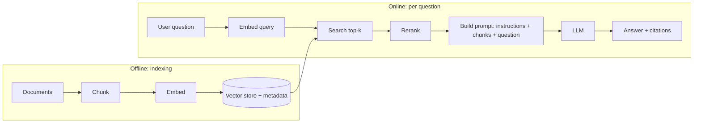

# AI-augmented development

Notes for a software developer. Concrete file formats are Claude Code's; the concepts apply to any stack.

## 1. LLM fundamentals

An LLM is a next-token predictor trained on a huge corpus, then tuned to follow instructions. It does not "look things up" or "know" facts reliably; it generates the most plausible continuation of its input.

| Concept | What to know |
|---|---|
| **Token** | Unit of text (~4 chars / ¾ word in English). You pay and are limited per token, input and output. Code and non-English text cost more tokens |
| **Context window** | Max tokens the model sees per call (prompt + history + tool results + output). Quality degrades on long, noisy contexts even before the limit |
| **Stateless** | The API remembers nothing. You resend the whole conversation each turn. "Memory" = what you put back in the prompt |
| **Roles** | `system` (durable rules, persona), `user`, `assistant`, `tool` results |
| **Temperature / top_p** | Randomness. Low (0-0.3) for extraction, code, classification. Higher for brainstorming |
| **Max output tokens** | Hard cap on the answer; a truncated JSON is a common bug (check `stop_reason`) |
| **Hallucination** | Confident but wrong output. Mitigate with grounding (RAG, tools), asking for citations, and verification (tests, schema validation) |
| **Non-determinism** | Same prompt, different answer. Never build logic that assumes identical output; validate instead |
| **Prompt caching** | Reuse a long static prefix (system prompt, docs) at a fraction of the cost/latency. Put stable content first, variable content last |
| **Latency / cost** | Grows with input + output tokens. Small/fast model for simple steps, large model for hard reasoning. Streaming improves perceived latency |
| **Knowledge cutoff** | The model does not know recent events or your private data; inject them at call time |

### Model families in practice
Pick per task, not per brand: small/fast (classification, routing, extraction), mid (most coding and chat), large/reasoning (planning, hard debugging, agents). Start with the cheapest that passes your evals.

### Minimal API call (Python, Anthropic SDK)
```python
import anthropic
client = anthropic.Anthropic()          # reads ANTHROPIC_API_KEY from env, never hard-code keys

resp = client.messages.create(
    model="claude-sonnet-5-5",
    max_tokens=1024,
    system="You are a code reviewer. Answer in JSON.",
    messages=[{"role": "user", "content": "Review: def add(a,b): return a-b"}],
)
print(resp.content[0].text, resp.stop_reason, resp.usage)
```

### Structured output
Never regex free text. Ask for JSON matching a schema (or force it through a tool/`response_format`), **validate it** (Pydantic, Zod, Jackson), and on failure retry once feeding the validation error back.

## 2. Prompting essentials

- **Be specific about the task, audience, format, constraints.** Vague in, vague out.
- **Give context the model cannot guess**: file paths, versions, conventions, what you already tried.
- **Show, don't tell**: 2-3 few-shot examples fix format and edge cases better than paragraphs of rules.
- **Separate instructions from data** with delimiters/XML tags: `<document>...</document>`. Required for security (see section 8).
- **Let it think for hard problems** (extended thinking / "reason step by step, then answer"), but ask for a short final answer.
- **Say what to do, not only what to avoid.** Give an exit: "If unsure, say 'unknown'."
- **Iterate like code**: version prompts in git, keep a small test set, change one thing at a time.
- System prompt = durable behaviour. User turn = the task.

Template:
```text
Role: senior Java reviewer.
Task: review the diff below for bugs and security issues only.
Constraints: max 5 findings, ordered by severity, cite file:line.
Output: JSON [{"file","line","severity","issue","fix"}]
<diff>...</diff>
```

## 3. RAG (Retrieval-Augmented Generation)

**Problem**: the model does not know your private/recent data and hallucinates. **Idea**: at question time, retrieve relevant passages from your data and put them in the prompt so the model answers from them.



### Key pieces
| Piece | Notes |
|---|---|
| **Embedding** | A model turns text into a vector (e.g. 768-3072 floats). Similar meaning → close vectors (cosine similarity). Use the **same model** for documents and queries |
| **Chunking** | Split docs into 200-800 token pieces, ~10-15% overlap, split on structure (headings, paragraphs, code functions) not blindly. Keep metadata (source, title, section, date, ACLs) |
| **Vector store** | pgvector (already have Postgres? start here), Qdrant, Weaviate, Pinecone, OpenSearch. Index type HNSW/IVFFlat = approximate nearest neighbour |
| **Hybrid search** | Combine vector (semantic) + keyword BM25 (exact terms, IDs, error codes), merge with reciprocal rank fusion. Better than either alone |
| **Reranker** | Cross-encoder re-scores the top 20-50 → keep best 3-8. Big quality win for small cost |
| **Prompt assembly** | "Answer only from the context. If missing, say you don't know. Cite [source]." Put chunks in tags |
| **Query rewriting** | Rewrite chat follow-ups into standalone queries; optionally split multi-part questions |

### pgvector example
```sql
CREATE EXTENSION vector;
CREATE TABLE chunks (
  id bigserial PRIMARY KEY, source text, content text,
  embedding vector(1024));                      -- dimension = your embedding model
CREATE INDEX ON chunks USING hnsw (embedding vector_cosine_ops);

-- top 5 nearest chunks to a query embedding
SELECT source, content FROM chunks
ORDER BY embedding <=> :query_embedding LIMIT 5;
```
```python
def answer(question: str) -> str:
    q_vec = embed(question)                                  # embedding API
    rows = db.query(TOP_K_SQL, q_vec)                        # retrieve
    context = "\n\n".join(f"[{r.source}] {r.content}" for r in rows)
    return llm(system="Answer only from <context>. Cite sources. Say 'I don't know' if absent.",
               user=f"<context>{context}</context>\n\nQuestion: {question}")
```

### Evaluate RAG (separately, retrieval then generation)
- **Retrieval**: recall@k / hit rate: does the top-k contain the passage that answers the question? Build 30-100 real Q → expected-source pairs.
- **Generation**: faithfulness (answer supported by context?), relevance, correct refusal when context lacks the answer. LLM-as-judge plus human spot checks.
- Change one knob at a time (chunk size, k, reranker) and re-run the set.

### Common failure modes
| Symptom | Likely cause / fix |
|---|---|
| Right doc exists but not retrieved | Bad chunking, embedding mismatch, need hybrid search / rewrite the query |
| Retrieved but answer ignores it | Too many/noisy chunks ("lost in the middle"), reduce k, rerank, clearer instruction |
| Confident wrong answer | No "say I don't know" rule, no citations required, stale index |
| Leaks other users' data | No metadata filter / ACL at retrieval time (**filter before ranking**) |
| Stale answers | No re-index pipeline on document change |

### RAG vs fine-tuning vs long context
| Need | Use |
|---|---|
| Fresh/private/changing knowledge, citations, access control | **RAG** |
| Fixed style, format or behaviour on a narrow task | Fine-tuning (last resort; try prompting + examples first) |
| Small corpus that fits in the window | Just put it in the prompt (+ prompt caching) |

## 4. Tools, function calling, MCP

The model cannot act; it **asks you to run a tool** and you feed the result back.

```text
user → LLM → "call get_weather(city='Tunis')"   (stop_reason = tool_use)
your code runs the function → sends the result back → LLM → final answer
```
- A tool = name + **description** + JSON schema of inputs. The description is a prompt: the model picks tools by reading it, so make similar tools clearly different.
- Your code executes tools, so **you** enforce permissions, validation and limits.
- **MCP (Model Context Protocol)**: open standard so one tool server (GitHub, Postgres, Jira, filesystem...) works with any compatible client. Use MCP for capabilities reused across apps, a plain in-app tool for one app.

## 5. What is an agent?

An agent = an LLM in a **loop** that decides the next step, calls tools, observes results, and stops when done.

```text
while not done and steps < MAX:
    response = llm(messages, tools)
    if response wants tools: run them, append results to messages
    else: done, return response
```
- **Workflow vs agent**: if the steps are known in advance, write a fixed workflow (prompt chaining, routing, parallel calls). Use an autonomous agent only when the path is unknown. The simplest structure that works wins (cheaper, testable, predictable).
- Agent = model + tools + system prompt + loop + guardrails + context management.

## 6. Build steps, Claude Code

### 6.1 Skill (reusable instructions + optional scripts)
A skill is a folder the model loads **on demand** when its `description` matches the task. Only the name/description sit in context; the body loads when triggered (cheap context).

1. Pick a repeatable task (release notes, PR review checklist, DB migration conventions).
2. Create the folder: project `.claude/skills/<name>/` or personal `~/.claude/skills/<name>/`.
3. Write `SKILL.md`:
```markdown
---
name: db-migration
description: Use when writing or reviewing a Flyway/Liquibase migration. Covers naming, backward-compatible changes, and lock-safe DDL.
---

# DB migration rules
1. File name `V<yyyyMMddHHmm>__<what>.sql`.
2. Never rename/drop a column in the same release as the code change (expand → migrate → contract).
3. Create indexes with `CREATE INDEX CONCURRENTLY`.
See [checklist](checklist.md). Run `scripts/lint.sh <file>` before finishing.
```
4. Optionally add `checklist.md`, `templates/`, `scripts/` next to it (referenced from `SKILL.md`, loaded only when needed).
5. Test: ask for a task that should trigger it (`/db-migration` or plain language). If it does not trigger, **rewrite the `description`** (it is the trigger). If it triggers wrongly, make it narrower.
6. Commit it to git so the team shares it.

Tips: description says *what* and *when*; keep `SKILL.md` short, push detail into linked files; deterministic work → a script, not prose.

### 6.2 Subagent (specialised worker with its own context)
Runs in a **separate context window** with its own system prompt and restricted tools, then returns only a summary. Use it to isolate noisy work (big searches, log analysis), to run tasks in parallel, or to enforce a role with limited permissions.

1. Create `.claude/agents/<name>.md` (project) or `~/.claude/agents/<name>.md` (personal), or use `/agents`.
2. Write frontmatter + system prompt:
```markdown
---
name: security-reviewer
description: Use proactively after code changes to review for injection, authz, and secret-handling issues. Read-only.
tools: Read, Grep, Glob        # allow-list; omit to inherit all tools
model: sonnet                  # or haiku for cheap/fast, opus for hard
---

You are a security reviewer. Review only the changed files (`git diff`).
Report findings as: severity, file:line, issue, fix. Do not modify files.
If nothing found, say so explicitly.
```
3. Invoke: automatically (Claude matches the `description`), by name ("use the security-reviewer agent on this diff"), or from another agent.
4. Design rules: one clear job per subagent; least-privilege tools; a precise `description` (drives delegation); specify the **output format** since the parent only sees the final message; subagents don't see the parent conversation, so pass the needed context in the task.

### 6.3 Plugin (package and distribute)
A plugin bundles skills, subagents, slash commands, hooks and MCP servers so a team installs them in one command.

1. Layout:
```text
my-plugin/
├── .claude-plugin/
│   └── plugin.json          # manifest (only this file goes in .claude-plugin/)
├── skills/db-migration/SKILL.md
├── agents/security-reviewer.md
├── commands/review.md       # /my-plugin:review
├── hooks/hooks.json         # deterministic automation
└── .mcp.json                # MCP servers
```
2. Manifest:
```json
{
  "name": "my-plugin",
  "version": "1.0.0",
  "description": "Team conventions: migrations + security review",
  "author": { "name": "Your Team" }
}
```
3. Test locally: `claude --plugin-dir ./my-plugin`, then try each component.
4. Distribute with a **marketplace** (a git repo with `.claude-plugin/marketplace.json` listing plugins):
```json
{
  "name": "team-marketplace",
  "owner": { "name": "Your Team" },
  "plugins": [ { "name": "my-plugin", "source": "./my-plugin", "description": "Team conventions" } ]
}
```
5. Users install: `/plugin marketplace add <org>/<repo>` then `/plugin install my-plugin@team-marketplace`.
6. Bump `version` on each release. Review third-party plugins before installing (they run code and hooks).

### 6.4 Hooks (deterministic guardrails)
Shell commands run by the harness on events (`PreToolUse`, `PostToolUse`, `SessionStart`, `Stop`...), configured in `settings.json` or a plugin's `hooks.json`. Use them for what must **always** happen (format after edit, block `rm -rf`, run tests); instructions in a prompt are advisory, hooks are enforced.

### 6.5 Your own agent (Agent SDK or raw API)
1. **Define the job and success criteria** (what does "done" look like? how will you measure it?).
2. **Try a plain workflow first**; only go agentic if the steps can't be predetermined.
3. **Design tools**: few, well-named, clear descriptions, strict JSON schemas, small helpful outputs, actionable error messages. Prefer read-only tools; gate destructive ones.
4. **Write the system prompt**: role, goal, rules, when to stop, when to ask a human.
5. **Run the loop** with the Agent SDK (handles loop, tools, context, permissions, MCP, subagents) or hand-roll it (section 5). Always set a **max-steps/budget** and a timeout.
6. **Manage context**: truncate/summarise big tool outputs, compact history, offload sub-investigations to subagents, keep durable notes in files.
7. **Guardrails**: least privilege, human approval for irreversible actions (payments, deletes, deploys, external messages), sandboxing, allow-lists, hooks/validators on tool calls.
8. **Evaluate**: a set of realistic tasks with pass/fail checks (tests pass, expected file changed, correct DB state), run on every prompt/tool/model change. Track success rate, steps, tokens, cost, latency.
9. **Observe**: log every prompt, tool call, result, token usage; make runs replayable.
10. **Iterate from failures**: read failed traces, fix the tool description or prompt first, add the failure to the eval set.

Minimal hand-rolled loop:
```python
def run_agent(task, tools, max_steps=15):
    messages = [{"role": "user", "content": task}]
    for _ in range(max_steps):
        resp = client.messages.create(model=MODEL, max_tokens=2048, system=SYSTEM, tools=TOOL_SPECS, messages=messages)
        messages.append({"role": "assistant", "content": resp.content})
        if resp.stop_reason != "tool_use":
            return resp.content[0].text
        results = []
        for block in resp.content:
            if block.type == "tool_use":
                out = tools[block.name](**block.input)      # validate + authorise here
                results.append({"type": "tool_result", "tool_use_id": block.id, "content": str(out)})
        messages.append({"role": "user", "content": results})
    raise RuntimeError("step budget exhausted")
```

## 7. Which one do I need?

| Need | Reach for |
|---|---|
| Reusable **instructions/conventions**, loaded when relevant | **Skill** |
| Isolated context, parallel work, restricted permissions, a specialised role | **Subagent** |
| Connect an external system/API/database to any client | **MCP server** |
| Something that must happen every time, no exceptions | **Hook** |
| Always-on project rules (build commands, code style) | `CLAUDE.md` |
| Shortcut prompt you type (`/review`) | Slash command |
| Share all of the above with a team | **Plugin** (+ marketplace) |
| Your own product needing autonomy | **Agent** (Agent SDK) |
| Answers from private/changing docs | **RAG** |

`CLAUDE.md` is loaded every session (keep it short: build/test commands, architecture, conventions, pitfalls). Skills load on demand, so put occasional/long procedures there instead.

## 8. Working habits and safety

- **You own the output.** Read every diff. AI code compiles more often than it is correct.
- **Verify with executable checks**: tests, type-check, linter, build. Give the agent the commands so it can self-verify. Test-first works very well (write/approve the test, let AI make it pass).
- **Plan before code** on non-trivial work (plan mode): review the plan, then execute. Small, reviewable steps and commits.
- **Context hygiene**: one task per session, `/clear` between unrelated tasks, `/compact` on long ones, point to files rather than pasting, use subagents for exploration.
- **Good tasks for AI**: boilerplate, tests, refactors with tests as safety net, migrations, explaining unfamiliar code, log/stack-trace triage, docs, first drafts of queries (then `EXPLAIN`, see [SQL](sql.md)). **Poor tasks**: unclear requirements, security-critical logic without expert review, anything you cannot verify.
- **Prompt injection**: text from web pages, tickets, emails, files or retrieved docs can contain instructions. Treat it as **untrusted data**, keep it separate from trusted instructions, give the agent least privilege, and require approval for sensitive actions. Bigger models or polite system prompts are not a defence; permissions and hooks are.
- **Secrets & data**: never put secrets in prompts, code or `CLAUDE.md`; minimise PII sent to a model; know your provider's data-retention terms.
- **Permissions**: allow-list safe commands, keep dangerous ones on prompt. Don't run "skip all permissions" outside a sandbox/container.
- **Cost control**: cheaper model for simple steps, prompt caching, cap output, cap agent steps, monitor token usage.
- **Treat prompts and skills as code**: version them, review them, test them with evals.
- **Keep your fundamentals sharp**: you must be able to review what the AI writes (design, SQL plans, concurrency, security).

## 9. Glossary

| Term | Meaning |
|---|---|
| Embedding | Vector representing the meaning of text |
| Vector DB | Store optimised for nearest-neighbour search on embeddings |
| Grounding | Forcing answers to rely on provided sources |
| Few-shot | Examples included in the prompt |
| Chain-of-thought / extended thinking | Model reasons before the final answer |
| Tool use / function calling | Model requests a function call, you execute it |
| MCP | Open protocol to expose tools/data to LLM clients |
| Agent | LLM + tools in a loop that decides its next step |
| Orchestrator-worker | Lead agent delegates to subagents and merges results |
| Eval | Repeatable test set measuring AI behaviour |
| LLM-as-judge | Using a model to grade outputs |
| Guardrail | Enforced limit (validation, permissions, hooks) |
| Prompt injection | Malicious instructions hidden in data the model reads |
