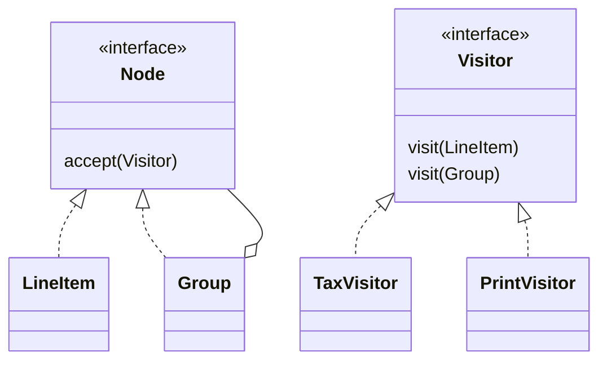

# Design Patterns

## 🟢 Fondamentaux

### Patrons créationnels

#### Q1. Quel problème résout réellement le Singleton, et comment l'implémenter de façon thread-safe en Java ? {#problem-singleton-solve-implement-thread}
**Réponse :** Le Singleton garantit qu'une classe n'a qu'une seule instance et fournit un point
d'accès global unique — pertinent pour quelque chose de véritablement unique dans le processus :
une façade de logging, un registre de configuration, un wrapper de pool de connexions. Un naïf
`if (instance == null) instance = new Foo();` n'est pas thread-safe : deux threads peuvent tous
deux passer le test `null` avant qu'aucun n'affecte la variable, produisant deux instances. Les
implémentations Java idiomatiques et thread-safe sont (1) un champ `static final` **eager** (les
garanties de chargement de classe de la JVM servent de filet de sécurité, au prix de toujours
construire l'instance même si elle n'est jamais utilisée), (2) l'idiome **Bill Pugh / classe
interne statique holder** (paresseux, thread-safe, sans surcoût de synchronisation — la classe
holder n'est chargée qu'au premier accès), ou (3) un **enum** à un seul élément (recommandation de
Joshua Bloch — la JVM garantit que les instances d'enum sont créées exactement une fois, et c'est
sûr vis-à-vis de la sérialisation, gratuitement).

**Exemple :**

```java
// Idiome Bill Pugh : paresseux, thread-safe, pas de bloc synchronized à chaque appel.
public class ConfigRegistry {
    private ConfigRegistry() {}
    private static class Holder {
        static final ConfigRegistry INSTANCE = new ConfigRegistry();
    }
    public static ConfigRegistry getInstance() { return Holder.INSTANCE; }
}

// Idiome enum : forme correcte la plus courte, immunisée contre la réflexion et la sérialisation.
public enum ConfigRegistryEnum {
    INSTANCE;
    public void reload() { /* ... */ }
}
```

**Pourquoi c'est un piège :** le double-checked locking sans `volatile` sur le champ est une
réponse classique fausse qui « a l'air » correcte — sans `volatile`, un autre thread peut observer
un objet partiellement construit à cause du réordonnancement d'instructions. Si le double-checked
locking est utilisé, le champ doit être `private static volatile Foo instance;`.

*Voir aussi :* [Java Q28](java-core-jvm.md#name-thread-safe-singleton-implementation) pour la mécanique JVM : chargement de classe, et pourquoi `enum` résiste aussi à la réflexion et à la désérialisation.

#### Q2. Quelle est la vraie différence entre Factory Method et Abstract Factory ? {#factory-method-abstract-factory}
**Réponse :** **Factory Method** est une méthode unique — souvent surchargée dans une sous-classe —
qui crée un seul type d'objet, laissant les sous-classes décider du type concret à instancier
pendant que l'appelant ne dépend que de l'interface du type de retour. **Abstract Factory** va plus
loin : une interface exposant *plusieurs* méthodes de fabrique qui produisent ensemble une
**famille d'objets liés** destinés à être utilisés ensemble, garantissant que l'appelant ne mélange
jamais accidentellement des objets de familles incompatibles. La question distinctive en entretien
n'est pas « lequel crée des objets » (les deux le font) mais « l'appelant a-t-il besoin d'un seul
produit, ou d'une famille cohérente de plusieurs produits ensemble ».

**Exemple :**

```java
// Factory Method : un seul produit, décidé par la sous-classe.
abstract class DocumentExporter {
    abstract Exporter createExporter();
    void export(Document d) { createExporter().write(d); }
}
class PdfDocumentExporter extends DocumentExporter {
    Exporter createExporter() { return new PdfExporter(); }
}

// Abstract Factory : toute une famille de produits liés, garantis compatibles.
interface UiFactory {
    Button createButton();
    Checkbox createCheckbox();
}
class DarkThemeFactory implements UiFactory {
    public Button createButton() { return new DarkButton(); }
    public Checkbox createCheckbox() { return new DarkCheckbox(); }
}
```

**Pourquoi c'est un piège :** réciter les définitions sans la distinction « famille de produits
liés » est le signe qu'un candidat a mémorisé les noms sans comprendre pourquoi Abstract Factory
existe — le vrai bug qu'il évite est un appelant se retrouvant avec un `DarkButton` à côté d'une
`LightCheckbox` parce que deux Factory Method indépendantes ont été appelées avec des thèmes
incohérents.

#### Q3. Quand un Builder est-il préférable à un constructeur télescopique ou à de simples setters JavaBean ? {#builder-beat-telescoping-constructor-plain}
**Réponse :** Un constructeur télescopique (`new Pizza(size)`, `new Pizza(size, cheese)`, `new
Pizza(size, cheese, pepperoni)`, ...) devient illisible et source d'erreurs au-delà de 3-4
paramètres, surtout quand plusieurs partagent le même type (quel `boolean` est lequel ?). Les
setters simples règlent la lisibilité mais sacrifient l'immutabilité et laissent l'objet dans un
état incohérent entre la construction et le dernier appel de setter — dangereux si un autre thread
le lit en cours de construction, ou si une validation nécessite « tous les champs requis présents »
avant que l'objet soit utilisable. Le Builder fournit des méthodes nommées et chaînables qui
accumulent l'état et ne construisent l'objet réel (éventuellement immuable) que dans un appel final
`build()`, seul endroit où les invariants portant sur plusieurs champs peuvent être validés
ensemble.

**Exemple :**

```java
Pizza pizza = new Pizza.Builder()
    .size(Size.LARGE)
    .cheese(true)
    .pepperoni(false)
    .build(); // la validation croisée des champs a lieu ici, et le résultat peut être totalement immuable

class Pizza {
    private final Size size;
    private final boolean cheese;
    private Pizza(Builder b) { this.size = b.size; this.cheese = b.cheese; }
    static class Builder {
        private Size size; private boolean cheese;
        Builder size(Size s) { this.size = s; return this; }
        Builder cheese(boolean c) { this.cheese = c; return this; }
        Pizza build() {
            if (size == null) throw new IllegalStateException("size is required");
            return new Pizza(this);
        }
    }
}
```

**Pourquoi c'est un piège :** utiliser un Builder pour une classe à 2 champs est l'erreur inverse —
du boilerplate pour du boilerplate. Le pattern justifie son coût précisément quand il y a plusieurs
paramètres optionnels, une validation croisée entre champs, et un objet final qu'on veut immuable.

#### Q4. Quand le pattern Prototype (clonage) est-il préférable à un appel à `new` ? {#prototype-pattern-cloning-beat-calling}
**Réponse :** Prototype crée de nouveaux objets en copiant une instance existante, déjà entièrement
configurée, plutôt qu'en construisant depuis zéro — ce qui vaut le coup quand la construction est
coûteuse (une lecture base de données onéreuse, un appel réseau, ou un calcul lourd pour arriver à
l'état initial) ou quand la classe concrète exacte à instancier n'est pas connue à la compilation
et que seule une instance existante est disponible à copier. `Cloneable`/`clone()` en Java est le
mécanisme canonique mais notoirement maladroit (copie superficielle par défaut, pas d'appel de
constructeur, facile à mal implémenter avec des champs mutables) ; en pratique, un constructeur de
copie ou une méthode de fabrique statique qui copie explicitement en profondeur l'état mutable est
généralement le choix le plus sûr plutôt que d'implémenter `Cloneable`.

**Exemple :**

```java
class Report implements Cloneable {
    private List<String> sections = new ArrayList<>();
    @Override
    public Report clone() {
        Report copy = new Report();
        copy.sections = new ArrayList<>(this.sections); // copie profonde explicite du champ mutable
        return copy;
    }
}
// Une alternative moins coûteuse qui évite entièrement les pièges de Cloneable :
class ReportCopy {
    static Report copyOf(Report r) { /* copie champ par champ explicite et profonde */ return new Report(r); }
}
```

**Pourquoi c'est un piège :** compter sur la copie superficielle par défaut d'`Object.clone()`
quand un champ est une collection ou un objet imbriqué mutable — l'original et la « copie »
partagent alors la même liste sous-jacente, et une mutation via l'un corrompt silencieusement
l'état supposément indépendant de l'autre.

### Patrons structurels

#### Q5. Comment Adapter réconcilie-t-il deux interfaces incompatibles, et quelle est la distinction adaptateur d'objet vs. adaptateur de classe ? {#adapter-reconcile-two-incompatible-interfaces}
**Réponse :** Adapter enveloppe une classe existante derrière l'interface qu'un client attend
réellement, traduisant les appels sans modifier ni l'un ni l'autre côté — le cas d'usage classique
est l'intégration d'une bibliothèque tierce dont l'API ne correspond pas à l'interface dont dépend
le reste du code. Un **adaptateur d'objet** détient une instance de l'adapté par composition et lui
délègue (fonctionne dans n'importe quel langage, y compris Java, et peut aussi adapter des
sous-classes). Un **adaptateur de classe** utilise l'héritage multiple pour hériter à la fois de
l'interface cible et de l'adapté directement — impossible en Java pour deux classes concrètes
(héritage simple), donc le code Java prend toujours de facto la forme adaptateur d'objet.

**Exemple :**

```java
interface MediaPlayer { void play(String file); }

class LegacyThirdPartyDecoder {
    void decodeAndPlay(String path) { /* forme d'API incompatible */ }
}

class LegacyDecoderAdapter implements MediaPlayer { // adaptateur d'objet : composition, pas héritage
    private final LegacyThirdPartyDecoder decoder = new LegacyThirdPartyDecoder();
    public void play(String file) { decoder.decodeAndPlay(file); }
}
```

**Pourquoi c'est un piège :** utiliser Adapter pour masquer une abstraction réellement mauvaise à
l'intérieur de son *propre* code (plutôt qu'à une vraie frontière tierce) ne fait que cacher un
problème de conception derrière une couche d'indirection supplémentaire, au lieu de corriger
l'interface qui n'aurait jamais dû diverger.

#### Q6. En quoi Decorator diffère-t-il d'une simple sous-classe pour ajouter du comportement ? {#decorator-differ-just-subclassing-add}
**Réponse :** La sous-classe ajoute du comportement à la compilation, de façon statique, et
multiplie combinatoirement — `CoffeeWithMilk`, `CoffeeWithSugar`, `CoffeeWithMilkAndSugar`, une
sous-classe par combinaison. Decorator enveloppe un objet de la même interface à *l'exécution*,
ajoutant du comportement avant/après avoir délégué à l'instance enveloppée, si bien que toute
combinaison s'obtient en imbriquant des décorateurs plutôt qu'en déclarant une nouvelle classe par
combinaison — le nombre de classes reste linéaire dans le nombre de comportements, pas exponentiel
dans leurs combinaisons.

**Exemple :**

```java
interface Coffee { double cost(); }
class SimpleCoffee implements Coffee { public double cost() { return 2.0; } }

abstract class CoffeeDecorator implements Coffee {
    protected final Coffee wrapped;
    CoffeeDecorator(Coffee c) { this.wrapped = c; }
}
class MilkDecorator extends CoffeeDecorator {
    MilkDecorator(Coffee c) { super(c); }
    public double cost() { return wrapped.cost() + 0.5; }
}
class SugarDecorator extends CoffeeDecorator {
    SugarDecorator(Coffee c) { super(c); }
    public double cost() { return wrapped.cost() + 0.2; }
}

Coffee order = new SugarDecorator(new MilkDecorator(new SimpleCoffee())); // toute combinaison, aucune nouvelle classe
```

**Pourquoi c'est un piège :** Decorator préserve la *même* interface à chaque couche — si le
comportement ajouté a réellement besoin de nouvelles méthodes que les appelants doivent invoquer,
Decorator est le mauvais outil ; c'est un signal pour Strategy ou une simple composition, pas pour
un décorateur qui ne respecte pas son interface.

#### Q7. Quel problème précis Facade résout-il pour un sous-système complexe ? {#specific-problem-facade-solve-complex}
**Réponse :** Un sous-système avec de nombreuses classes en interaction (une bibliothèque de
conversion vidéo avec codecs, buffers, gestion du bitrate, etc.) force chaque appelant à apprendre
et à correctement séquencer cette complexité interne. Facade introduit une interface unique,
simplifiée et de plus haut niveau exposant les cas d'usage courants, sans retirer l'accès au
sous-système sous-jacent pour les appelants qui ont encore besoin d'un contrôle fin. C'est une
amélioration d'utilisabilité/de couplage, pas une frontière de sécurité — les classes du
sous-système restent directement accessibles.

**Exemple :**

```java
class VideoConversionFacade {
    public File convertToMp4(File video) {
        Codec codec = CodecFactory.extract(video);
        BitrateReader.read(video, codec);
        AudioMixer mixer = new AudioMixer();
        return mixer.fix(video); // l'appelant ne touche jamais directement Codec, BitrateReader, AudioMixer
    }
}
```

**Pourquoi c'est un piège :** traiter la façade comme le *seul* point d'entrée autorisé puis la
tordre pour exposer chaque réglage du sous-système « au cas où » va à l'encontre du but recherché —
une façade qui accumule des paramètres pour chaque option sous-jacente redevient l'API complète du
sous-système, juste renommée.

#### Q8. Quelles sont les variantes de Proxy, et en quoi diffère-t-il de Decorator ? {#proxy-variants-differ-decorator}
**Réponse :** Proxy contrôle **l'accès** à un objet en se substituant à lui derrière la même
interface : un **proxy virtuel** diffère une construction coûteuse jusqu'à la première utilisation
réelle (chargement paresseux), un **proxy de protection** ajoute des vérifications d'autorisation
avant de déléguer, un **proxy distant** masque le fait que l'objet réel vit dans un autre
processus/machine, et un **proxy de logging/cache** enregistre ou court-circuite les appels. La
forme structurelle est identique à Decorator (envelopper la même interface, déléguer, ajouter du
comportement autour de l'appel) — la différence est *l'intention* : Decorator ajoute de nouvelles
*responsabilités/comportements* que le client souhaite explicitement superposer ; Proxy contrôle
*l'accès* à un objet auquel le client croit parler directement, souvent de façon transparente.

**Exemple :**

```java
interface Image { void display(); }
class RealImage implements Image {
    RealImage(String path) { loadFromDisk(path); /* coûteux */ }
    public void display() { /* ... */ }
}
class VirtualProxyImage implements Image { // même interface, diffère la construction coûteuse
    private final String path;
    private RealImage real;
    VirtualProxyImage(String path) { this.path = path; }
    public void display() {
        if (real == null) real = new RealImage(path); // chargé seulement au premier display() réel
        real.display();
    }
}
```

**Pourquoi c'est un piège :** affirmer que Proxy et Decorator sont « le même pattern avec des noms
différents » — les proxys `@Transactional`/sécurité de Spring lui-même sont un exemple réel et
structurant de *contrôle d'accès* (cet appel doit-il seulement être autorisé à continuer, et sous
quelle transaction ?), pas l'ajout d'une nouvelle capacité décorative ; voir `spring-architecture.md`
Q11/Q13 pour la façon dont ce proxy précis interagit avec l'auto-invocation.

### Patrons comportementaux

#### Q9. Qu'apporte Strategy par rapport à un gros `if`/`switch` sur du comportement ? {#strategy-buy-large-switch-behavior}
**Réponse :** Strategy extrait un algorithme (ou l'une de plusieurs variantes interchangeables)
derrière une interface commune, si bien que l'algorithme peut être sélectionné et échangé à
l'exécution — souvent via injection de dépendances — sans que la classe qui l'utilise sache quelle
implémentation concrète elle détient. Il suit directement le principe ouvert/fermé : ajouter une
nouvelle stratégie signifie ajouter une nouvelle classe, pas modifier chaque branche d'une
conditionnelle existante.

**Exemple :**

```java
interface DiscountStrategy { double apply(double price); }
class NoDiscount implements DiscountStrategy { public double apply(double p) { return p; } }
class PercentageDiscount implements DiscountStrategy {
    private final double pct;
    PercentageDiscount(double pct) { this.pct = pct; }
    public double apply(double p) { return p * (1 - pct); }
}

class Checkout {
    private final DiscountStrategy discount; // injecté, interchangeable, aucun if/switch dans Checkout
    Checkout(DiscountStrategy discount) { this.discount = discount; }
    double total(double price) { return discount.apply(price); }
}
```

**Pourquoi c'est un piège :** nommer le pattern sans nommer le vrai bénéfice (conformité au
principe ouvert/fermé, testabilité indépendante de chaque stratégie) est la moitié superficielle de
la réponse — voir Q17 pour les cas où cette indirection ne vaut pas le coût.

#### Q10. Comment Observer découple-t-il éditeurs et abonnés, et quel est le piège classique à signaler d'emblée ? {#observer-decouple-publishers-subscribers-classic}
**Réponse :** Un sujet maintient une liste d'observateurs et les notifie tous à chaque changement
d'état, sans rien savoir de ce que chaque observateur fait de cette notification — éditeurs et
abonnés ne dépendent que d'une interface fine `Observer`/`Listener`, pas des types concrets l'un de
l'autre, ce qui permet d'ajouter de nouveaux abonnés sans aucun changement côté éditeur. Le piège à
signaler immédiatement (détaillé avec un scénario d'échec concret en Q18/S2) : si un abonné n'est
jamais explicitement désinscrit, la liste du sujet garde une référence vivante vers lui pour
toujours, ce qui est une fuite mémoire classique dans un processus longue durée.

**Exemple :**

```java
interface OrderListener { void onOrderPlaced(Order o); }

class OrderService {
    private final List<OrderListener> listeners = new ArrayList<>();
    void subscribe(OrderListener l) { listeners.add(l); }
    void unsubscribe(OrderListener l) { listeners.remove(l); } // facile à oublier d'appeler
    void place(Order o) { listeners.forEach(l -> l.onOrderPlaced(o)); }
}
```

**Pourquoi c'est un piège :** décrire Observer comme un simple « pub/sub » sans mentionner la
responsabilité de désinscription est incomplet — voir Q18 pour le piège de fuite mémoire que cela
crée en pratique.

#### Q11. Que corrige Template Method, et en quoi diffère-t-il d'un simple appel de méthodes utilitaires dans l'ordre ? {#template-method-fix-differ-just}
**Réponse :** Template Method définit le *squelette fixe* d'un algorithme dans une méthode de
classe de base (souvent `final`, pour que les sous-classes ne puissent ni réordonner ni sauter
d'étapes), tout en déléguant des étapes spécifiques à des méthodes « hook » abstraites ou
surchargeables que les sous-classes implémentent. Contrairement à un appelant qui appelle
manuellement des méthodes utilitaires dans le bon ordre à chaque fois (facile à réordonner ou à
oublier une étape par erreur), le séquencement lui-même vit à un seul endroit et ne peut jamais
être mal fait par une sous-classe — les sous-classes ne peuvent remplir que les étapes
personnalisables, pas l'ordre dans lequel elles s'exécutent.

**Exemple :**

```java
abstract class DataImporter {
    final void run(File f) {           // le squelette fixe de l'algorithme — final, ne peut être réordonné
        Data raw = read(f);
        Data valid = validate(raw);
        persist(valid);
    }
    abstract Data read(File f);
    Data validate(Data d) { return d; } // hook par défaut, surchargeable mais pas obligatoire
    abstract void persist(Data d);
}
class CsvImporter extends DataImporter {
    Data read(File f) { /* spécifique au CSV */ return null; }
    void persist(Data d) { /* ... */ }
}
```

**Pourquoi c'est un piège :** rendre la méthode squelette non-`final` invite une sous-classe à
surcharger l'ensemble de la séquence, réintroduisant silencieusement exactement le bug « étapes
dans le mauvais ordre » que le pattern est censé prévenir.

#### Q12. Qu'apporte Command au-delà d'un « simple appel de méthode direct », et quels sont ses principaux cas d'usage ? {#command-buy-beyond-just-call}
**Réponse :** Command transforme une requête (un appel de méthode plus ses arguments) en un objet
autonome implémentant une interface commune (typiquement une méthode `execute()`), ce qui découple
l'objet qui *déclenche* une action de l'objet qui *sait comment l'exécuter*, et permet de stocker,
mettre en file, journaliser ou annuler cette requête. Les appels de méthode directs ne peuvent pas
être mis en file pour plus tard, réessayés, sérialisés, ou trivialement annulés — un objet
`Command` peut faire tout cela, parce que la requête elle-même est maintenant une donnée, pas
seulement une frame de pile en cours d'exécution.

**Exemple :**

```java
interface Command { void execute(); void undo(); }

class AddTextCommand implements Command {
    private final Document doc; private final String text;
    AddTextCommand(Document doc, String text) { this.doc = doc; this.text = text; }
    public void execute() { doc.append(text); }
    public void undo() { doc.removeLast(text.length()); }
}

class CommandHistory {
    private final Deque<Command> history = new ArrayDeque<>();
    void run(Command c) { c.execute(); history.push(c); }
    void undoLast() { if (!history.isEmpty()) history.pop().undo(); }
}
```

**Pourquoi c'est un piège :** utiliser Command pour une action simple, immédiate, en un coup, qui
n'aura jamais besoin d'être mise en file, journalisée, réessayée ou annulée, est de la pure
cérémonie — le pattern se justifie précisément quand l'un de ces besoins transverses (annulation,
file de tâches, journal d'audit des actions exécutées) est réellement présent.

#### Q13. En quoi State diffère-t-il de Strategy, alors que leurs diagrammes de classes sont presque identiques ? {#state-differ-strategy-given-class}
Les deux délèguent le comportement à un objet interchangeable derrière une interface ; la différence est *qui choisit et pourquoi*.

Avec **Strategy**, le client choisit un algorithme de l'extérieur et il change rarement durant la vie de l'objet (une règle de tarification, un ordre de tri).

Avec **State**, le comportement de l'objet change quand son état interne change, et ce sont généralement les objets d'état eux-mêmes qui déclenchent les transitions (`Order` passe de `NEW -> PAID -> SHIPPED` ; `ship()` est légal dans un état et une erreur dans un autre).

State remplace un `switch (status)` qui grossit et se répète dans chaque méthode par une classe par état, de sorte que les transitions illégales deviennent impossibles par construction au lieu d'être gardées par des `if` éparpillés.

Le coût : plus de classes — pour deux ou trois états aux règles triviales, un enum avec un `switch` est plus simple (même test de sur-ingénierie que Q22).

Piège habituel : des objets d'état sans état peuvent être des singletons, mais ceux qui portent des données par commande ne le peuvent pas.

**Exemple :**

```java
interface OrderState {
    OrderState pay(Order o);
    OrderState ship(Order o);
}
class New implements OrderState {
    public OrderState pay(Order o)  { o.charge(); return new Paid(); }
    public OrderState ship(Order o) { throw new IllegalStateException("pay first"); }
}
class Paid implements OrderState {
    public OrderState pay(Order o)  { throw new IllegalStateException("already paid"); }
    public OrderState ship(Order o) { o.dispatch(); return new Shipped(); }
}
// Order : this.state = state.pay(this);   <- l'état décide de l'état suivant
```

#### Q14. Quand Chain of Responsibility est-il le bon choix, et où l'utilisez-vous déjà sans le nommer ? {#chain-responsibility-right-fit-already}
Chain of Responsibility fait circuler une requête le long d'une séquence de handlers, dont chacun la traite, la modifie ou la transmet au suivant ; l'émetteur ne sait pas quel handler agira.

Il convient aux pipelines dont les étapes sont indépendantes, ordonnées, et ajoutées ou retirées par configuration : filtres servlet et chaîne de filtres de Spring Security, middleware HTTP, règles de validation ou d'approbation (« sous 1 k : chef d'équipe ; sous 10 k : directeur »), niveaux de log.

Les bénéfices : des étapes découplées, réordonnables ou testables isolément ; les pièges ressemblent à ceux des Decorator empilés (Q16) : l'ordre est un contrat caché, un handler qui oublie d'appeler `next` avale silencieusement la requête, et si aucun handler ne correspond il faut un comportement par défaut explicite (échec ou rejet) plutôt qu'un no-op silencieux.

Contrairement à Decorator, un handler peut *interrompre* la chaîne ; un décorateur délègue toujours.

**Exemple :**

```java
interface Handler { void handle(Request r, Runnable next); }

Handler auth  = (r, next) -> { if (!r.hasToken()) throw new UnauthorizedException(); next.run(); };
Handler rate  = (r, next) -> { if (limiter.tooMany(r.ip())) throw new TooManyRequests(); next.run(); };
Handler audit = (r, next) -> { log.info("{} {}", r.method(), r.path()); next.run(); };
// l'ordre compte : authentifier avant de limiter par utilisateur, audit en dernier. Oublier next.run() avale la requête.
```

## 🟡 Pièges seniors

### Questions

#### Q15. Pourquoi de nombreux ingénieurs seniors traitent-ils Singleton comme un anti-pattern malgré le fait que ce soit le pattern « le plus facile » à implémenter correctement ? {#many-senior-engineers-treat-singleton}
**Réponse :** Le fait que l'implémentation soit facile à réussir (Q1) n'est pas le problème — c'est
la conséquence de *conception* qui l'est. Un Singleton est un état mutable global avec un point
d'accès statique, ce qui signifie que toute classe l'utilisant a une dépendance cachée invisible
dans sa signature de constructeur, rendant le graphe de dépendances plus difficile à raisonner et
impossible à substituer par un double de test sans recourir à des outils plus lourds (mock statique,
astuces de classloader). Pire, dans une suite de tests, l'état d'un Singleton peut fuir entre des
tests exécutés dans la même JVM/classloader — un test qui le modifie sans nettoyer peut faire
échouer un test ultérieur sans rapport, de façon non déterministe, souvent uniquement en exécution
parallèle des tests. L'alternative senior dans la plupart des cas : l'injection de dépendances avec
une *portée* singleton gérée par un framework (par exemple un `@Bean` Spring à portée par défaut) —
même garantie « une seule instance », mais la dépendance est explicite dans le constructeur et
trivialement remplaçable par un mock dans un test.

**Exemple :**

```java
// Singleton fait main : dépendance cachée, difficile à substituer dans un test.
class ReportGenerator {
    void generate() {
        String key = ConfigRegistry.getInstance().get("api.key"); // dépendance invisible
    }
}

// Équivalent DI : même garantie « une instance dans l'appli », explicite et interchangeable.
class ReportGenerator {
    private final Config config;
    ReportGenerator(Config config) { this.config = config; } // trivialement mockable dans un test
}
```

**Pourquoi c'est un piège :** répondre « Singleton c'est bon, je l'ai implémenté thread-safe »
répond à la mauvaise question — la thread-safety n'a jamais été l'objection ; ce sont la
testabilité et le couplage caché, et une implémentation correcte ne corrige ni l'un ni l'autre.

#### Q16. Quand empiler des Decorator devient-il pire que l'explosion d'héritage qu'il devait éviter ? {#stacking-decorators-become-worse-inheritance}
**Réponse :** Decorator échange une explosion *exponentielle* de classes contre une chaîne
d'exécution potentiellement profonde et sensible à l'ordre — cinq ou six décorateurs imbriqués,
chacun dépendant silencieusement de s'exécuter avant ou après un autre (un décorateur de logging
qui doit envelopper un décorateur de cache, pas l'inverse, sous peine de calculer la clé de cache
sur des données périmées), transforme « quelle est cette combinaison ? » en un problème de débogage
sur des sites de construction dispersés dans le code plutôt qu'une hiérarchie de classes fixe et
visible. La chaîne rend aussi le pas-à-pas au débogueur nettement plus difficile — un appel logique
traverse désormais N couches façon proxy.

**Exemple :**

```java
// L'ordre compte et est facile à inverser sans aucune aide du compilateur dans un sens ou l'autre :
Coffee a = new LoggingDecorator(new CachingDecorator(new MilkDecorator(new SimpleCoffee())));
Coffee b = new CachingDecorator(new LoggingDecorator(new MilkDecorator(new SimpleCoffee())));
// a journalise le résultat (correct) mis en cache ; b journalise un appel qui contourne le cache à chaque fois — mêmes classes, bug différent
```

**Pourquoi c'est un piège :** présenter « n'importe quel nombre de décorateurs, librement
combinés » comme l'argument de vente du pattern sans reconnaître les contraintes d'ordre — au-delà
d'une poignée de couches avec de vraies dépendances de séquencement, un builder ou une petite
classe de pipeline explicite documentant l'ordre requis est souvent plus déboguable que la
composition de décorateurs théoriquement infinie.

#### Q17. Quand introduire Strategy ajoute-t-il plus de complexité qu'un simple `if`/`switch` ? {#introducing-strategy-add-more-complexity}
**Réponse :** Strategy est rentable quand le nombre de variantes est véritablement ouvert (plugins,
configuration à l'exécution, comportement par tenant) ou quand chaque variante a suffisamment de
logique interne et sa propre surface de test pour mériter sa propre classe. C'est le mauvais choix
pour 2-3 branches stables et simples qui changeront rarement — un `switch` est plus lisible à un
seul endroit, ne nécessite aucune indirection supplémentaire à suivre, et n'oblige pas un lecteur à
sauter d'un fichier à l'autre pour voir ce que fait réellement chaque option.

**Exemple :**

```java
// Switch simple : trois options stables, corps triviaux — parfaitement lisible tel quel.
double shipping(String method) {
    return switch (method) {
        case "STANDARD" -> 5.0;
        case "EXPRESS" -> 15.0;
        case "OVERNIGHT" -> 30.0;
        default -> throw new IllegalArgumentException(method);
    };
}
// Strategy ici serait trois classes minuscules et une interface injectée pour une logique aussi simple.
```

**Pourquoi c'est un piège :** appliquer Strategy par réflexe pour « éviter les conditionnelles »
comme une règle, plutôt que parce que de nouvelles variantes sont réellement attendues avec le
temps, est du pattern pour le pattern — le bénéfice ouvert/fermé de Q9 ne compte que si l'ensemble
fermé de cas va réellement s'ouvrir.

#### Q18. Que se passe-t-il concrètement quand les abonnés Observer ne sont jamais désinscrits ? {#happens-observer-subscribers-never-unregistered}
**Réponse :** La liste d'écouteurs du sujet détient une référence forte vers chaque abonné qui lui
a jamais été donné — si un abonné est, disons, un composant d'interface ou un objet à portée
requête qui aurait dû être garbage-collecté une fois son écran/sa requête propriétaire terminé,
cette seule référence le maintient (lui et tout ce qu'il détient transitivement) en vie pour toute
la durée de vie du *sujet*, qui est souvent l'application entière. Dans un service longue durée,
cela se traduit par une croissance mémoire lente et régulière qui finit en `OutOfMemoryError` des
jours ou des semaines après le démarrage — difficile à attribuer spécifiquement à Observer sans un
dump de tas, car rien n'a planté ni généré d'erreur en cours de route.

**Exemple :**

```java
class ScreenController implements OrderListener {
    ScreenController(OrderService svc) { svc.subscribe(this); }
    // si close()/unsubscribe n'est jamais appelé, OrderService.listeners le garde en vie pour toujours
    void onOrderPlaced(Order o) { /* met à jour l'UI */ }
}
```

**Pourquoi c'est un piège :** la fuite ne produit aucune exception ni comportement immédiatement
faux — elle se découvre via une courbe de croissance mémoire lente en supervision de production, et
à ce stade, en retracer la cause jusqu'à un `unsubscribe()` précis oublié nécessite un dump de tas
et une analyse d'arbre de dominateurs, pas une pile d'appels.

#### Q19. Qu'est-ce que le piège du « modèle de domaine anémique », et comment l'application non critique de patterns y contribue-t-elle ? {#anemic-domain-model-trap-uncritical}
**Réponse :** Un modèle de domaine anémique est un ensemble de classes qui sont de purs conteneurs
de données (champs plus getters/setters) avec tout le comportement réel extrait dans des classes
« service » ou « manager » séparées — cela paraît organisé (séparation propre des données et de la
logique) mais viole en réalité l'encapsulation : rien n'empêche un service de mettre un objet dans
un état invalide, car l'objet lui-même n'impose aucun invariant. On accuse les patterns d'y
contribuer quand Strategy, Factory ou un Builder deviennent une excuse pour continuer à pousser du
comportement *hors* de l'objet de domaine plutôt que de modéliser l'invariant directement dessus —
les patterns ne sont pas la cause, mais y recourir par réflexe, au lieu de se demander « cet objet
ne devrait-il pas simplement imposer cette règle lui-même », est ainsi qu'une base de code dérive
vers ce piège.

**Exemple :**

```java
// Anémique : rien n'empêche OrderService de fixer un état impossible.
class Order { List<Item> items; String status; } // pures données, aucun comportement, aucune protection
class OrderService {
    void markShipped(Order o) { o.status = "SHIPPED"; } // pas de vérification que items est non vide, etc.
}

// Riche : l'invariant vit là où vivent les données — impossible à contourner par un appelant négligent.
class Order {
    private List<Item> items; private Status status;
    void markShipped() {
        if (items.isEmpty()) throw new IllegalStateException("cannot ship an empty order");
        this.status = Status.SHIPPED;
    }
}
```

**Pourquoi c'est un piège :** « j'ai utilisé le pattern Strategy pour découpler la logique de
l'entité » peut décrire soit un découplage réellement bon d'un *algorithme* interchangeable, soit
un symptôme d'avoir dépouillé une entité de tout invariant dont elle devrait elle-même être
responsable — la présence du pattern ne dit pas lequel des deux s'est produit ; la question est
toujours « qui peut mettre cet objet dans un état invalide », pas « la logique est-elle dans une
classe séparée ».

#### Q20. Quel est le piège de concurrence avec une instance de Builder mutable partagée ? {#concurrency-trap-shared-mutable-builder}
**Réponse :** Un Builder accumule un état mutable à travers des appels chaînés avant un `build()`
final — c'est très bien pour le cas courant d'un builder utilisé par un seul thread pour construire
un seul objet. Cela casse dès que la *même instance de builder* est partagée ou réutilisée entre
threads (par exemple mise en cache et réutilisée « pour l'efficacité », ou passée à une étape de
configuration partagée) : des appels concurrents à ses méthodes `with...()` entrent en compétition
sur les mêmes champs mutables, et le `build()` d'un thread peut observer une combinaison de champs
à moitié mise à jour qu'aucun appelant seul n'a jamais voulue, sans qu'aucune exception ne soit
levée.

**Exemple :**

```java
// Dangereux si `builder` est partagé entre threads/requêtes :
RequestBuilder builder = new RequestBuilder(); // PAS thread-safe par conception
// Thread A :
builder.header("X-Tenant", "acme");
// Thread B, en parallèle :
builder.header("X-Tenant", "other");
Request r = builder.build(); // pourrait observer l'un ou l'autre tenant, ou un état qu'aucun thread n'a fixé seul
```

**Pourquoi c'est un piège :** l'immutabilité habituelle de l'objet *final construit* par un Builder
se confond mentalement avec l'idée que le builder lui-même serait sûr à partager — le builder est
un objet mutable, à usage unique, typiquement mono-thread, et réutiliser une instance entre
requêtes pour « économiser une allocation » réintroduit exactement les conditions de course que
l'immutabilité était censée éliminer en aval.

## 🔴 Expert / Ouvert

### Questions

#### Q21. Concevez une architecture de plugins avec Strategy, Factory et un registre — détaillez les pièces. {#design-plugin-architecture-using-strategy}
Un système de plugins a besoin de trois choses : un contrat commun que chaque plugin implémente
(**Strategy** — pour que le code hôte ne dépende que de l'interface, jamais d'une classe de plugin
concrète), un moyen d'obtenir la bonne instance de plugin pour un nom/type donné sans que
l'appelant code en dur un nom de classe (**Factory**), et un endroit où de nouveaux plugins
s'enregistrent eux-mêmes sans modifier le code source de l'hôte (**Registre**, souvent peuplé via
`ServiceLoader` de Java, une `Map<String, Strategy>` Spring auto-injectée depuis tous les beans de
ce type, ou un enregistrement explicite au démarrage). La Factory devient alors mince — c'est en
réalité juste « chercher la stratégie enregistrée par clé » — mais la garder comme étape séparée
isole quand même les appelants de la représentation interne du registre. La question de conception
ouverte à soulever spontanément : que se passe-t-il pour une clé de plugin inconnue à l'exécution
(échouer immédiatement vs. un défaut documenté sans effet), et si les plugins peuvent dépendre de
la présence/de l'ordre des autres, ce qu'un registre plat n'exprime pas.

**Exemple :**

```java
interface PaymentPlugin { PaymentResult process(Payment p); }

class PaymentPluginRegistry {
    private final Map<String, PaymentPlugin> plugins;
    PaymentPluginRegistry(Map<String, PaymentPlugin> plugins) { this.plugins = plugins; } // Spring auto-injecte tous les beans
    PaymentPlugin get(String key) {
        PaymentPlugin p = plugins.get(key);
        if (p == null) throw new IllegalArgumentException("no plugin registered for " + key); // échec rapide, décidé explicitement
        return p;
    }
}
```

#### Q22. Quand un design pattern est-il de la sur-ingénierie plutôt que le bon choix, et comment en décider en revue de code ? {#design-pattern-engineering-right-call}
Le pattern lui-même n'est jamais le risque — c'est le décalage entre la promesse du pattern
(flexibilité pour un changement futur) et la probabilité réelle et démontrée de ce changement qui
l'est. L'heuristique pratique de revue : existe-t-il un second cas réel et proche dans le temps que
cette abstraction doit servir, ou est-il spéculatif (« on aura peut-être besoin d'un autre
fournisseur de paiement un jour ») ? Une revue de code guidée par le YAGNI exige ce second cas
concret et nommé — pas hypothétique — avant d'approuver une interface à une seule implémentation,
une Factory produisant un seul produit, ou un Strategy avec une seule stratégie — non pas que les
patterns soient mauvais, mais parce qu'une abstraction payée avant d'être nécessaire ajoute une
couche que chaque futur lecteur doit d'abord comprendre puis découvrir qu'elle n'a jamais été
réellement exercée. À l'inverse, refuser un pattern qui correspond clairement à une forme déjà
répétée (trois branches `if` quasi identiques faisant structurellement la même chose avec des
données différentes) ne fait que reporter le même refactoring à un moment où il sera plus
entremêlé avec du nouveau code.

**Exemple :**

```java
// Sur-ingénierie : abstraction spéculative
interface PaymentProvider { Receipt charge(Money m); }   // 1 implementation
class PaymentProviderFactory { ... }                    // creates that 1 implementation
// Dimensionné juste : la classe simple, tant qu'un second cas n'existe pas
class StripeClient { Receipt charge(Money m) { ... } }  // extract the interface when provider #2 is real
```

#### Q23. Comment les patterns créationnels/structurels du GoF se rapportent-ils aux patterns tactiques DDD comme Repository, Factory et Aggregate ? {#gof-creational-structural-patterns-relate}
Les patterns tactiques DDD sont en grande partie des patterns GoF re-cadrés pour un rôle précis
dans un modèle de domaine plutôt qu'un nouvel ensemble d'idées. Une **Factory** DDD est exactement
la Factory GoF (Method ou Abstract) contrainte à produire un Aggregate valide — elle existe
spécifiquement pour préserver les invariants d'un Aggregate à la construction, pas juste pour
cacher un `new`. Un **Repository** DDD est plus proche d'un hybride Facade/Proxy sur la
persistance — il présente une interface simple, façon collection (`findById`, `save`) tout en
masquant la vraie mécanique de requête/ORM derrière, et peut ajouter une couche façon
proxy-protection ou proxy-cache de manière transparente. Un **Aggregate** en soi n'est pas un
pattern GoF du tout — c'est un concept de frontière de cohérence — mais les objets qui le composent
sont fréquemment construits avec un Builder (pour une construction complexe) et Strategy (pour des
politiques enfichables à l'intérieur de l'aggregate, par exemple une stratégie de tarification).
Reconnaître cette correspondance compte en pratique : un candidat qui ne peut que réciter les noms
GoF par cœur, sans les relier à l'endroit où ils apparaissent réellement dans une architecture que
le code utilise déjà, n'a pas intégré *pourquoi* chaque pattern existe.

**Exemple :**

```java
class Order {                                   // Racine d'Aggregate : impose ses propres invariants
    private final List<OrderLine> lines = new ArrayList<>();
    void addLine(Product p, int qty) { if (qty <= 0) throw new IllegalArgumentException(); lines.add(new OrderLine(p, qty)); }
}
interface OrderRepository { Optional<Order> findById(OrderId id); void save(Order o); }   // Repository : façade façon collection sur la persistance
class OrderFactory { Order create(Customer c, Cart cart) { ... } }                     // Factory : construit un Aggregate valide
```

#### Q24. Composite associé à Visitor sur un domaine en arbre (par exemple des règles de facturation imbriquées ou un système de fichiers) — quel est le vrai compromis face à l'ajout de méthodes directement sur les nœuds de l'arbre ? {#composite-plus-visitor-tree-shaped}
Composite permet aux nœuds feuilles et composites de partager une interface uniforme, si bien que
le code client peut traiter un élément unique et un groupe d'éléments de façon identique
(`node.total()` fonctionne que `node` soit une ligne ou un dossier de lignes). Ajouter une
*nouvelle opération* sur tout cet arbre (sérialiser en XML, calculer une taxe, afficher pour
impression) peut se faire de deux façons : ajouter une nouvelle méthode à chaque classe de nœud
(simple, mais chaque classe de nœud doit être touchée et recompilée pour chaque nouvelle opération
— viole le principe ouvert/fermé pour les opérations), ou implémenter **Visitor**, où chaque nœud
accepte un objet visiteur et où la logique de l'opération vit entièrement dans le visiteur, ajoutée
sans toucher aucune classe de nœud. Le compromis est symétrique à la tension Strategy de Q17/Q9
mais inversé sur un autre axe : Visitor rend l'ajout d'une nouvelle *opération* gratuit mais l'ajout
d'un nouveau *type de nœud* coûteux (chaque visiteur existant doit gagner une nouvelle surcharge
`visit(NewNodeType)`) — exactement l'inverse de l'approche méthodes-sur-nœuds. Le bon choix dépend
de quel axe de l'arbre change le plus souvent en pratique : des types de nœuds stables avec des
opérations fréquemment ajoutées favorisent Visitor ; des types de nœuds fréquemment ajoutés avec un
ensemble stable et restreint d'opérations favorisent le maintien de la logique sur les nœuds
eux-mêmes.

**Exemple :**



```java
class TaxVisitor implements Visitor {                         // l'opération vit dans le visiteur ; les classes Node restent intactes
    public void visit(LineItem i) { total += i.price() * 0.2; }
    public void visit(Group g)    { g.children().forEach(n -> n.accept(this)); }
}
```

## 🎯 Scénarios réels

### S1. Les tests d'intégration passent isolément mais échouent de façon intermittente quand toute la suite s'exécute {#integration-tests-pass-isolation-but}
- **Symptômes :** Un test qui vérifie une valeur calculée échoue uniquement lorsqu'il s'exécute
  avec d'autres tests, et seulement parfois — le relancer isolément passe toujours.

> 🧠 **À essayer d'abord :** Avant d'ouvrir la réponse, écrivez vos trois premières hypothèses et la commande ou la métrique que vous vérifieriez pour chacune.

<details markdown="1">
<summary>Afficher diagnostic, résolution & prévention</summary>

- **Diagnostic :** Chercher un Singleton fait main (Q1/Q15) touché par plus d'un test — un champ
  statique retenant un état (un cache, un compteur, un « tenant courant ») défini par un test
  précédent et jamais réinitialisé avant l'exécution du suivant dans la même JVM.
- **Exemple :**

  ```java
  public enum TenantContext { INSTANCE; private String tenantId; /* défini par le test A, lu par le test B */ }
  ```

- **Voir aussi :** [Testing S6](testing.md#test-passes-alone-but-fails), la méthode générale pour les tests dépendants de l'ordre (ordre aléatoire, bissection).
- **Résolution :** Ajouter une réinitialisation/un teardown explicite de l'état mutable du
  Singleton entre les tests, ou — solution plus durable — remplacer le Singleton par une instance
  injectée, constructible par test, pour que chaque test obtienne naturellement une instance
  fraîche sans aucun état statique partagé.
- **Prévention :** Traiter tout Singleton fait main détenant un état *mutable* (pas seulement un
  service sans état) comme un signal en revue de code ; préférer des instances gérées par DI que
  les tests peuvent trivialement reconstruire à neuf (Q15).

</details>

### S2. L'utilisation du tas croît régulièrement sur plusieurs jours d'activité, sans pic évident {#heap-usage-climbs-steadily-days}
- **Symptômes :** La mémoire croît à peu près linéairement avec le temps de fonctionnement (pas
  spécifiquement avec le volume de trafic), finissant par une `OutOfMemoryError`, sans rien dans
  les logs pointant vers une requête ou une fonctionnalité précise.

> 🧠 **À essayer d'abord :** Avant d'ouvrir la réponse, écrivez vos trois premières hypothèses et la commande ou la métrique que vous vérifieriez pour chacune.

<details markdown="1">
<summary>Afficher diagnostic, résolution & prévention</summary>

- **Diagnostic :** L'arbre des dominateurs d'un dump de tas montre une liste d'écouteurs
  Observer (Q10/Q18) détenant des milliers de références vers des objets qui auraient dû être
  éphémères — chacun maintenu en vie uniquement parce que `unsubscribe()` n'a jamais été appelé.
- **Exemple :**

  ```text
  Arbre des dominateurs : OrderService.listeners -> List<OrderListener> (48 203 entrées, 1,2 Go retenus)
  ```

- **Voir aussi :** [Java Core S5](java-core-jvm.md#heap-usage-climbs-steadily-never), même symptôme avec une autre cause (une map `static` non bornée).
- **Résolution :** Ajouter l'appel `unsubscribe()` manquant à la vraie fin de vie de l'abonné (fin
  de requête, démontage de composant), ou passer à des références faibles pour les écouteurs dont
  le cycle de vie ne peut vraiment pas être suivi précisément par le sujet.
- **Prévention :** Associer chaque appel à `subscribe()` à un `unsubscribe()` correspondant en
  revue, et ajouter une métrique périodique sur la taille des listes d'écouteurs en production pour
  détecter une croissance non bornée bien avant qu'elle n'atteigne un OOM.

</details>

### S3. Un changement de comportement d'une ligne nécessite de toucher une chaîne de cinq décorateurs, et personne n'est sûr de l'ordre {#one-line-behavior-change-requires}
- **Symptômes :** Une demande de « journaliser ceci avant la mise en cache, pas après » se
  transforme en un changement que personne ne veut relire, car l'ordre d'exécution réel n'existe
  qu'implicitement, à chaque site de construction, dispersé dans le code.

> 🧠 **À essayer d'abord :** Avant d'ouvrir la réponse, écrivez vos trois premières hypothèses et la commande ou la métrique que vous vérifieriez pour chacune.

<details markdown="1">
<summary>Afficher diagnostic, résolution & prévention</summary>

- **Diagnostic :** La chaîne de décorateurs (Q16) a grandi au-delà du point où son ordre de
  composition est évident à la lecture d'un seul fichier — l'ordre est une convention que personne
  n'a écrite.
- **Exemple :**

  ```java
  return new AuthDecorator(new RetryDecorator(new CachingDecorator(new LoggingDecorator(
      new MetricsDecorator(realService)))));
  // lequel de ces cinq doit vraiment s'exécuter en premier, et pourquoi ? non documenté nulle part.
  ```

- **Résolution :** Extraire la construction de la chaîne dans une méthode de fabrique nommée avec
  un commentaire inline précisant l'ordre requis et pourquoi, ou remplacer l'imbrication ad hoc par
  une classe de pipeline explicite et ordonnée qui fait de la séquence une liste visible plutôt que
  des appels de constructeurs imbriqués.
- **Prévention :** Plafonner la profondeur de décorateurs par convention (signal de revue au-delà
  de 3-4 couches) et toujours centraliser la composition à un seul endroit plutôt que de laisser
  chaque site d'appel assembler son propre ordre.

</details>

### S4. Une abstraction de plugins « flexible » n'a exactement qu'une seule implémentation un an après sa sortie {#flexible-plugin-abstraction-has-exactly}
- **Symptômes :** Une revue de code signale une interface, une Factory et un squelette Strategy
  pour de « futurs fournisseurs de paiement » — un an plus tard, seul le fournisseur d'origine a
  jamais été ajouté.

> 🧠 **À essayer d'abord :** Avant d'ouvrir la réponse, écrivez vos trois premières hypothèses et la commande ou la métrique que vous vérifieriez pour chacune.

<details markdown="1">
<summary>Afficher diagnostic, résolution & prévention</summary>

- **Diagnostic :** L'abstraction (Q22) a été construite pour un second cas spéculatif qui ne s'est
  jamais matérialisé ; chaque lecteur depuis a dû comprendre l'indirection pour faire un
  changement qui, en pratique, n'affecte jamais que l'unique implémentation existante.
- **Résolution :** Réintégrer l'interface et la Factory dans l'implémentation concrète unique, en
  gardant simple le code réellement utilisé ; réintroduire l'abstraction si et quand un second cas
  réel apparaît, en s'appuyant sur ce que ce second cas nécessite réellement (souvent différent de
  ce que l'interface spéculative d'origine avait deviné).
- **Exemple :**

  ```diff
  // Effondrer la couche spéculative (avant -, après +)
  - interface PaymentProvider { Receipt charge(Money m); }
  - class PaymentProviderFactory { static PaymentProvider forName(String n) { return new StripeProvider(); } }
  + class StripeProvider { Receipt charge(Money m) { ... } }
  - PaymentProvider p = PaymentProviderFactory.forName("stripe");
  + StripeProvider p = new StripeProvider();
  ```

- **Prévention :** Exiger un second cas d'usage concret et nommé — pas hypothétique — avant
  d'approuver une interface à implémentation unique en revue (Q22).

</details>

### S5. Un nouveau moyen de paiement oblige à modifier un `switch` de 300 lignes à cinq endroits {#new-payment-method-requires-editing}
- **Symptômes :** Chaque version ajoute un type de paiement et casse un autre sans rapport.

> 🧠 **À essayer d'abord :** Avant d'ouvrir la réponse, écrivez vos trois premières hypothèses et la commande ou la métrique que vous vérifieriez pour chacune.

<details markdown="1">
<summary>Afficher diagnostic, résolution & prévention</summary>

- **Diagnostic :** Un comportement variant selon le type est dispersé dans des chaînes `switch`/`if` : une violation de l'open-closed. Comptez les switchs sur le même type.
- **Résolution :** Introduisez une interface `PaymentMethod` (Strategy) avec une classe par type, choisie via une map ou un lookup de beans Spring ; déplacez chaque branche dans sa classe, après des tests de caractérisation. Avec des sealed types, ne gardez `switch` que là où il est exhaustif.
- **Prévention :** Règle de revue : un deuxième `switch` sur le même type est le signal pour extraire une strategy.

</details>

## 🗣️ Questions fréquentes

Questions qui reviennent souvent en entretien sur ce thème (un jeu typique, non lié à un entretien précis). Chacune a une courte réponse type : développez-la avec les sections ci-dessus et dites-la à voix haute.

#### R1. Strategy vs State : quelle différence ? {#strategy-state}
**Réponse :** Les deux échangent un comportement derrière une interface. Strategy est choisie par le client et les algorithmes sont indépendants (tri, tarification) ; State change d'elle-même quand l'objet avance dans son cycle de vie, et les états connaissent les transitions (commande : NEW → PAID → SHIPPED).

#### R2. Factory Method vs Abstract Factory. {#factory-method-abstract-factory-2}
**Réponse :** Factory Method est une méthode de création que des sous-classes ou la config décident (un produit). Abstract Factory crée une famille de produits liés qui vont ensemble (ex. widgets d'un même thème). N'ajoutez aucune des deux avant d'avoir deux vraies variantes.

#### R3. Observer vs publish/subscribe. {#observer-publish-subscribe}
**Réponse :** Observer : le sujet détient des références directes vers ses observateurs et les appelle en mémoire, de façon synchrone. Pub/sub : un broker ou bus d'événements s'intercale, donc émetteurs et abonnés sont découplés dans le temps et l'espace (`ApplicationEvent` Spring, Kafka). Observer est plus simple ; pub/sub passe à l'échelle et survit aux redémarrages si le broker persiste.

## 🎤 Quiz oral

Dix questions réparties sur les niveaux. Répondez à chacune **à voix haute en 2–3 minutes**, sans regarder, en structurant : contexte → options → décision → compromis. Ouvrez ensuite la question et notez-vous : **0** vide · **1** définition seule · **2** plus un exemple · **3** plus compromis et piège. Sous 24/30, refaites les points faibles après deux semaines. Les questions et scénarios sont dans les sections ci-dessus.

1. Q1. Quel problème résout réellement le Singleton, et comment l'implémenter de façon thread-safe en Java ?
2. Q7. Quel problème précis Facade résout-il pour un sous-système complexe ?
3. Q12. Qu'apporte Command au-delà d'un « simple appel de méthode direct », et quels sont ses principaux cas d'usage ?
4. Q15. Pourquoi de nombreux ingénieurs seniors traitent-ils Singleton comme un anti-pattern malgré le fait que ce soit le pattern « le plus facile » à implémenter correctement ?
5. Q17. Quand introduire Strategy ajoute-t-il plus de complexité qu'un simple `if`/`switch` ?
6. Q20. Quel est le piège de concurrence avec une instance de Builder mutable partagée ?
7. Q21. Concevez une architecture de plugins avec Strategy, Factory et un registre — détaillez les pièces.
8. Q24. Composite associé à Visitor sur un domaine en arbre (par exemple des règles de facturation imbriquées ou un système de fichiers) — quel est le vrai compromis face à l'ajout de méthodes directement sur les nœuds de l'arbre ?
9. S1. Les tests d'intégration passent isolément mais échouent de façon intermittente quand toute la suite s'exécute
10. S4. Une abstraction de plugins « flexible » n'a exactement qu'une seule implémentation un an après sa sortie

## 📌 Cheat-sheet

### Patterns de création (comment les objets sont créés)

**À retenir d'abord :** Singleton est souvent un piège ; Builder résout les longs constructeurs ; Factory cache quelle classe est créée ; Prototype copie au lieu de construire.

- **Singleton** — une seule instance d'une classe avec accès global. *Utiliser le holder Bill Pugh (une classe interne statique qui la crée paresseusement) ou un `enum` pour la thread-safety.*
- **Singleton est un anti-pattern pour de vraies dépendances ou un état mutable** — il cache le couplage et se teste mal. *Préférer une portée gérée par DI (ex. un bean singleton Spring).*
- **Factory Method** — un produit, créé par une méthode décidée par une sous-classe. *Ex. `createParser()` renvoie un `JsonParser` ou un `XmlParser` selon la sous-classe.*
- **Abstract Factory** — crée toute une *famille* de produits liés garantis compatibles entre eux. *Ex. une factory « thème sombre » fournit un Button + une Checkbox sombres assortis.*
- **Builder** — construction nommée et chaînable avec validation croisée des champs au `build()`, p. ex. `new Pizza.Builder().size(12).cheese(true).build()`. *Se justifie au-delà de ~3-4 paramètres optionnels.*
- **Builder est mutable** — l'objet builder lui-même change au fil des appels chaînés. *Ne pas en partager un entre threads (pas thread-safe).*
- **Prototype** — cloner une instance coûteuse à construire plutôt qu'appeler `new`. *Préférer un constructeur de copie explicite au défaut de `Cloneable`, une copie superficielle (la copie partage les objets imbriqués avec l'original).*

### Patterns structurels (comment les objets sont reliés)

**À retenir d'abord :** Adapter convertit, Facade simplifie, Decorator ajoute du comportement, Proxy contrôle l'accès — les deux derniers se ressemblent dans le code, c'est l'intention qui diffère.

- **Adapter** — réconcilier une interface incompatible (un « adaptateur de prise »). *À utiliser à une vraie frontière, généralement une bibliothèque tierce.*
- **Adaptateur d'objet** — l'adapter détient l'autre objet (composition) au lieu de l'étendre. *Java prend toujours cette forme, faute d'héritage multiple de classes.*
- **Decorator** — même interface que l'objet enveloppé, empile du comportement à l'exécution, p. ex. `new BufferedInputStream(new FileInputStream(f))`. *Donne des classes linéaires au lieu d'une explosion exponentielle de sous-classes.*
- **Ordre des Decorators** — l'ordre d'enveloppement change le résultat (compresser puis chiffrer ≠ chiffrer puis compresser). *C'est une vraie contrainte, non documentée par défaut au-delà de quelques couches.*
- **Facade** — un point d'entrée unique et simplifié sur un sous-système complexe. *Ne pas retirer l'accès direct au sous-système pour les appelants qui en ont besoin.*
- **Proxy** — même forme que Decorator, intention différente : il contrôle *l'accès* (virtuel = chargement paresseux, protection = contrôle des droits, distant = représente un objet éloigné, logging). *Voir `spring-architecture.md` Q11/Q13 pour le proxy `@Transactional` en pratique.*

### Patterns comportementaux (comment les objets collaborent)

**À retenir d'abord :** Strategy échange un algorithme, Observer diffuse des événements, Template Method fixe un squelette, Command transforme une requête en objet.

- **Strategy** — algorithmes interchangeables derrière une interface, échangeables à l'exécution (ex. plusieurs implémentations de `PaymentMethod`). *Rentable pour un ensemble de variantes ouvert ou testable indépendamment, pas 2-3 branches stables.*
- **Observer** — pub/sub découplé : les abonnés sont notifiés quand quelque chose arrive. *Le piège : un abonné qui n'appelle jamais `unsubscribe()` cause une fuite mémoire lente et difficile à attribuer, pas une exception.*
- **Template Method** — squelette d'algorithme fixe (`final`) avec étapes surchargeables. *Les sous-classes personnalisent le comportement mais ne peuvent jamais réordonner ni sauter la séquence.*
- **Command** — une requête enveloppée dans un objet. *Se justifie quand quelque chose doit être mis en file, journalisé, réessayé ou annulé ; sinon pure cérémonie pour un appel simple en un coup.*
- **State vs Strategy** — même forme, moteur différent : Strategy est choisie de l'extérieur par le client ; State évolue avec le cycle de vie de l'objet et ses états déclenchent les transitions. *Un `enum` + `switch` suffit pour 2-3 états triviaux.*
- **Chain of Responsibility** — handlers ordonnés pouvant interrompre la chaîne (filtres, middleware, règles d'approbation). *L'ordre est un contrat caché et un `next` oublié avale la requête.*

### Jugement de conception et architecture

**À retenir d'abord :** un pattern doit mériter sa place ; exiger un second cas d'usage concret avant d'ajouter une abstraction.

- **Test de sur-ingénierie** — exiger un second cas d'usage concret avant d'approuver une interface, une Factory ou un Strategy à implémentation unique. *Un cas futur hypothétique ne compte pas.*
- **Modèle de domaine anémique** — le comportement est extrait dans des services pendant que les entités (ex. `Order`) n'imposent aucune règle elles-mêmes. *Demander « qui peut mettre cet objet dans un état invalide ? », pas « la logique est-elle découplée ? »*
- **Architectures de plugins** — Strategy (le contrat) + Factory/registre (recherche par clé). *Décider explicitement en amont du comportement pour une clé inconnue (échec rapide vs. défaut).*
- **Patterns tactiques DDD** *(avancé)* — le DDD (Domain-Driven Design) a ses propres briques, qui correspondent à des patterns GoF. Repository ≈ Facade/Proxy sur la persistance. *Factory ≈ Factory GoF, cadrée pour préserver les invariants d'un Aggregate (son groupe cohérent d'objets) à la construction.*
- **Composite** *(avancé)* — traiter un arbre d'objets (dossier → fichiers) de façon uniforme via une seule interface.
- **Visitor** *(avancé)* — sort une opération des classes de nœuds vers un objet « visiteur » séparé. *L'ajout d'opérations devient gratuit mais l'ajout de types de nœuds coûteux — l'inverse de méthodes-sur-nœuds. Choisir selon l'axe qui change le plus souvent en pratique.*
