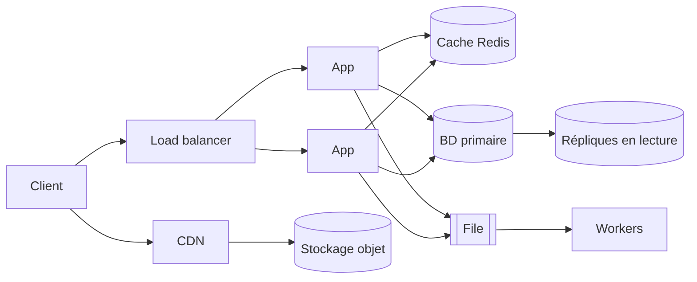
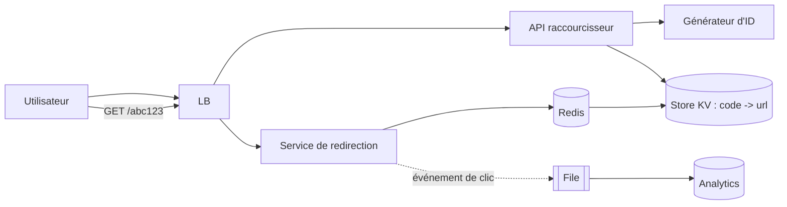
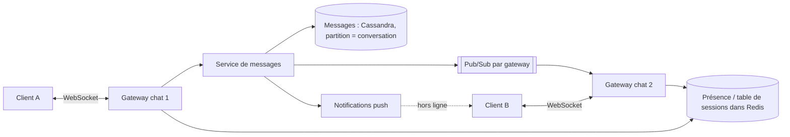
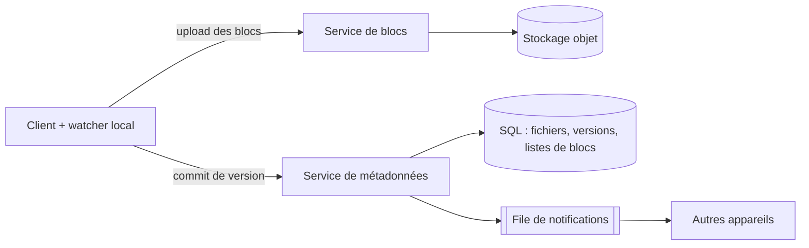
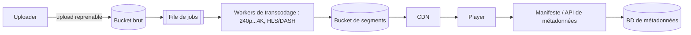
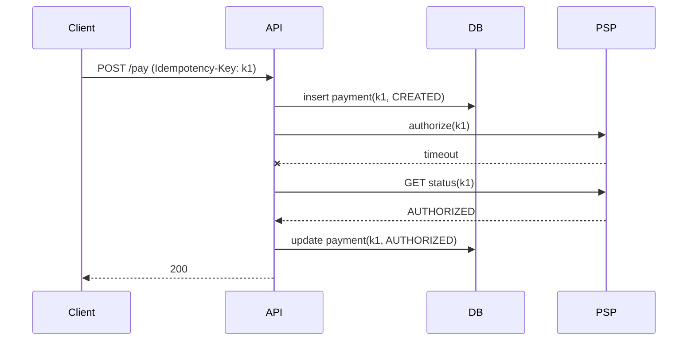
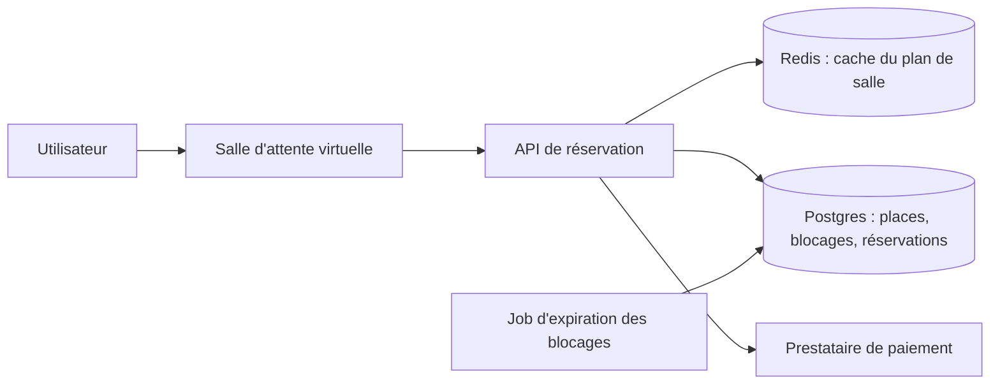
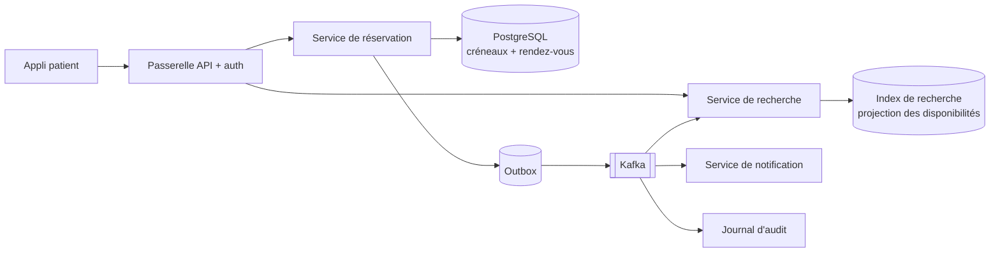
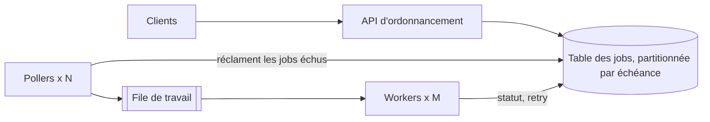

# System Design

> Méthode d'entretien, ordres de grandeur, briques de base, cohérence, scaling, fiabilité, sécurité, conceptions complètes et scénarios d'incident. Les sujets humains et d'équipe sont dans [Leadership](leadership-behavioral.md).

## 🟢 Fondamentaux

### Méthode

#### Q1. Quelles étapes suivez-vous dans un entretien de system design, et comment répartissez-vous les 45 minutes ?

Exigences → estimation → API → modèle de données → conception haut niveau → approfondissement → goulots
d'étranglement et compromis. En gros : 5 min pour clarifier les exigences fonctionnelles et non fonctionnelles
(échelle, latence, cohérence, disponibilité), 5 min de calculs d'ordre de grandeur, 5 min d'API et de modèle de données,
10 min de boîtes et flèches haut niveau, 15 min d'approfondissement sur un ou deux composants qui intéressent
l'interviewer, 5 min sur les pannes, les goulots et la suite. Énoncez vos hypothèses à voix haute (« je suppose 100 M
d'utilisateurs actifs par jour, lecture 100:1 ») pour que l'interviewer corrige tôt, et menez la discussion : il s'agit
de montrer une méthode, pas de réciter une architecture apprise par cœur.

Exemple (conception d'un fil d'actualité, 10 premières minutes) :

```text
Clarify:  "100M DAU, read-heavy 100:1, p99 < 300 ms, a few seconds of staleness OK?"   <- exigences non fonctionnelles d'abord
Numbers:  100M x 10 views/day = 10^9/day ~ 12k req/s avg, ~50k peak   <- les chiffres décident cache/sharding
API:      GET /feed?cursor=...&limit=20      POST /posts   <- pagination par curseur (Q11)
Data:     posts(id, author, body, ts), follows(follower, followee)   <- puis boîtes et flèches (Q3), puis approfondissement
```

#### Q2. Quels ordres de grandeur faut-il connaître par cœur ?

Il faut des ordres de grandeur, pas de la précision.

| Grandeur                          | Valeur                                  |
|-----------------------------------|-----------------------------------------|
| Secondes par jour                 | ~86 400 (≈ 10⁵)                         |
| 1 M de requêtes/jour              | ≈ 12 req/s en moyenne                   |
| Facteur de pic                    | 2 à 10× la moyenne                      |
| Lecture RAM                       | ~100 ns                                 |
| Lecture aléatoire SSD             | ~100 µs                                 |
| Aller-retour même datacenter      | ~0,5 ms                                 |
| Aller-retour intercontinental     | ~100–150 ms                             |
| Un nœud Postgres                  | ~1–10k requêtes simples/s, ~To de données |
| Un nœud Redis                     | ~100k ops/s                             |
| Serveur d'appli stateless typique | ~1–5k req/s                             |
| Enregistrement texte / image / vidéo (min.) | ~1 Ko / ~200 Ko / ~50 Mo      |

**Exemple :** 100 M d'utilisateurs actifs × 10 lectures/jour = 10⁹ lectures/jour ≈ 12k lectures/s en moyenne, ~50k en
pointe → quelques dizaines de serveurs d'appli plus un cache ; 100 M × 1 post/jour × 1 Ko ≈ 100 Go/jour ≈ 36 To/an de
texte seul → il faut du sharding ou du stockage objet.

#### Q3. Un serveur unique manque de CPU et de RAM. Décrivez l'évolution de l'architecture.

Chaque étape résout le seul goulot réellement observé : (1) **scaling vertical** d'abord — le moins cher, avec un
plafond ; (2) **load balancer + N serveurs d'appli stateless** — les sessions doivent être externalisées ; (3) la base
devient le goulot → **cache** des lectures chaudes (Redis) et **répliques en lecture** ; (4) fichiers statiques et médias
vers **stockage objet (S3) + CDN** ; (5) le travail lent ou en rafale part dans une **file + workers** ; (6) quand un
primaire unique ne tient plus les écritures → **partitionnement/sharding**. L'erreur à éviter : sauter à l'étape 6 dès le
premier jour.



#### Q4. Quelle est la différence entre la conception de haut niveau (HLD) et la conception de bas niveau (LLD) ?

La HLD est la vue d'ensemble — les grandes pièces du système (serveurs d'application, base de données, cache, file, CDN)
et la façon dont les requêtes circulent entre elles. Concevoir Instagram au niveau HLD revient à se demander : où va la requête
d'un utilisateur, où les données sont-elles stockées, que se passe-t-il quand le trafic augmente, qu'est-ce qui casse en premier et
comment ce composant est-il mis à l'échelle ou rendu résilient. La LLD zoome sur une fonctionnalité précise et pose les
questions au niveau de l'implémentation : pour une fonctionnalité « like » en particulier — que se passe-t-il quand l'utilisateur
appuie sur like, quelle fonction/quel service le traite, comment vérifie-t-on que l'utilisateur a déjà aimé
le post, comment le like est-il persisté, comment le compteur de likes est-il mis à jour sans compter deux fois
le même utilisateur. Un entretien (et un vrai design doc) passe généralement de la HLD à une analyse approfondie d'un
ou deux composants au niveau LLD, plutôt que de rester entièrement à un seul niveau du début à la fin.

**Exemple (bouton « like ») :** le HLD dit *où* vivent les likes (app → BDD → cache) ; le LLD décide de la mécanique exacte.

```sql
-- LLD : la clé primaire rend le double like impossible, le compteur ne bouge que sur un vrai insert
WITH ins AS (
  INSERT INTO likes (post_id, user_id) VALUES (:post, :user)
  ON CONFLICT DO NOTHING RETURNING 1
)
UPDATE posts SET like_count = like_count + 1
WHERE id = :post AND EXISTS (SELECT 1 FROM ins);
```

### Briques de base

#### Q5. Qu'est-ce qu'un load balancer, et quel problème précis résout-il ?

Quand un serveur unique manque de CPU/RAM pour absorber un trafic croissant, ajouter un autre serveur
n'aide que si les requêtes sont réellement réparties entre les deux — un load balancer se place devant
plusieurs serveurs et décide lequel traite chaque requête entrante (round-robin, least-
connections, ou des algorithmes plus sophistiqués), transformant « un serveur désormais surchargé » en
« N serveurs qui se partagent la charge », et retirant aussi de la rotation un serveur défaillant pour que le trafic ne
continue pas d'affluer vers quelque chose d'hors service. C'est le premier composant que la plupart des conceptions à mise à l'échelle horizontale
introduisent, car sans lui, ajouter des serveurs n'aide pas vraiment — rien n'y route le trafic.

**Exemple :**

```nginx
upstream app {
    least_conn;   # envoie vers l'instance ayant le moins de connexions actives
    server 10.0.1.11:8080 max_fails=3 fail_timeout=10s;   # 3 échecs -> retirée de la rotation pendant 10 s
    server 10.0.1.12:8080 max_fails=3 fail_timeout=10s;
}
server { listen 80; location / { proxy_pass http://app; } }
```

#### Q6. Que signifie pour un service d'être stateless, et pourquoi est-ce important pour la mise à l'échelle et la résilience ?

Un service stateless ne conserve aucun état propre à une requête ou à un utilisateur **dans sa mémoire ou sur son disque local entre
les requêtes** : tout ce qui est nécessaire pour traiter une requête arrive avec elle (paramètres, un token) ou est récupéré depuis un store externe (une
base de données, un cache comme Redis, un stockage objet). N'importe quelle instance peut alors servir n'importe quelle requête, donc un load balancer peut répartir le trafic en
simple round-robin (Q5) — sans sticky sessions — et l'on peut ajouter des instances pour scale out, remplacer une instance plantée sans
perdre les données de personne, déployer avec des rolling updates et faire de l'autoscaling à la hausse comme à la baisse librement. L'état ne disparaît pas ; il migre vers la
couche conçue pour le conserver, là où la réplication, les sauvegardes et la cohérence sont gérées délibérément. Endroits typiques
où le statefulness s'infiltre : les sessions HTTP stockées dans la mémoire du serveur d'application (les déplacer vers un session store partagé ou utiliser un token signé), les fichiers écrits sur le disque
local (utiliser un stockage objet), les caches in-process qui diffèrent d'une instance à l'autre (l'accepter, ou utiliser un cache partagé), les jobs planifiés qui s'exécutent sur chaque réplique (les exécuter sous verrou ou via un leader, Q30) et les connexions WebSocket, intrinsèquement stateful et qui nécessitent un backplane pub/sub partagé pour router les messages vers la bonne instance.
Le statelessness est une propriété à préserver partout où c'est peu coûteux, pas un absolu : les caches, les connection pools et l'état préchauffé sont acceptables tant que leur perte ne coûte que de la performance,
jamais de la correction.

**Exemple :**

```text
Stateful:   POST /login  -> session kept in app-1's memory
            next request lands on app-2 -> 401, user logged out   <- sticky sessions nécessaires, un crash perd toutes les sessions
Stateless:  POST /login  -> signed JWT (or session id stored in Redis)
            any instance validates it -> kill app-1 at any time, nobody notices
```

#### Q7. Qu'est-ce que le caching, et quelle est l'idée de base de l'invalidation du cache ?

Le caching conserve une copie de données fréquemment demandées ou coûteuses à calculer dans une couche
d'accès plus rapide (en mémoire, plus proche du client) pour que les requêtes répétées sur les mêmes données ne répètent pas
à chaque fois le travail sous-jacent coûteux (une requête lente, un calcul lourd, un appel réseau).
L'invalidation en est la moitié la plus difficile : dès que des données en cache sont servies à la place de la source de vérité, le
cache doit être mis à jour ou expiré quand les données sous-jacentes changent, sinon les clients reçoivent des données périmées
indéfiniment — les stratégies de base (expiration par TTL, invalidation explicite à l'écriture, et les
patterns de lecture/écriture de la Q26) existent toutes parce que « on le met en cache et on l'oublie » sacrifie silencieusement
la correction au profit de la vitesse tant que l'invalidation n'est pas délibérément conçue.

**Exemple :**

```text
SET product:42 '{"price":19.9}' EX 300   # en cache 5 min : le TTL borne l'obsolescence
GET product:42   # hit : aucune requête BDD
-- price changes in the DB (source of truth)
DEL product:42   # invalidation explicite à l'écriture ; la lecture suivante recharge
```

#### Q8. Comment choisit-on entre une base relationnelle (SQL) et un store NoSQL lors de la conception d'un système ?

Partir des **patterns d'accès et des besoins de cohérence**, pas de l'effet de mode. Une base relationnelle est le choix par défaut pour
les données avec relations et invariants — commandes, paiements, inventaire — car elle offre des transactions ACID,
des contraintes, des jointures et des requêtes ad hoc que l'on n'avait pas prévues, et PostgreSQL moderne gère une très grande
échelle avec un primaire et des réplicas (Q23, Q20). NoSQL est une famille, et chaque type répond à une pression précise : un store
**clé-valeur/document** (DynamoDB, MongoDB, Redis) pour des lookups simples par clé à très grande échelle et une latence
prévisible, avec un schéma flexible ; un store **wide-column** (Cassandra) pour un très haut débit d'écriture sur plusieurs régions avec
une cohérence ajustable ; un **moteur de recherche** (Elasticsearch/OpenSearch) pour la recherche plein texte et à facettes ; un store **graphe** pour des données
fortement connectées ; un store **time-series** pour les métriques. Ce à quoi l'on renonce, c'est généralement la possibilité d'interroger autrement
que par le chemin d'accès prévu, les transactions multi-lignes et l'intégrité référentielle, et il faut modéliser les données *autour des
requêtes* (dénormaliser, dupliquer) et gérer soi-même l'incohérence qui en résulte. Une réponse pragmatique : commencer avec une base
relationnelle comme système de référence, ajouter un store spécialisé (un cache, un index de recherche, une base time-series) comme copie *dérivée* quand une exigence
mesurée l'impose, et ne choisir un NoSQL comme base principale que lorsqu'on peut nommer la raison précise — un volume d'écriture ou une taille de données qu'un
seul cluster relationnel ne peut pas porter, un pattern d'accès par clé qui n'aura jamais besoin de jointures, ou des écritures multi-régions globales. « Schema-less » n'est pas
un avantage en soi : le schéma existe toujours, dans le code de l'application, et c'est désormais là qu'on le fait respecter.

**Exemple :**

```text
orders, payments, inventory     -> PostgreSQL (ACID, FK, joins, ad-hoc reports)
session by token, rate counters -> Redis (key lookup, sub-ms)
product search with facets      -> Elasticsearch (derived copy of the SQL data)
10M writes/s of device events   -> Cassandra / DynamoDB (partition key = device_id)   <- seulement ici on renonce aux jointures et aux transactions
```

#### Q9. Quand place-t-on une file de messages dans une conception, et qu'apporte-t-elle ?

Quand le producteur ne doit pas attendre le consommateur : **découplage** (l'émetteur fonctionne même si le récepteur est
en panne), **lissage de charge** (un pic devient un backlog plutôt qu'une panne), **retry et fan-out** (plusieurs
consommateurs, dead-letter queue pour les messages empoisonnés). Le prix : cohérence à terme, questions d'ordre et de
doublons (at-least-once ⇒ consommateurs idempotents) et un composant de plus à exploiter. Une file convient aux e-mails,
miniatures, indexation, analytics ; on n'y cache pas une réponse synchrone attendue par l'utilisateur.

**Exemple :**

```text
POST /signup -> INSERT user -> publish user.created -> 201 (fast)
consumers: welcome-email | analytics | search-index (independent, each retries then DLQ)
spike: 5k msg/s in, workers do 1k/s -> backlog grows 4k/s during the spike, drains after;
without the queue the same spike hits the email provider directly and times out.
```

#### Q10. Comment une fonction de recherche s'intègre-t-elle ? Pourquoi pas simplement `LIKE '%terme%'` sur la base principale ?

Un `LIKE` avec joker en tête ne peut pas utiliser un index B-tree et parcourt toute la table. La recherche demande un
**index inversé** (terme → identifiants de documents, avec classement type BM25, stemming, tolérance aux fautes), ce
que fournissent Elasticsearch/OpenSearch ou le full-text de Postgres. L'index est une **copie dérivée** : la base SQL reste
la source de vérité et les changements alimentent l'index via un pipeline outbox/CDC ; il est donc cohérent à terme et
toujours reconstructible. Commencez par `tsvector` de Postgres si les données sont petites ; passez à un moteur dédié
quand le réglage de pertinence, les facettes ou le volume l'exigent.

**Exemple :**

```sql
-- scans the whole table: a leading wildcard cannot use a B-tree index
SELECT id FROM products WHERE title LIKE '%laptop%';

-- Postgres full-text: inverted index (GIN) + ranking
ALTER TABLE products ADD COLUMN tsv tsvector GENERATED ALWAYS AS
  (to_tsvector('english', title || ' ' || coalesce(description, ''))) STORED;
CREATE INDEX ON products USING gin (tsv);
SELECT id FROM products WHERE tsv @@ plainto_tsquery('english', 'laptop bag')
ORDER BY ts_rank(tsv, plainto_tsquery('english', 'laptop bag')) DESC LIMIT 20;
```

#### Q11. REST, gRPC ou GraphQL — comment choisir, et comment paginer une grande liste ?

REST pour les API publiques, cacheables, orientées ressources ; gRPC pour les appels internes service-à-service
(binaire, schéma d'abord, streaming, faible latence) ; GraphQL quand de nombreux clients façonnent leur propre payload et
que vous acceptez le coût de limitation de complexité des requêtes et un cache plus difficile. Pour les listes,
préférez la **pagination par curseur (keyset)** (`WHERE id < :last ORDER BY id DESC LIMIT 20`) à `OFFSET` : l'offset est
en O(n) sur les pages profondes et saute ou répète des lignes quand les données changent entre deux requêtes.

**Exemple :**

```text
GET /posts?limit=2            -> {"items":[{"id":98},{"id":97}], "next_cursor":"97"}
GET /posts?limit=2&cursor=97  -> SELECT ... WHERE id < 97 ORDER BY id DESC LIMIT 2   -- recherche d'index, même coût page 1 ou page 10 000
                                 (a post inserted meanwhile does not shift the pages)
```

*Voir aussi :* [Persistence Q11](persistence-sql-postgres.md) pour la dégradation de `OFFSET` et le fonctionnement de la pagination keyset en SQL.

## 🟡 Pièges seniors

### Compromis

#### Q12. Expliquez le théorème CAP avec un exemple concret — pourquoi un système distribué ne peut-il pas avoir les trois ?

**Réponse :** CAP énonce que pendant une partition réseau (P — une défaillance de communication entre
des nœuds, qui dans tout système distribué réel *finira* par arriver), un système doit choisir
entre Consistency (chaque lecture voit l'écriture la plus récente, ou une erreur) et Availability (chaque
requête reçoit une réponse, même si elle ne reflète pas forcément la dernière écriture) — on ne peut pas avoir les deux
pendant la partition, bien qu'on puisse avoir l'une des deux plus la tolérance au partitionnement. Un système CP (p. ex.
un store de configuration fortement cohérent comme ZooKeeper/etcd) refuse de servir une lecture/écriture du côté
minoritaire plutôt que de risquer de renvoyer des données périmées ou conflictuelles — il sacrifie la disponibilité à la
cohérence. Un système AP (p. ex. Cassandra dans sa configuration typique, ou un service de panier d'achat)
continue de servir des requêtes des deux côtés pendant la partition, en acceptant que les deux côtés puissent
brièvement diverger, pour être réconciliés une fois la partition résorbée — il sacrifie la cohérence stricte à la
disponibilité. Le point de niveau senior : c'est un compromis délibéré, fait système par système selon le mode de
défaillance qui est réellement le pire pour ce cas d'usage précis (un grand livre bancaire penche CP ; un bouton « ajouter au panier »
penche AP), et non une réponse « correcte » universelle.

**Exemple :**

```text
Network link between region A and region B drops for 90 seconds.

CP system (etcd-style):
  region B (minority side) -> write request -> "unavailable: no quorum" (fails loudly)
  region A (majority side) -> keeps serving, single source of truth preserved

AP system (Cassandra-style, quorum relaxed to ONE):
  region A -> accepts writes locally
  region B -> also accepts writes locally
  partition heals -> both sides' writes get reconciled/merged, possibly with conflicts
```

**Pourquoi c'est un piège :** les candidats récitent « CAP signifie en choisir deux sur trois » comme une règle générale, mais
la tolérance au partitionnement n'est pas optionnelle dans un vrai système distribué — le choix réellement fait,
à chaque fois, est C contre A pendant la partition précisément, et une réponse senior nomme *quel mode de
défaillance précis* (une lecture périmée ou une requête rejetée) est le pire pour *ce* système, pas seulement le nom du
théorème.

#### Q13. CAP est cité dans chaque entretien — qu'ajoute PACELC ?

**Réponse :** CAP ne décrit que le comportement *pendant* une partition. PACELC ajoute le cas quotidien : en cas de
**P**artition, choisir **A** ou **C** ; **E**lse (fonctionnement normal), choisir **L**atence ou **C**ohérence. Répliquer
de façon synchrone vers une autre région donne la cohérence mais ajoute un aller-retour inter-région à chaque écriture ;
répliquer en asynchrone est rapide mais les lecteurs peuvent voir des données périmées. La plupart des décisions réelles
relèvent de la moitié « ELC », car les partitions sont rares alors que la latence se paie à chaque requête.

**Exemple :**

```text
DynamoDB (défaut)    : PA/EL  -> disponible en partition, faible latence, lectures cohérentes à terme
Spanner / CockroachDB: PC/EC  -> toujours cohérent, paie commit-wait / latence inter-région
```

**Pourquoi c'est un piège :** les candidats étiquettent une base « CP » ou « AP » comme si c'était figé ; la plupart des
systèmes permettent de régler cela par opération (lectures quorum, lectures fortement cohérentes), et la réponse senior
nomme le coût en latence de chaque choix.

#### Q14. Fan-out à l'écriture ou à la lecture pour un fil d'actualité — et que casse l'échelle « célébrité » ?

**Réponse :** Le *fan-out à l'écriture* (push) précalcule la timeline de chaque abonné à la création d'un post : la
lecture est un seul accès cache, mais un utilisateur avec 50 M d'abonnés provoque 50 M d'écritures. Le *fan-out à la
lecture* (pull) fusionne les posts des comptes suivis à la requête : écritures peu chères, lectures coûteuses et lentes.
La production utilise un **hybride** : push pour les utilisateurs normaux, pull pour les célébrités, fusionnés à la lecture.

**Exemple :**

```text
read(timeline):
  ids = redis.lrange("tl:" + user, 0, 100)            # posts poussés
  ids += recent_posts(celebrities_followed(user))      # tirés à la lecture
  return hydrate(sort_by_rank(ids))[:20]
```

**Pourquoi c'est un piège :** choisir le push pur « parce que la lecture domine » ignore l'amplification d'écriture des
comptes très suivis et des utilisateurs inactifs — on paie pour construire des timelines que personne ne lit.

#### Q15. Comparez les algorithmes de rate limiting. Lequel choisir et où stocker les compteurs ?

**Réponse :** La *fenêtre fixe* est la plus simple mais autorise des rafales ×2 à la frontière de fenêtre. Le *journal de
fenêtre glissante* est exact mais stocke chaque horodatage. Le *compteur de fenêtre glissante* approxime avec deux
compteurs — peu coûteux et suffisant. Le *token bucket* autorise des rafales contrôlées et est utilisé par la plupart des
gateways ; le *leaky bucket* lisse la sortie à un débit constant. Les compteurs vivent dans Redis, mis à jour
**atomiquement** (script Lua ou `INCR` + `EXPIRE`), avec pour clé utilisateur/clé d'API/IP.

**Exemple :**

```text
-- token bucket dans Redis (Lua, atomique)
tokens = min(capacity, tokens + (now - last) * refill_rate)
if tokens >= 1 then tokens = tokens - 1; allow else reject(429, Retry-After) end
```

**Pourquoi c'est un piège :** un read-then-write depuis le serveur d'appli subit des races en concurrence, et un Redis
central sur le chemin critique devient un point unique de défaillance — décidez si le limiteur **échoue ouvert**
(disponibilité) ou **fermé** (protection) quand Redis est down.

#### Q16. Comment mettre à jour la base *et* publier un événement sans perdre l'un des deux ?

**Réponse :** Traité dans [Messaging Q27](messaging-rabbitmq-kafka.md) (outbox transactionnel) et [Messaging Q31](messaging-rabbitmq-kafka.md) (double écriture vs outbox par polling vs CDC).
En bref : écrire la ligne métier et une ligne `outbox` dans la même transaction locale, laisser un relais publier en at-least-once, et rendre les consommateurs idempotents.

#### Q17. Comment invalider une entrée de cache, et quelle race se cache derrière l'invalidation à l'écriture ?

**Réponse :** (1) **TTL seul** — simple, péremption bornée ; (2) **invalider à l'écriture** (supprimer la clé après le
commit en base) — plus frais, mais une race entre un lecteur qui remplit l'ancienne valeur et la suppression peut laisser
une donnée périmée jusqu'au TTL ; (3) **invalidation pilotée par événements** via CDC ; (4) **clés versionnées**
(`user:42:v17`) — on n'invalide jamais, on lit une nouvelle clé. Gardez toujours un TTL comme filet de sécurité.

**Exemple :**

```text
T1 lecteur : cache miss, lit la BD (ancienne valeur)
T2 écrivain : met à jour la BD, supprime la clé du cache
T1 lecteur : écrit l'ANCIENNE valeur dans le cache   <- périmé jusqu'au TTL
```

**Pourquoi c'est un piège :** « mettre à jour le cache à l'écriture » a la même race plus des problèmes d'ordre ;
supprimer est plus sûr que mettre à jour, et aucun des deux ne remplace un TTL.

#### Q18. Pourquoi ne pas utiliser partout des auto-increments ou des UUID aléatoires dans un système distribué ?

**Réponse :** Le choix de clé primaire (`bigint` vs UUIDv4 vs UUIDv7) est traité dans [Persistence Q40](persistence-sql-postgres.md) ; le générateur distribué (Snowflake, ULID, dérive d'horloge) est traité dans Q40.
En bref : l'auto-incrément exige un coordinateur et révèle les volumes, et les UUID aléatoires dispersent les insertions dans le B-tree. Préférer des identifiants ordonnés dans le temps.

### Cohérence & réplication

#### Q19. Donnez un exemple concret et pratique où l'on choisit la cohérence à terme plutôt que la cohérence forte, et expliquez pourquoi c'est le bon choix dans ce cas.

**Réponse :** Un « nombre de likes » ou « nombre d'abonnés » sur un réseau social est le cas d'école : afficher un compteur
périmé de quelques secondes est tout à fait acceptable pour les utilisateurs, et l'alternative — une cohérence forte,
exigeant une lecture/écriture coordonnée sur chaque réplique pour chaque like — ajouterait une vraie latence et réduirait la disponibilité pour une donnée dont la péremption n'a
pratiquement aucun coût dans le monde réel. À l'inverse d'un solde de compte ou d'un stock au moment du paiement, où la même
péremption pourrait signifier une double dépense ou une survente d'un article en stock limité — ces opérations
justifient le coût en latence/disponibilité d'une cohérence plus forte (ou au minimum une vérification de cohérence
au moment exact de la transaction) précisément parce que le coût d'une erreur y est réel
et immédiat, contrairement à un compteur de likes.

**Exemple :**

```text
Like count:       read from any replica, cached, off by a few -> nobody notices
Checkout balance:  read must reflect the latest committed write, or two concurrent
                    checkouts can both succeed against the same last unit of stock
```

**Pourquoi c'est un piège :** « cohérence à terme partout pour l'échelle » et « cohérence forte
partout par sécurité » sont tous deux de mauvais choix par défaut — la réponse senior choisit par type de donnée selon
le coût réel de la péremption pour ce champ précis, pas une politique uniforme pour tout le système.

#### Q20. Quelle est la différence entre la réplication de base de données synchrone et asynchrone, et que sacrifie chacune ?

**Réponse :** La réplication synchrone attend que la ou les répliques confirment avoir reçu et
appliqué une écriture avant de l'acquitter auprès du client — elle garantit que la réplique n'est jamais en retard sur le
primaire, au prix d'une latence d'écriture accrue (bornée par la réplique la plus lente) et d'une disponibilité réduite
(si la réplique est injoignable, l'écriture se bloque-t-elle ou échoue-t-elle ?). La réplication asynchrone
acquitte l'écriture dès que le primaire l'a, sans attendre les répliques — latence d'écriture plus faible, meilleure disponibilité, mais elle introduit
un replication lag : une réplique peut être sensiblement
en retard sur le primaire, et un failover vers cette réplique après la mort du primaire peut perdre les écritures les plus
récentes, non encore répliquées. La plupart des systèmes à grande échelle choisissent l'async par défaut pour le
bénéfice en latence/disponibilité, en acceptant le lag comme un compromis connu et surveillé, et réservent
la réplication synchrone aux données pour lesquelles perdre ne serait-ce que quelques secondes d'écritures récentes lors d'un
failover est réellement inacceptable.

**Exemple :**

```text
Sync:  client -> primary -> [wait for replica ack] -> ack to client   (higher latency, no lag)
Async: client -> primary -> ack to client -> (replica catches up later)  (lower latency, lag window)

Primary fails during the lag window -> failover promotes the replica ->
any write the replica hadn't yet applied is gone.
```

**Pourquoi c'est un piège :** les candidats présentent souvent la réplication async comme strictement pire (« on peut perdre
des données ! ») sans nommer ce qu'elle apporte en échange — le piège fonctionne aussi dans l'autre sens : tout mettre
en synchrone « par sécurité » impose discrètement un coût de latence et de disponibilité à des données
qui n'avaient jamais besoin de cette garantie (voir Q19).

#### Q21. Pourquoi read-your-own-writes se brise-t-il sous réplication asynchrone, et comment le corriger pour les données qui en ont besoin ?

**Réponse :** Avec la réplication async (Q20), une écriture atterrit sur le primaire et est acquittée avant que
chaque réplique l'ait appliquée. Si la requête suivante du *même utilisateur* est une lecture routée vers une
réplique en retard — une configuration courante, puisque les lectures sont généralement réparties entre les répliques pour
le débit — elle peut renvoyer l'état d'avant l'écriture, donnant l'impression que l'action de l'utilisateur n'a pas
pris effet. C'est un bug réellement déroutant pour l'utilisateur (« je viens de sauvegarder, où est-ce passé ? »),
distinct d'un autre utilisateur qui voit des données périmées, ce qui est généralement tolérable. Correctifs : router les
lectures d'un utilisateur vers le primaire (ou une réplique connue comme à jour) pendant une courte fenêtre juste après
sa propre écriture ; passer un token/timestamp « read-your-own-writes » que le chemin de lecture compare au lag de la
réplique avant de répondre depuis une réplique ; ou, pour les champs concernés, faire afficher par le client
de façon optimiste ce qu'il vient d'écrire plutôt que de re-fetcher immédiatement.

**Exemple :**

```text
t=0.00  user PATCHes /profile {bio: "new bio"} -> primary commits, acks -> client shows "saved"
t=0.05  client re-fetches /profile to confirm -> load balancer routes to replica-3
t=0.05  replica-3 hasn't applied the write yet -> returns bio: "old bio"
        user sees their own save appear to have been silently reverted
```

**Pourquoi c'est un piège :** on le confond facilement avec le « la cohérence à terme suffit pour les
données à faible enjeu » de la Q19 — mais l'enjeu ici ne tient pas à l'importance de la donnée, il tient à *qui* lit :
une péremption vue par un autre utilisateur est généralement invisible et acceptable, alors qu'une péremption vue par
l'*auteur* juste après sa propre écriture passe pour une fonctionnalité cassée.

#### Q22. Two-phase commit vs sagas — comment garde-t-on des données cohérentes entre plusieurs services sans base de données partagée ?

**Réponse :** Le **two-phase commit (2PC)** coordonne une transaction atomique unique sur plusieurs ressources : un coordinateur demande à chaque participant de
*prepare* (voter oui, en conservant les verrous), et ce n'est que si tous votent oui qu'il leur dit de *commit*. Il donne une forte atomicité mais à un
prix : les participants conservent des verrous pendant le protocole, donc le débit et la disponibilité chutent ; le coordinateur est un point unique dont la défaillance entre les phases laisse
les participants **bloqués dans le doute** ; et il exige que chaque participant le supporte (XA), ce que la plupart des message brokers, API SaaS et stores NoSQL ne font pas.
Une **saga** remplace une transaction distribuée par une séquence de transactions locales, chacune publiant un événement ou une commande qui déclenche la suivante ; si une
étape échoue, les étapes déjà terminées sont défaites par des **actions compensatoires** (rembourser le paiement, libérer le stock réservé) plutôt que rollbackées. Elle peut être
**chorégraphiée** (les services réagissent aux événements des autres — simple pour peu d'étapes, difficile à suivre quand ça grossit) ou **orchestrée** (un coordinateur détient l'état du workflow — plus facile à
raisonner, superviser et soumettre à des timeouts). Les conséquences à prévoir : les sagas sont **à cohérence à terme**, avec des états intermédiaires visibles par d'autres requêtes (une commande « pending » pendant un moment) ; les compensations doivent être
**idempotentes** et peuvent elles-mêmes échouer (retry, puis alerter un humain) ; certaines actions ne peuvent pas être annulées (un email envoyé, un colis expédié), donc ordonner les étapes pour placer les
irréversibles en dernier ; et chaque étape et son événement doivent être publiés de façon fiable avec un outbox (Q16) pour qu'un crash entre « write » et « publish » ne bloque pas la saga. En pratique : préférer éviter la
transaction distribuée en gardant les données fortement couplées dans un seul service (Q32), utiliser des sagas pour les vrais processus métier inter-services, et n'utiliser le 2PC qu'au sein d'une seule
plateforme de confiance où tous les participants le supportent et où la latence est acceptable.

**Exemple :**

```text
Order saga (orchestrated):
  1. Orders:    create order PENDING                  compensation: mark CANCELLED
  2. Payments:  charge card                            compensation: refund
  3. Inventory: reserve stock                          compensation: release stock
  4. Shipping:  create shipment (irreversible - last)  compensation: n/a
  step 3 fails  ->  refund (2), cancel order (1); each compensation is idempotent and retried
```

**Pourquoi c'est un piège :** les candidats répondent « on utilise des transactions distribuées » (un problème de disponibilité) ou « on utilise une saga » sans mentionner l'échec des compensations, l'idempotence, la visibilité des états
intermédiaires ni l'outbox — et les affirmations « exactly-once » entre services cachent presque toujours du *at-least-once delivery plus traitement idempotent* (Q9, Q28).

*Voir aussi :* [Messaging Q26](messaging-rabbitmq-kafka.md) (orchestration vs chorégraphie) et [Messaging Q30](messaging-rabbitmq-kafka.md) (une saga détaillée).

### Scaling & caching

#### Q23. Mise à l'échelle horizontale vs verticale — quel est le vrai compromis ?

**Réponse :** La mise à l'échelle verticale (une machine plus grosse — plus de CPU/RAM sur le même nœud) est plus simple (pas de
complexité de systèmes distribués, pas de partitionnement de données à raisonner) mais a un plafond dur
(il existe une plus grosse machine achetable) et un point unique de défaillance. La mise à l'échelle horizontale (plus de
machines) n'a pas de plafond pratique et améliore la tolérance aux pannes, mais introduit une vraie complexité :
load balancing, cohérence des données entre nœuds, latence réseau entre des composants qui étaient auparavant des appels
in-process, et surcharge opérationnelle. La réponse pratique à laquelle aboutissent la plupart des systèmes : monter
verticalement aussi loin que c'est raisonnable pour la simplicité, et recourir à l'horizontal quand
le plafond du vertical ou le risque de point unique de défaillance devient la contrainte réelle, pas par défaut
dès le premier jour pour un système qui n'en a pas encore besoin.

**Exemple :**

```text
Vertical: db.small -> db.large -> db.2xlarge -> db.8xlarge -> ... -> biggest instance money buys
          one machine, one failure domain, zero coordination code

Horizontal: 1 node -> 3 nodes -> 20 nodes -> ...
          needs: a load balancer, a partitioning/sharding scheme, replica consistency,
          and monitoring for N failure domains instead of one
```

**Pourquoi c'est un piège :** « il suffit de scaler horizontalement, c'est plus moderne » est la réponse naïve — un candidat
senior nomme la complexité réelle qu'achète la mise à l'échelle horizontale (partitionnement, cohérence, surcharge
opérationnelle) au lieu de la traiter comme une mise à niveau gratuite, et sait dire clairement quand la mise à l'échelle verticale reste
le bon choix.

#### Q24. Comment choisit-on une clé de sharding de base de données, et que se passe-t-il avec un mauvais choix ?

**Réponse :** Une clé de sharding détermine sur quel shard physique vit une ligne donnée (généralement via un hash
de la clé, ou un partitionnement par plage sur celle-ci) — l'objectif est de répartir à la fois le volume de données et, surtout,
la *charge de requêtes/écritures* uniformément entre les shards. Un mauvais choix crée un « hot shard » : choisir
une clé à faible cardinalité (p. ex. sharder par `country` alors que 80 % des utilisateurs sont dans un seul pays) ou une clé
corrélée à un biais du pattern d'accès (un petit nombre de comptes générant une part disproportionnée
de toute l'activité) place l'essentiel de la charge réelle sur un seul shard, peu importe l'uniformité de la répartition du
*stockage*. Corriger une mauvaise clé de sharding après coup (re-sharder un système en production avec des
données déjà inégalement réparties) est l'une des migrations les plus pénibles sur le plan opérationnel dans les
systèmes distribués, ce qui explique précisément pourquoi le choix mérite un vrai examen avant que le système ne soit
construit autour.

**Exemple :**

```text
Sharded by `country`: 4 shards, one per region
  shard(US) -> 80% of all users and all traffic  <- hot shard
  shard(NZ), shard(IS), shard(LU) -> nearly idle

Cluster-wide CPU on the main dashboard reads "35% utilized" while shard(US) sits at 95%.
```

**Pourquoi c'est un piège :** les métriques agrégées du cluster masquent complètement un hot shard — un candidat qui se contente de
vérifier « le cluster est-il en surcapacité » rate le symptôme réel en production, qui se manifeste par la dégradation de la latence d'un seul
shard alors que la moyenne sur toute la flotte a encore l'air saine.

#### Q25. Qu'est-ce que le consistent hashing, et pourquoi l'utilise-t-on pour les caches distribués et le sharding plutôt que le simple hashing modulo ?

**Réponse :** Le simple hashing modulo (`hash(key) % N` pour choisir un serveur parmi N) pose un grave problème
quand N change (un serveur est ajouté ou retiré) : le serveur assigné à presque toutes les clés change aussi,
parce que le modulo lui-même a changé — pour un cache distribué, cela signifie qu'un changement de nœud invalide
presque tout le cache d'un coup (un « cache stampede » qui frappe la base de données simultanément, S1 et S7).
Le consistent hashing place serveurs et clés sur un anneau conceptuel, et chaque clé appartient au
serveur suivant dans le sens horaire sur l'anneau — ajouter ou retirer un serveur ne remappe que les clés
tombant précisément entre lui et son voisin, laissant la grande majorité des assignations clé-serveur
inchangées.

**Exemple :**

```text
Modulo, N=4->5 servers:  hash(key) % 4  vs  hash(key) % 5  -> ~80% of keys remap

Consistent hashing, ring with a 5th server added:
  only the keys between the new server and its counter-clockwise neighbor move
  -> roughly 1/5 of keys remap, not 4/5
```

**Pourquoi c'est un piège :** les candidats savent généralement expliquer le problème du hashing modulo mais s'arrêtent avant le
mécanisme qui le corrige — « le consistent hashing aide » sans la mécanique d'anneau/voisin est un nom
sans explication, et la relance d'un intervieweur (« pourquoi seul ce sous-ensemble bouge-t-il ? ») expose
immédiatement la lacune.

#### Q26. Cache-aside, write-through ou write-behind — comment choisir une stratégie d'écriture de cache ?

**Réponse :** **Cache-aside** (lazy loading) : l'application vérifie d'abord le cache, et en cas de miss,
lit dans la base de données et alimente le cache — simple, mais la première requête pour n'importe quelle clé est
toujours un miss lent, et il y a un vrai risque de servir des données périmées jusqu'à l'expiration du TTL ou une
invalidation explicite. **Write-through** : chaque écriture va au cache et à la base de données ensemble,
de façon synchrone — garde le cache toujours cohérent, au prix d'une latence d'écriture accrue et de la mise en cache de
données qui ne seront peut-être jamais lues. **Write-behind (write-back)** : les écritures vont au cache
immédiatement et sont vidées de façon asynchrone vers la base de données plus tard — écritures les plus rapides, mais risque de perte
de données si le cache tombe avant le flush. L'expiration par TTL est souvent superposée à n'importe laquelle d'entre elles
comme simple filet de sécurité, bornant l'âge que peuvent atteindre les données périmées même si l'invalidation explicite est oubliée.

**Exemple :**

```python
# Cache-aside
def get_user(id):
    if (u := cache.get(id)) is not None:
        return u
    u = db.query(id)
    cache.set(id, u, ttl=300)
    return u
```

**Pourquoi c'est un piège :** « il suffit d'ajouter un cache » sans nommer laquelle de ces trois stratégies, ni son
compromis précis en péremption/latence, est le véritable anti-pattern contre lequel met en garde la blague classique —
le signal en entretien est de choisir une stratégie délibérément selon le ratio lecture/écriture concerné,
et non de réciter les trois comme des choix par défaut équivalents.

#### Q27. Que résout réellement un CDN, et quand n'aide-t-il pas ?

**Réponse :** Un CDN met en cache du contenu sur des points de présence (edge) géographiquement proches des utilisateurs finaux, réduisant
la latence et déchargeant le serveur d'origine du trafic pour du contenu identique pour tous les utilisateurs.
Il est très efficace pour le contenu statique ou peu changeant (images, bundles JS/CSS, vidéo)
et, avec la bonne configuration de cache-control, même pour du contenu semi-dynamique identique
pour tous les utilisateurs pendant une courte fenêtre. Il n'aide *pas* pour du contenu réellement dynamique, par utilisateur et en temps
réel — le mettre en cache à l'edge sert soit des données périmées/erronées au mauvais utilisateur, soit exige une
clé de cache si granulaire qu'elle cesse complètement de fonctionner comme un cache partagé.

**Exemple :**

```text
Cache-Control: public, max-age=86400          # product image — great CDN hit rate
Cache-Control: private, no-store               # "your account balance" — must not be cached
Cache-Control: private, max-age=0, must-revalidate  # personalized feed — edge can't help here
```

**Pourquoi c'est un piège :** « mets un CDN devant » est proposé comme correctif de performance par défaut même pour
des endpoints intrinsèquement par utilisateur — le piège est de traiter le CDN comme de la vitesse gratuite au lieu de
vérifier d'abord si la réponse est réellement partageable entre les requêtes.

### Fiabilité

#### Q28. Quel est le piège de l'idempotency key quand un client retente une écriture après un timeout ?

**Réponse :** Un client envoie une écriture (p. ex. « passer commande »), le serveur la traite et commit, mais
la réponse est perdue en route ou le client expire avant qu'elle n'arrive — du point de vue du client,
le résultat de la requête est inconnu, donc un client naïf retente exactement la même requête.
Sans mécanisme explicite pour reconnaître « c'est la même requête logique, pas une nouvelle », le
retry exécute l'écriture une seconde fois — une deuxième commande, un deuxième prélèvement. Le correctif est une
idempotency key : le client génère une clé unique par opération logique (pas par tentative HTTP)
et l'envoie à chaque tentative ; le serveur persiste la clé avec le résultat de la première
exécution réussie et, en voyant une clé répétée, renvoie le résultat stocké au lieu de
ré-exécuter l'écriture. Cela doit être garanti par une contrainte d'unicité au niveau de la couche de stockage,
et pas seulement par une vérification en mémoire, sinon une course entre deux retries quasi simultanés peut encore laisser passer les deux.

**Exemple :**

```sql
POST /orders
Idempotency-Key: 7f3a9c21-...   <- same key on every retry of THIS logical request

Attempt 1: times out client-side after the server already committed the order
Attempt 2 (retry, same key): server finds the key already recorded -> returns the
                              original order's result, does NOT insert a new row

CREATE UNIQUE INDEX ON idempotency_keys (key);  -- the actual enforcement point
```

**Pourquoi c'est un piège :** « il suffit de retenter sur timeout, c'est plus sûr que de perdre la requête » est l'instinct —
vrai pour les lectures, faux pour les écritures sans idempotence, et un candidat qui dit « il suffit de retenter »
sans nommer le risque d'écriture en double n'a pas vraiment réfléchi à ce que « timeout » signifie : la
requête a très bien pu réussir côté serveur sans que le client ne l'ait jamais su.

#### Q29. Comment le backpressure et le load shedding maintiennent-ils un système surchargé en vie, et que se passe-t-il sans eux ?

**Réponse :** Tout système a un débit maximal ; quand le taux d'arrivée le dépasse, le travail s'accumule dans des files (thread pools, backlogs de connexions, files de messages), la **latence croît sans limite**, la mémoire se remplit, les timeouts se déclenchent, les clients retentent, et les retries ajoutent *encore plus* de
charge — un effondrement auto-renforcé dont le système ne peut souvent pas se relever même après la fin du pic initial (une « metastable failure » ; voir S14). Deux
mécanismes l'empêchent. Le **Backpressure** repousse la limite en amont : des files bornées qui bloquent ou rejettent quand elles sont pleines, un consommateur qui signale ce qu'il peut absorber
(demande des reactive streams, fenêtres TCP, modèle pull de Kafka), et un producteur qui ralentit. Le **Load shedding** rejette délibérément le surplus tôt et à peu de frais —
renvoyer `429`/`503` avec `Retry-After` immédiatement — pour que les requêtes acceptées soient servies vite ; prioriser par importance (health checks et clients payants avant le trafic batch) et rejeter
d'abord le *moins précieux*. Pratiques complémentaires : des **timeouts** sur chaque appel distant (plus courts que le timeout de l'appelant lui-même, une deadline propagée
en aval), des **retries avec backoff exponentiel et jitter** et un budget de retries, des **circuit breakers** pour cesser d'appeler une dépendance défaillante, des **bulkheads**
(pools séparés pour qu'une dépendance lente ne puisse pas consommer tous les threads), et l'autoscaling comme *complément* — il réagit en minutes, alors que la surcharge
arrive en secondes. Les files non bornées sont l'anti-pattern : elles transforment la surcharge en latence invisible puis finalement en crash out-of-memory.

**Exemple :**

```java
// Bounded work queue: when full, reject immediately instead of queueing forever.
ThreadPoolExecutor pool = new ThreadPoolExecutor(
    16, 16, 0, TimeUnit.SECONDS,
    new ArrayBlockingQueue<>(200),                    // bounded: at most 200 waiting
    new ThreadPoolExecutor.AbortPolicy());            // -> RejectedExecutionException

@PostMapping("/reports")
ResponseEntity<?> create(@RequestBody ReportRequest r) {
    try {
        pool.execute(() -> reports.generate(r));
        return ResponseEntity.accepted().build();
    } catch (RejectedExecutionException e) {
        return ResponseEntity.status(503).header("Retry-After", "5").build();   // shed load early
    }
}
```

**Pourquoi c'est un piège :** les équipes traitent la capacité comme « ajouter des serveurs » et laissent chaque file non bornée, si bien que le premier pic de trafic
ou la première dépendance lente se convertit en minutes de latence et en une panne qui dure plus longtemps que le déclencheur. Échouer vite sous surcharge paraît une
expérience utilisateur pire dans une démo, mais c'est ce qui garde le service disponible pour les requêtes qu'il peut servir.

#### Q30. Pourquoi un lock distribué (Redis `SET NX`, ZooKeeper, ligne de base de données) n'est-il pas aussi sûr qu'il en a l'air, et que sont les fencing tokens ?

**Réponse :** Un lock est censé garantir qu'un seul worker à la fois effectue une action sur une ressource. Dans un système distribué, le détenteur du lock
peut *se tromper en croyant le détenir encore* : le lock est acquis avec un **TTL** (pour qu'un détenteur planté ne bloque pas tout le monde indéfiniment), mais une longue pause GC, une VM bloquée ou un
réseau lent peuvent amener le détenteur à continuer à travailler après l'expiration du bail — alors qu'un second worker a acquis le lock et travaille aussi. Les deux
écrivent alors, et la garantie a silencieusement disparu. Le décalage d'horloge et le failover du service de lock lui-même (un primaire Redis qui plante avant de
répliquer la clé du lock) produisent le même effet. Vérifier « détiens-je encore le lock ? » juste avant d'écrire n'y remédie pas, car la pause peut survenir entre la vérification et l'écriture. Le
correctif robuste est un **fencing token** : le service de lock distribue un nombre strictement croissant à chaque attribution ; le worker envoie le token avec chaque écriture
vers la ressource protégée, et c'est la *ressource* qui rejette toute écriture portant un token inférieur à un token déjà vu. Cela déplace la garantie de correction du détenteur du lock (peu fiable)
vers la ressource (faisant autorité). Là où un fencing token n'est pas possible, concevoir l'action pour qu'elle soit **idempotente** (Q28) ou rendre l'écriture conditionnelle
(`UPDATE ... WHERE version = ?`, optimistic locking), ce qui est souvent une alternative plus simple à un lock. Utiliser les locks pour l'*efficacité* (éviter le travail en double) plutôt que pour la *correction*
sauf si l'on a du fencing ; pour une vraie exclusion mutuelle, préférer les verrous de ligne/contraintes d'unicité propres à la base de données, ou un système basé sur le consensus (etcd/ZooKeeper) avec fencing.

**Exemple :**

```text
worker A: acquires lock, token=33   ── long GC pause ──────────────► writes (token=33)  REJECTED
lock TTL expires
worker B: acquires lock, token=34 ──► writes (token=34) OK   (storage remembers max token = 34)

storage rule:  if request.token < max_seen_token: reject
```

```sql
-- Optimistic alternative: the write only succeeds if nobody changed the row meanwhile.
update accounts set balance = :new, version = version + 1
where id = :id and version = :expected_version;      -- 0 rows updated -> conflict, retry
```

**Pourquoi c'est un piège :** `SET key value NX PX 30000` dans un exemple de code ressemble à un mutex, et la défaillance
n'apparaît que lors de la rare pause ou du failover qui n'arrive jamais dans les tests — alors deux workers facturent deux fois un client ou corrompent un fichier. La défense consiste à cesser de
faire confiance à l'avis du détenteur du lock sur le lock.

#### Q31. Que signifient RTO et RPO dans la planification de la reprise après sinistre, et comment guident-ils les décisions d'architecture ?

**Réponse :** **RTO (Recovery Time Objective)** : combien de temps le système peut être indisponible avant que l'impact
métier ne devienne inacceptable — guide les décisions sur l'automatisation du failover et l'infrastructure de secours.
**RPO (Recovery Point Objective)** : quelle perte de données (mesurée en temps) est acceptable — guide
les décisions de réplication et de fréquence de sauvegarde. Les deux sont des décisions métier, pas purement techniques
— le travail d'un architecte est de traduire un RTO/RPO énoncé en mécanisme technique concret
qui l'atteint réellement, et de challenger si un objectif énoncé (p. ex. « zéro perte de données, zéro
interruption ») exigerait un coût ou une complexité disproportionnés par rapport au besoin métier réel qui le
motive.

**Exemple :**

```text
RTO = 5 min   -> needs automated failover to a hot standby, health checks, auto-promotion
RPO = 0       -> needs synchronous replication for the affected data (Q20), not async
RTO = 4 hours -> a documented manual runbook and a warm (not hot) standby is enough
```

**Pourquoi c'est un piège :** les candidats proposent parfois la configuration la plus robuste possible (multi-région
synchrone, tout automatisé) sans tenir compte des objectifs énoncés — sur-construire face à un
RTO/RPO plus souple que ce dont le métier a réellement besoin a son propre coût réel, ce n'est pas un choix par défaut sûr.

### Architecture & sécurité

#### Q32. Quand un monolithe est-il préférable aux microservices, et quel est le vrai coût de choisir les microservices trop tôt ?

**Réponse :** Un monolithe est le meilleur choix par défaut pour une petite équipe, un produit en phase initiale avec un
modèle de domaine évolutif/flou, ou un système où la surcharge opérationnelle des systèmes distribués
n'est pas encore justifiée par un besoin organisationnel ou de mise à l'échelle réel. Le coût réel des
microservices prématurés : découper un système selon des frontières qui s'avèrent fausses (les vraies frontières
du domaine n'étaient pas encore comprises) est bien plus coûteux à défaire à travers des frontières réseau et
des déploiements séparés que de refactorer les frontières de modules au sein d'une seule base de code — et une petite équipe porte désormais
aussi toute la charge opérationnelle d'un système distribué pour une échelle et une
structure organisationnelle qui n'en avaient pas encore besoin. Les microservices méritent leur coût précisément quand la propriété indépendante par
équipe, le déploiement indépendant et la mise à l'échelle indépendante deviennent de véritables contraintes, ressenties aujourd'hui.

**Exemple :**

```text
Year 1, 4-person team splits into "user-service", "order-service", "notification-service" —
the actual bounded contexts weren't known yet, so "order" needs "user" data on every
request: a chatty network call replaces what used to be one in-process join, and the team
now debugs 3 deployments instead of 1 for every feature.
```

**Pourquoi c'est un piège :** « les microservices sont le choix scalable/moderne » est proposé comme choix par défaut — une
réponse senior nomme la contrainte *précise*, ressentie aujourd'hui, qui justifie le découpage, et n'hésite pas
à dire qu'un monolithe est la bonne réponse pour une équipe qui n'a pas encore cette contrainte.

#### Q33. Que centralise une API Gateway, et pourquoi la placer devant une architecture de microservices ?

**Réponse :** Une API Gateway se place comme point d'entrée unique devant un ensemble de services backend,
centralisant des préoccupations qui devraient sinon être dupliquées dans chaque service individuel :
l'authentification/autorisation, le rate limiting, le routage des requêtes, la traduction de protocole, et souvent
l'agrégation de réponses. Le compromis : c'est un nouveau point unique qui, s'il tombe, peut couper
l'accès à chaque service derrière lui — ce qui explique pourquoi la disponibilité/redondance de la gateway est traitée avec
le même sérieux que tout autre composant réellement critique du chemin, et pourquoi la logique de la gateway elle-même
doit rester mince (routage et préoccupations transverses) plutôt que d'accumuler de la vraie
logique métier.

**Exemple :**

```text
client -> [API Gateway: authn, rate-limit, route] -> user-service
                                                    -> order-service
                                                    -> notification-service

Gateway goes down -> every service behind it becomes unreachable, even though each
individual service is still healthy on its own.
```

**Pourquoi c'est un piège :** les candidats proposent une gateway comme un pur avantage (l'auth en un seul endroit !) sans
nommer le SPOF qu'elle introduit — la relance à anticiper est « que se passe-t-il quand la gateway
elle-même tombe », ce qui explique précisément pourquoi la redondance de la gateway est traitée aussi sérieusement que les
services qu'elle protège.

#### Q34. Citez plusieurs risques de l'OWASP Top 10 et comment vous atténuez chacun au niveau de la conception du système.

**Réponse :** **Injection** (SQL, commande) : requêtes paramétrées/prepared statements, jamais
d'entrée concaténée sous forme de chaîne dans une requête. **Broken authentication** : politiques de mots de passe robustes, MFA,
gestion de session sécurisée, ne pas réinventer sa propre crypto/auth. **Sensitive data exposure** : chiffrer
les données en transit (TLS) et au repos, ne pas journaliser les champs sensibles, minimiser ce qui est collecté/conservé
dès le départ. **Broken access control** : appliquer l'autorisation côté serveur à chaque requête
(ne jamais se fier à une seule vérification côté client), deny par défaut plutôt qu'allow par défaut. **Security
misconfiguration** : pas d'identifiants par défaut, surface exposée minimale, dépendances patchées.
**Cross-site scripting (XSS)** : échapper/assainir toute entrée utilisateur restituée dans du HTML, utiliser l'
échappement intégré d'un framework plutôt qu'une interpolation de chaînes artisanale dans le markup.
**Insecure deserialization** : ne jamais désérialiser une entrée non fiable vers des types arbitraires sans
validation stricte. Le point au niveau conception du système : la sécurité est un ensemble de décisions de frontière
délibérées (où l'entrée est-elle validée, où la sortie est-elle échappée, où l'autorisation est-elle appliquée)
intégrées à l'architecture, et non une checklist appliquée après coup.

**Exemple :**

```java
// Injection — vulnerable:
String sql = "SELECT * FROM users WHERE email = '" + input + "'"; // attacker: ' OR '1'='1

// Fixed — parameterized, input is always data, never concatenated into the query text:
PreparedStatement ps = conn.prepareStatement("SELECT * FROM users WHERE email = ?");
ps.setString(1, input);
```

**Pourquoi c'est un piège :** les candidats énumèrent bien les risques mais les traitent comme une checklist à mentionner, pas comme des
frontières autour desquelles concevoir — la relance qui sépare vraiment une réponse senior est « où dans
l'architecture cela est-il appliqué, et un appelant peut-il contourner cette couche » (une vérification d'autorisation
uniquement côté client est la version la plus courante de cette lacune en pratique).

Voir aussi : le module [Sécurité](security.md) pour les détails au niveau du code (JWT, IDOR, SSRF, CSRF, supply chain).

## 🔴 Expert / Ouvert

### Exercices de conception

#### Q35. Concevez un raccourcisseur d'URL (bit.ly). Couvrez génération d'ID, stockage, redirections et échelle.

**Exigences :** créer un lien court, rediriger, alias personnalisé/expiration optionnels, analytics. Non fonctionnel :
redirection p99 < 50 ms, lecture:écriture 100:1, hautement disponible, liens jamais réutilisés.

**Estimation :** 100 M de nouveaux liens/mois ≈ 40 écritures/s ; 4 Md de redirections/mois ≈ 1,5k lectures/s en moyenne,
~15k en pointe. 500 o par enregistrement × 100 M × 12 × 5 ans ≈ 3 To — tient confortablement sur un store clé-valeur shardé.

**Conception :**



- **Génération du code :** une chaîne base62 de 7 caractères donne 62⁷ ≈ 3,5 billions de codes. Prenez un entier unique
  d'un service compteur qui alloue des plages (chaque serveur d'appli loue un bloc de 1 000 ids) et encodez-le en base62
  — pas de collisions, pas de race check-then-insert. Hasher l'URL (MD5 tronqué) impose de gérer les collisions.
- **Stockage :** accès clé-valeur par code uniquement → DynamoDB/Cassandra ou une table SQL shardée par code.
- **Redirection :** un `301` est mis en cache par les navigateurs (moins de charge, mais on perd les analytics de clics) ;
  un `302` vous sollicite à chaque fois. Mettez en cache les ~20 % chauds dans Redis (TTL long, les liens sont immuables).
- **Analytics :** jamais sur le chemin de redirection — émettre un événement dans une file, agréger en asynchrone.

**Compromis à citer :** les codes séquentiels sont énumérables (ajoutez une permutation Feistel si la confidentialité
compte) ; les alias personnalisés exigent une contrainte d'unicité ; l'abus/phishing demande un contrôle de réputation de
l'URL à la création.

#### Q36. Concevez un système de chat type WhatsApp ou Slack (1:1 et groupes, accusés de réception, utilisateurs hors ligne).

**Exigences :** envoi/réception en temps réel, historique, groupes, envoyé/délivré/lu, push vers les appareils hors
ligne. Non fonctionnel : faible latence, ordre par conversation, aucune perte de message.

**Conception :**



- **Connexions :** WebSockets longue durée sur des gateways quasi stateless ; une table Redis `user → gateway` indique au
  service de messages où livrer. Une gateway gère ~100k connexions, donc 50 M d'utilisateurs simultanés ≈ 500+ gateways.
- **Flux :** persister d'abord, puis router : écrire dans le store → publier vers la gateway du destinataire → ack à
  l'émetteur (`sent`) → ack du destinataire (`delivered`) → accusé de lecture. Les utilisateurs hors ligne reçoivent un
  push et récupèrent depuis le store à la reconnexion via `since=last_seen_id`.
- **Ordre et ids :** un numéro de séquence monotone par conversation (écrivain unique par partition de conversation) —
  pas l'heure murale. Les clients dédoublonnent par id de message car les retries sont at-least-once.
- **Groupes :** les petits groupes font un fan-out à l'écriture par membre ; les très gros canaux stockent une fois et
  laissent les membres lire.
- **Stockage :** lourd en écriture, append-only, accès par conversation + plage de temps → store wide-column partitionné
  par `conversation_id`, clusterisé par id de message.

**Compromis :** le chiffrement de bout en bout déplace la gestion des clés vers les clients et casse la recherche côté
serveur ; les mises à jour de présence sont bavardes — limitez et groupez-les.

#### Q37. Concevez un service de stockage et de synchronisation de fichiers (Dropbox / Google Drive).

**Idée centrale :** séparer les **métadonnées** (petites, transactionnelles, SQL) des **blocs** (gros, immuables, stockage objet).



- **Découpage :** découper les fichiers en blocs d'environ 4 Mo, hasher chacun (SHA-256). N'uploader que les blocs que le
  serveur n'a pas — d'où **sync delta**, **déduplication** entre versions et utilisateurs, et uploads reprenables.
- **Commit :** une version de fichier est une liste de hashes de blocs ; le commit de métadonnées est atomique et utilise
  un contrôle de version (concurrence optimiste) — en cas de conflit, garder les deux et créer une « copie en conflit ».
- **Sync :** les appareils gardent un canal long-poll/WebSocket vers le service de notifications, puis tirent les
  changements depuis leur dernier curseur.
- **Durabilité :** stockage objet avec réplication inter-AZ ou erasure coding ; ramasser les blocs non référencés avec un
  délai, car un bloc peut redevenir référencé par un upload concurrent.

**Compromis :** la déduplication entre utilisateurs révèle « ce fichier existe-t-il » sauf si limitée à un tenant ; des
blocs plus gros donnent moins de requêtes mais une moins bonne efficacité du delta.

#### Q38. Concevez un service de streaming vidéo (YouTube / Netflix) : upload, traitement et lecture.



- **Chemin d'upload (écriture, rare) :** direct vers le stockage objet via URLs pré-signées pour que les serveurs d'appli
  ne fassent jamais transiter des gigaoctets ; une file déclenche le transcodage en plusieurs résolutions/débits,
  découpées en **segments** de 2–10 s (HLS/DASH) pour paralléliser le travail entre workers.
- **Chemin de lecture (énorme) :** le player récupère un manifeste puis les segments depuis le CDN, et **adapte le
  débit** à la bande passante mesurée. Plus de 95 % des octets sont servis par l'edge : le CDN est le vrai levier
  d'échelle.
- **Chiffres :** 1 heure de 1080p ≈ 3–5 Go ; 1 M de spectateurs simultanés × 5 Mbit/s = 5 Tbit/s — aucune origine ne peut
  servir cela, d'où CDN plus caches dans les FAI (Netflix Open Connect). Le contenu populaire est pré-positionné en heures
  creuses ; la longue traîne est tirée à la demande.
- Les **métadonnées** (titre, vues, commentaires) sont une BD shardée classique + cache ; les compteurs de vues utilisent
  des compteurs approximatifs (incréments groupés via une file).

**Compromis :** plus de rendus coûtent du stockage et du temps de transcodage (encoder plus agressivement les titres
populaires, paresseusement les rares) ; le DRM et les URLs signées compliquent le chemin CDN.

#### Q39. Concevez la saisie semi-automatique (typeahead) d'une barre de recherche.

**Exigences :** suggestions en ~100 ms pendant la frappe, top-k par popularité, assez frais pour les tendances.

- **Structure de données :** un **trie** où chaque nœud met en cache ses top-k complétions ; la recherche est en O(longueur
  du préfixe). En pratique, garder préfixe → top-10 dans un store clé-valeur/Redis, précalculé hors ligne.
- **Pipeline :** logs de requêtes → agrégation stream/batch (ex. comptages horaires, avec décroissance pour la fraîcheur)
  → reconstruction de la table de préfixes → publication d'un snapshot versionné ; la couche de service bascule
  atomiquement.
- **Astuces de latence :** cache CDN/navigateur pour les préfixes courts, debounce des frappes côté client (~100–150 ms),
  annulation des requêtes en vol, n'interroger qu'à partir de 2–3 caractères.
- **Échelle :** shard par plage de préfixes, mais les préfixes courts (`a`, `th`) sont chauds — répliquez-les plutôt que
  de les sharder.
- **Qualité :** filtrer les termes offensants, personnaliser légèrement, gérer les fautes de frappe via un repli par
  distance d'édition.

**Compromis :** temps réel contre coût de reconstruction — une petite surcouche « tendances » fusionnée à la lecture
couvre les requêtes fraîches sans reconstruire toute la structure.

**Exemple :**

```text
sug:v42:ip   -> ["iphone 15", "iphone case", "ipad", ...]   # top-10 précalculé par préfixe, snapshot versionné
GET /suggest?q=iph  ->  GET sug:v42:iph   (one key lookup, no trie walk at request time)
publish sug:v43:* offline, then flip the "current version" pointer atomically
```

#### Q40. Concevez un générateur d'identifiants uniques distribué (et dites ce que vous sacrifiez).

Exigences : 64 bits, approximativement ordonné dans le temps, pas de goulot central, ~100k ids/s pour le cluster.

- **Layout Snowflake :** 1 bit de signe | 41 bits de timestamp (≈ 69 ans) | 10 bits d'id worker | 12 bits de séquence.
  Chaque worker génère localement ; la séquence repart à zéro chaque milliseconde.
- Les **ids de worker** viennent de ZooKeeper/etcd ou d'un bail en BD au démarrage ; un worker qui perd son bail doit
  cesser d'émettre.
- **Régression d'horloge :** si `now < lastTimestamp`, attendre ou échouer — ne jamais émettre d'ids. Surveiller la dérive NTP.
- **Alternatives :** serveurs de tickets en BD (auto-increment avec pas N, un par nœud — simple, goulot), UUIDv7
  (128 bits, pas de registre de workers), service compteur à plages (utilisé en Q35).
- **Sacrifie :** l'ordre global strict — les ids ne sont ordonnés qu'à l'écart de millisecondes entre workers ; ne les
  utilisez donc jamais pour décider « qui est arrivé en premier » entre machines ; utilisez une horloge logique ou un
  écrivain unique pour cela.

**Exemple :**

```python
def next_id():
    ts = now_ms()
    if ts < last_ts: raise ClockMovedBackwards   # refuser d'émettre plutôt que risquer des doublons
    if ts == last_ts:
        seq = (seq + 1) & 0xFFF   # 4096 ids par ms et par worker
        if seq == 0: ts = wait_next_ms()
    else:
        seq = 0
    last_ts = ts
    return ((ts - EPOCH) << 22) | (worker_id << 12) | seq
```

#### Q41. Concevez un flux de paiement qui ne doit jamais débiter deux fois. Comment gérer les timeouts ?

Combinez trois idées : des **clés d'idempotence** (le client en génère une par tentative de paiement ; le serveur stocke
clé → résultat sous contrainte d'unicité — mécanique en Q28), une **machine à états** (`CREATED → AUTHORIZED → CAPTURED / FAILED`,
transitions seulement vers l'avant, persistées avant et après chaque appel externe) et une **réconciliation** (un job
compare votre grand livre au rapport de règlement du prestataire). Sur un timeout du prestataire vous ne **connaissez
pas** le résultat : ne supposez jamais l'échec ; interrogez le prestataire par votre clé d'idempotence, ou rejouez la même
clé, jusqu'à connaître l'état réel.



**Compromis :** les lignes d'un grand livre en partie double sont append-only (corriger les erreurs par des écritures
compensatoires, jamais par `UPDATE`) ; l'argent est un entier en unités mineures, jamais un float.

*Voir aussi :* [Messaging Q29](messaging-rabbitmq-kafka.md) pour le côté consommateur de la même garantie.

#### Q42. Concevez le feed d'Instagram à haut niveau, puis approfondissez un composant.

**Réponse :** Fonctionnel : publier une photo, suivre des utilisateurs, voir un fil, aimer/commenter. Non fonctionnel : forte lecture, fil rapide, cohérence à terme acceptable pour les compteurs de likes et de petits retards du fil.

HLD : un service de posts (métadonnées en base, image en stockage objet servie via CDN), un service de graphe social pour les follows et un générateur de fil — le point d'approfondissement.

On utilise le fan-out push/pull/hybride de la Q14 (push pour les utilisateurs normaux, pull pour les célébrités, fusion à la lecture) ; la suite approfondit le *store* du fil.

**Exemple (dimensionner le store du fil) :**

```text
Feed = Redis list per user, post ids only, capped at 800 (8 B each ~ 6.4 KB)
500M users x 6.4 KB ~ 3.2 TB  -> shard by user_id over ~50 nodes of 64 GB
Normal post (500 followers): 500 LPUSH+LTRIM, done async by workers off a queue
Celebrity (> 1M followers): flagged, skipped by the fan-out, merged at read time
```

**Pourquoi c'est un piège :** les candidats présentent souvent le fan-out on write comme simplement « l'option rapide » sans
nommer le mode de défaillance du compte célébrité — une conception qui ne traite pas à part les comptes à nombreux abonnés
s'effondrera visiblement (ou accumulera silencieusement une énorme amplification d'écriture) dès qu'un
vrai compte célébrité sera modélisé dans le même système.

#### Q43. Concevez un rate limiter comme composant de système distribué. Quelles sont les considérations d'échelle ?

**Réponse :** Choisir d'abord l'algorithme (le token bucket est le défaut habituel ; comparaison en Q15), puis la question plus difficile : où vit l'état quand le limiteur doit être correct sur de nombreuses instances du service protégé ?

Un compteur en mémoire par instance est simple mais faux à l'échelle — N instances autorisent collectivement N fois la limite. Le correctif standard est un store de compteurs partagé (Redis, opérations atomiques) que chaque instance consulte.

Ce store devient une dépendance du chemin critique (fail open vs fail closed quand il est brièvement indisponible est une vraie décision) et ajoute un aller-retour réseau par vérification, qui doit rester assez rapide pour ne pas devenir le goulot qu'il est censé protéger.

**Exemple :**

```text
Per-instance counter (wrong at scale):
  instance-1: allows 100/min   instance-2: allows 100/min   instance-3: allows 100/min
  -> a client behind a load balancer effectively gets ~300/min, not the intended 100/min

Shared Redis counter (correct):
  INCR rate:user123:2026-09-16T10:05      # atomic; EXPIRE ... 60 only when the result is 1
  every instance checks the SAME counter -> the limit is 100/min, cluster-wide

Scale: 1M checks/s vs ~100k ops/s per Redis node -> shard counters by key over 10+ nodes,
       or let each instance lease a batch of tokens (e.g. 50) and sync every 100 ms
```

**Pourquoi c'est un piège :** l'algorithme (token bucket vs sliding window) est la partie que les candidats
sur-préparent — le vrai bug qui casse à l'échelle est presque toujours l'erreur d'état par instance,
que le seul choix de l'algorithme ne corrige pas.

#### Q44. Concevez un système de notifications (email, SMS, push) qui sert de nombreuses équipes produit. Puis approfondissez les garanties de livraison.

Clarifier d'abord (Q1) : canaux, volume (disons 50 M de notifications/jour avec des pics ×10 lors des campagnes marketing), classes de latence (un OTP doit arriver en quelques secondes, une
newsletter peut prendre des heures), préférences utilisateur et opt-outs, et si l'ordre ou la livraison exactly-once compte. **Architecture :** les producteurs (autres services) appellent une
API de notification ou publient un événement ; le service valide, applique les préférences utilisateur, les plages de silence et les règles réglementaires (désinscription, consentement), rend un template avec
localisation, et place un message dans une **file par canal et par priorité** (des files séparées pour qu'une rafale marketing en masse ne puisse pas retarder les OTP — un bulkhead, Q29). Les **workers de canal** consomment et
appellent les fournisseurs (SES/SendGrid, Twilio, APNs/FCM), avec **abstraction de fournisseur et failover** vers un second prestataire, des limites de débit et un backoff par fournisseur. Persister un enregistrement de notification avec une
machine à états (`QUEUED → SENT → DELIVERED / FAILED`), et ingérer les webhooks des fournisseurs pour les événements de livraison, de bounce et de plainte, qui alimentent une liste de suppression. **Garanties de
livraison :** de bout en bout, c'est du **at-least-once** : la file redélivre en cas de défaillance d'un worker et un appel fournisseur peut réussir alors que la réponse est perdue, donc des
doublons sont possibles ; les réduire avec une **idempotency key** par notification logique (table de dédoublonnage avec contrainte d'unicité avant l'envoi, Q28), utiliser l'
idempotence supportée par le fournisseur lorsqu'elle existe, et accepter qu'un doublon rare vaut mieux qu'un OTP perdu — pour les messages critiques préférer les doublons à la perte, pour le marketing préférer l'inverse. Échecs : retry avec backoff
exponentiel et jitter jusqu'à une limite, puis une dead-letter queue avec alertes ; les mauvaises adresses et les hard bounces arrêtent les retries. **Échelle et abus :** shard/partitionner par utilisateur ou
tenant, appliquer des limites de débit par utilisateur et par tenant (Q43) pour qu'un bug dans un producteur ne puisse pas spammer tous les clients, et protéger la réputation du fournisseur (warm-up, throttling, suivi des plaintes).
Observabilité : lag et âge des files par priorité, latence d'envoi/de livraison, taux de bounce et de plainte. Les compromis ouverts à discuter : le choix du broker (SQS/Kafka/RabbitMQ), l'envoi synchrone
pour les OTP versus tout via les files, le regroupement par utilisateur (digest) pour éviter la fatigue de notifications, et construire ou acheter ([Leadership Q7](leadership-behavioral.md)).

**Exemple (envoi idempotent) :**

```sql
INSERT INTO notifications (id, dedupe_key, channel, status)
VALUES (gen_random_uuid(), 'order-4471:shipped:sms', 'sms', 'QUEUED')
ON CONFLICT (dedupe_key) DO NOTHING;   -- contrainte d'unicité = point de déduplication (Q28)
-- 0 rows inserted -> already handled, the worker acks and skips the provider call
```

#### Q45. Concevez un système de réservation de billets ou de places (concerts, vols) où deux personnes ne doivent jamais obtenir la même place.

**Exigences :** parcourir les événements et plans de salle, bloquer des places quelques minutes pendant le paiement,
payer, confirmer ; pics énormes à l'ouverture des ventes populaires. Non fonctionnel : **aucune double réservation**
(cohérence forte par place), lecture rapide du plan de salle, équité pendant les pics.

**Estimation :** une grosse mise en vente : 1 M d'utilisateurs arrivant en quelques minutes pour 50 k places ; les
lectures (plans de salle) écrasent les écritures ; les écritures se concentrent sur très peu de lignes (le même
événement).

**Conception :**



- **Bloquer une place :** une mise à jour conditionnelle fait foi :
  `UPDATE seat SET status='HELD', hold_id=?, held_until=now()+'10 min' WHERE id=? AND status='AVAILABLE'` ; 1 ligne
  modifiée signifie que vous l'avez, 0 que quelqu'un d'autre l'a eue. Pas besoin de verrou distribué : la ligne en base
  est le verrou, avec une contrainte unique sur `(event_id, seat_id)` dans les réservations comme seconde garde.
- **Expiration :** les blocages expirent ; un job (ou une vérification à la lecture) libère les blocages expirés. La
  confirmation du paiement vérifie que le blocage est toujours valide et appartient à cet utilisateur, dans la même
  transaction que la création de la réservation.
- **Paiement :** une clé d'idempotence par blocage (voir Q41) ; si le paiement réussit après l'expiration du blocage,
  remboursez ou revérifiez la disponibilité ; ne réservez jamais en silence.
- **Pics :** une **salle d'attente** admet les utilisateurs à un rythme contrôlé ; les plans de salle sont servis
  depuis le cache avec des TTL courts, et la disponibilité n'est revérifiée qu'au moment du blocage.
- **Placement libre** (sans numéro de place) : un compteur de stock,
  `UPDATE ... SET remaining = remaining - n WHERE remaining >= n`.

**Compromis à mentionner :** un événement très demandé, ce sont des lignes chaudes ; partitionnez par événement et
gardez des transactions minuscules. Un plan de salle en cache peut être légèrement périmé, ce qui est acceptable car le
chemin d'écriture fait foi. Les bots et revendeurs exigent des limites de débit, des jetons de file d'attente et des
plafonds par compte.

#### Q46. Concevez un système de prise de rendez-vous médicaux (type plateforme de santé), avec prévention des doubles réservations, annulations et pics de charge.

**Exigences :**
- Fonctionnelles : les praticiens publient leurs disponibilités ; les patients cherchent par spécialité, lieu et date,
  réservent, annulent et déplacent ; des rappels sont envoyés. Hors périmètre : paiement, téléconsultation.
- Non fonctionnelles : **jamais de double réservation** (invariant strict), la recherche peut être légèrement périmée,
  forte disponibilité (les patients se soignent), confidentialité (données liées à la santé : RGPD, piste d'audit), pics le
  lundi matin et après un événement médiatique.

**Estimation :** 100 k praticiens, 40 M de patients, 3 M de réservations/jour. Environ 35/s en moyenne avec des pics à x20,
soit ~700/s. La recherche est dominée par la lecture, environ 100 lectures par réservation, soit ~3,5 k/s en moyenne et des
dizaines de milliers en pointe : elle doit être servie par une couche de recherche/cache, pas par la table des réservations.

**Conception :**



- **Modèle** : `practitioner`, `patient`, `slot(id, practitioner_id, start, end, status)` ou un modèle *règles + exceptions*
  (planning hebdomadaire plus absences) qui génère les créneaux ; `appointment(id, slot_id, patient_id, status, version)`.
  Heures en UTC avec le fuseau du praticien, et gestion de l'heure d'été.
- **Empêcher la double réservation dans la base** (source de vérité) : contrainte d'unicité / d'exclusion sur
  `(practitioner_id, plage horaire) WHERE status = 'CONFIRMED'`, ou
  `UPDATE slot SET status='BOOKED' WHERE id=? AND status='FREE'` en vérifiant le nombre de lignes, puis `409` pour le perdant
  (voir [Persistence Q28](persistence-sql-postgres.md)). Rendez `POST /appointments` idempotent avec un
  `Idempotency-Key` pour que les nouvelles tentatives ne créent pas une seconde réservation.
- **Réservation temporaire** (confort UX) : quand le patient ouvre l'écran de confirmation, posez une retenue avec TTL (clé
  Redis `SET NX PX 300000` ou statut de créneau `HELD` avec expiration) pour que le créneau ne disparaisse pas pendant la
  saisie ; la retenue est un confort, la contrainte de base reste le garde-fou.
- **Annulation / déplacement** : annuler = changement de statut + libération du créneau dans la même transaction ; déplacer =
  réserver le nouveau créneau et annuler l'ancien de façon atomique (une transaction, nouveau créneau d'abord, pour que le
  patient ne se retrouve jamais sans rien) ; l'annulation émet un événement qui re-propose le créneau (liste d'attente).
- **Recherche** : un modèle de lecture (Elasticsearch/OpenSearch ou tables dénormalisées) alimenté depuis Kafka par le
  **pattern outbox** (voir [System Design Q16](system-design.md)). Il est *éventuellement cohérent* : un créneau « disponible »
  périmé est revérifié à la réservation et l'utilisateur reçoit un « vient d'être pris, voici des alternatives ».
- **À mettre en cache** : profils de praticiens, résultats de recherche quelques secondes, listes de créneaux à TTL court ;
  **jamais** la décision de réservation.
- **Pics de charge** : pods de réservation sans état derrière un autoscaler ; partitionner par praticien (les praticiens très
  demandés sont le point de contention, pas le volume total) ; mettre les notifications en file, jamais dans la transaction
  de réservation ; limiter le débit par utilisateur et ajouter une salle d'attente virtuelle pour les pics extrêmes ;
  protéger la BD par un pool de connexions borné et du délestage (voir [System Design Q29](system-design.md)).
- **Confidentialité** : chiffrement en transit et au repos, minimiser ce que la recherche indexe (pas de diagnostic), accès
  par rôle, audit de chaque lecture/écriture de données patient (voir [Security Q19](security.md)).

**Compromis à mentionner :** cohérence forte pour la réservation vs éventuelle pour la recherche ; TTL de retenue vs
simplicité ; une base par région (résidence des données) vs recherche globale ; complexité de l'outbox vs événements perdus ;
verrou pessimiste vs contrainte (choisir la contrainte).

#### Q47. Concevez un ordonnanceur de jobs distribué (cron à grande échelle) : exécuter de façon fiable des millions de jobs planifiés et différés.

**Exigences :** planifier des jobs ponctuels (« envoyer un rappel à 09:00 ») et récurrents (expressions cron), retries
avec backoff, exécution at-least-once, visibilité (statut, historique) et annulation. Non fonctionnel : survivre aux
pannes de nœuds, s'exécuter à l'heure (à quelques secondes près), monter en charge horizontalement.

**Estimation :** 10 M de jobs planifiés, 2 k arrivant à échéance par seconde au pic (souvent aux heures rondes :
09:00:00 est un pic).

**Conception :**



- **Stockage :** `jobs(id, due_at, status, payload, attempts, lease_until)` avec un index sur `(status, due_at)`. Pour
  les jobs récurrents, stockez l'expression cron et calculez le prochain `due_at` après chaque exécution.
- **Réclamer sans double exécution :** les pollers prennent les jobs échus avec `SELECT ... WHERE status='SCHEDULED'
  AND due_at <= now() ORDER BY due_at LIMIT 500 FOR UPDATE SKIP LOCKED`, les marquent `RUNNING` avec un bail, et les
  poussent dans une file. Plusieurs pollers travaillent en parallèle sans leader.
- **Pannes :** un worker qui meurt laisse expirer son bail, et le job est réclamé à nouveau. L'exécution est donc
  at-least-once, et les jobs doivent être **idempotents** (utilisez l'id du job comme clé d'idempotence). Les retries
  utilisent un backoff exponentiel jusqu'à une limite, puis le job passe en état d'échec avec une alerte.
- **Montée en charge :** partitionnez la table par tranche de temps ou shardez par id de job ; étalez les jobs
  récurrents avec du jitter pour éviter le troupeau de 09:00:00 ; séparez les files par priorité ou par tenant pour
  qu'un tenant lourd ne retarde pas les autres.
- **Sur étagère :** Quartz (en cluster via JDBC), db-scheduler ou JobRunr dans un monolithe Java ; Temporal pour les
  workflows longs en plusieurs étapes ; les ordonnanceurs cloud (EventBridge Scheduler) pour les cas simples.

**Compromis à mentionner :** l'exécution exactly-once est impossible, donc concevez pour l'idempotence ; le polling est
simple mais ajoute de la latence (une timing wheel ou une file différée est plus précise) ; les fuseaux horaires et
changements d'heure des jobs récurrents doivent être gérés explicitement.

#### Q48. Comment extrayez-vous un service d'un monolithe sans perturber les utilisateurs ? Traitez frontières, étapes de migration et propriété des données.

**Exigences :** un monolithe de réservation partage une seule base ; le module de notification (ou de facturation) change
chaque semaine, monte en charge différemment et bloque les livraisons. Objectif : l'extraire sans interruption et sans
réécriture « big bang ».

**Conception :**
- **Se demander d'abord s'il faut extraire** (voir [System Design Q32](system-design.md)) : on extrait quand un module a une
  frontière métier claire, un rythme de livraison ou un profil de charge indépendants, ou une équipe qui le possède de bout en
  bout ; on n'extrait **pas** pour « faire moderne ». Un *monolithe modulaire* (frontières de modules imposées, aucun accès
  inter-modules aux tables) suffit souvent.
- **Trouver la frontière** : regrouper par capacité métier et propriété des données (contexte borné DDD), et regarder le
  couplage : quelles tables, transactions et appels traversent la ligne ? Une bonne couture a peu d'interactions, grossières
  et asynchrones ; une mauvaise exige cinq jointures et une transaction partagée.
- **Migration en étrangleur (strangler fig)** : (1) rendre la frontière explicite *dans* le monolithe (une interface, puis un
  paquet/module séparé, ses propres tables derrière un dépôt) ; (2) placer une **façade/routeur** (passerelle API ou adaptateur
  dans le monolithe) devant, pour que les appelants ne changent pas ; (3) construire le nouveau service et lui **dupliquer le
  trafic** (shadow : comparer les résultats, sans impact utilisateur) ; (4) **lancement sombre / canary** par feature flag par
  tenant ou pourcentage, avec retour arrière immédiat ; (5) basculer les écritures, retirer l'ancien code. Chaque étape est
  réversible.
- **Propriété des données** : le nouveau service **possède ses données** ; aucun autre service ne lit ses tables. Migrer par
  phases : répliquer (CDC avec Debezium ou double lecture) → le nouveau service devient l'écrivain → l'ancien code lit via l'API
  du service → supprimer les anciennes tables. Évitez les **doubles écritures** durables (elles divergent) : écrire une fois et
  propager via outbox/CDC (voir [System Design Q16](system-design.md)).
- **Transactions distribuées** : l'ancienne transaction ACID unique disparaît. Remplacez-la par une **saga** (transactions
  locales + compensations, voir [System Design Q22](system-design.md)), des consommateurs idempotents et une outbox ; acceptez
  la cohérence éventuelle là où le métier le permet, et gardez les invariants fortement cohérents *à l'intérieur d'un seul
  service*.
- **Transverse** : propagation de l'authentification, traçage, contrats versionnés (tests pilotés par les consommateurs, voir
  [Testing Q19](testing.md)), observabilité avant la bascule, SLO par service.

**Compromis à mentionner :** la latence réseau et les pannes partielles remplacent les appels en processus (ajouter timeouts,
retries, circuit breakers) ; coût opérationnel (pipelines, tableaux de bord, astreinte par service) ; la cohérence des
données devient votre problème ; l'équipe doit être prête à l'exploiter (« you build it, you run it »). Résultat fréquent :
extraire 1 à 3 services là où la douleur est réelle et garder un cœur bien structuré.

### Multi-région

#### Q49. Comment concevriez-vous un service pour qu'il s'exécute en active-active sur deux régions, et à quoi devez-vous renoncer ?

L'active-active signifie que les deux régions servent du **trafic réel et acceptent des écritures**, offrant une latence plus faible aux utilisateurs proches de chaque région et la survie à la perte d'une région entière avec un temps de
failover minimal (RTO proche de zéro, Q31). Le point dur, ce sont les données. Avec une **réplication asynchrone** entre régions, une écriture dans la région A devient visible dans B avec un certain
délai de quelques millisecondes à quelques secondes (le replication lag est votre RPO), et si les deux régions peuvent écrire le *même enregistrement*, on obtient des **conflits** : last-write-wins par timestamp (simple, perd silencieusement des
mises à jour et dépend de la qualité des horloges), CRDTs ou fonctions de merge pour les données à fusion naturelle (compteurs, ensembles, texte collaboratif), ou résolution au niveau
applicatif. La réplication inter-régions **synchrone** (consensus à la Spanner) évite les conflits mais ajoute un aller-retour WAN (de dizaines à centaines de ms) à chaque écriture. Les conceptions pragmatiques contournent le
problème : **partitionner les données par propriété** (chaque utilisateur ou tenant a une *région d'origine* qui gère ses écritures, l'autre région servant de réplique chaude — « active-active par
shard »), garder en écrivain unique les données fortement cohérentes et sujettes aux conflits (soldes, inventaire) tout en autorisant le multi-région pour les données à forte lecture ou naturellement fusionnables, et router avec du geo-DNS ou
du load balancing global. Ce qu'il faut construire et tester : un failover de trafic avec health checks, des choix de data stores qui supportent les écritures multi-régions (DynamoDB global tables, Cassandra,
CockroachDB/Spanner) ou un replication lag toléré avec gestion du read-your-writes (Q21) via un routage sticky, un traitement d'événements **idempotent** car les événements sont répliqués et rejoués,
une génération d'ID uniques qui n'entrent pas en collision entre régions, et une **marge de capacité** — si une région meurt, la survivante doit absorber 100 % du trafic, donc chacune tourne à moins de
50 % ou fait de l'autoscaling rapide. Coûts : à peu près le double d'infrastructure, une complexité plus élevée et un rayon d'impact plus grand pour les mauvais déploiements (déployer région par région). Être honnête avec l'intervieweur : beaucoup de
systèmes sont mieux servis par de l'active-passive avec un failover testé, et c'est l'exigence (un vrai chiffre de RTO/RPO, Q31) — et non la technologie — qui doit justifier l'active-active.

**Exemple :**

```text
user 42, home = eu-west:  writes -> eu-west | reads -> nearest region | us-east holds an async replica
eu-west dies: health check flips geo-DNS -> us-east serves user 42; replication lag was 2 s -> RPO ~ 2 s
capacity: 2 regions x 50% load each; the survivor must absorb 100% -> run below 50% or autoscale fast
```

## 🎯 Scénarios réels

### S1. Après un déploiement, toutes les entrées du cache expirent d'un coup et la base s'effondre

- **Symptômes :** Au début de l'heure, le CPU de la BD atteint 100 %, la latence passe de 20 ms à plusieurs secondes et le
  taux de hit du cache chute de 95 % à presque zéro avant de remonter lentement.

> 🧠 **À essayer d'abord :** Avant d'ouvrir la réponse, écrivez vos trois premières hypothèses et la commande ou la métrique que vous vérifieriez pour chacune.

<details markdown="1">
<summary>Afficher diagnostic, résolution & prévention</summary>

- **Diagnostic :** Un cache froid (redémarrage, flush ou chargement en masse avec des TTL identiques) fait rater toutes
  les clés en même temps — un thundering herd. Vérifiez le taux de hit dans le temps, la distribution des TTL (échantillon
  de `TTL`) et la chronologie déploiement/flush.
- **Exemple :**

  ```text
  cache hit ratio: 95% -> 3% at 14:00:00 -> 40% at 14:05 -> 94% at 14:20
  db active connections: 40 -> 500 (pool max) at 14:00:05
  ```

- **Résolution :** Délester ou limiter la charge pour protéger la BD, réchauffer le cache depuis un snapshot ou une
  réplique avant de router le trafic, et activer le single-flight (coalescence des requêtes) par clé.
- **Prévention :** Ajouter du jitter aléatoire aux TTL, réchauffer les caches avant de basculer le trafic, redémarrer les
  nœuds de cache en rolling, et tester en charge avec un cache froid.

</details>

### S2. Les utilisateurs voient d'anciennes données pendant plusieurs secondes après une écriture, uniquement le soir

- **Symptômes :** « J'ai enregistré mon profil et l'ancienne photo s'affiche » ; les plaintes corrèlent avec les heures de
  pointe ; la base primaire est saine.

> 🧠 **À essayer d'abord :** Avant d'ouvrir la réponse, écrivez vos trois premières hypothèses et la commande ou la métrique que vous vérifieriez pour chacune.

<details markdown="1">
<summary>Afficher diagnostic, résolution & prévention</summary>

- **Diagnostic :** Lag de réplication sous forte charge d'écriture ; les lectures vont aux répliques. Vérifiez le replay lag
  de `pg_stat_replication` ou `Seconds_Behind_Master`, et les requêtes longues sur la réplique qui bloquent le replay.
- **Exemple :**

  ```sql
  SELECT application_name, replay_lag FROM pg_stat_replication;  -- replay_lag: 00:00:07
  ```

- **Résolution :** Router les requêtes read-after-write (les lectures suivantes de l'auteur) vers le primaire ou vers une
  réplique ayant atteint le LSN de l'auteur ; tuer ou déplacer les requêtes de reporting lourdes hors de la réplique.
- **Prévention :** Alerter sur le lag de réplication, donner sa propre réplique à l'analytics, et rendre le routage
  read-your-writes explicite dans la couche d'accès aux données plutôt qu'ad hoc.

</details>

### S3. Le backlog de la file de messages grossit pendant des heures alors que les consommateurs semblent sains

- **Symptômes :** La profondeur de la file augmente régulièrement, l'âge du plus vieux message est de 3 heures, le CPU des
  consommateurs est bas, aucune erreur dans les logs.

> 🧠 **À essayer d'abord :** Avant d'ouvrir la réponse, écrivez vos trois premières hypothèses et la commande ou la métrique que vous vérifieriez pour chacune.

<details markdown="1">
<summary>Afficher diagnostic, résolution & prévention</summary>

- **Diagnostic :** Un CPU bas avec un backlog signifie que les consommateurs *attendent* : un aval lent (appel HTTP, lock
  BD), trop peu de partitions pour paralléliser, ou un message « poison » lent qui bloque la tête d'une partition.
  Comparez le débit de consommation au débit de publication, le temps de traitement par message et le lag par partition.
- **Exemple :**

  ```text
  publish 1,200 msg/s ; consume 300 msg/s ; processing p99 = 2.4 s (downstream /pricing call)
  one partition lag = 1.8M, the others ~0
  ```

- **Résolution :** Monter les consommateurs jusqu'au nombre de partitions, corriger ou cloisonner (bulkhead) la
  dépendance lente, déplacer le message poison vers une dead-letter queue, et ajouter des partitions ou une meilleure clé
  si une clé est chaude.
- **Prévention :** Alerter sur l'âge du plus vieux message (pas seulement la profondeur), poser des timeouts de traitement
  et une DLQ avec plafond de retries, et tester la capacité de consommation face au pic de publication.

</details>

### S4. Une panne régionale devient mondiale quand le trafic bascule

- **Symptômes :** La région A tombe, le trafic bascule vers la région B, et en quelques minutes B devient aussi
  indisponible.

> 🧠 **À essayer d'abord :** Avant d'ouvrir la réponse, écrivez vos trois premières hypothèses et la commande ou la métrique que vous vérifieriez pour chacune.

<details markdown="1">
<summary>Afficher diagnostic, résolution & prévention</summary>

- **Diagnostic :** La région B était dimensionnée pour sa propre part de 50 %, pas pour 100 % ; le failover envoie aussi
  une tempête de retries et un cache froid. Vérifiez la saturation CPU/connexions de B, les limites d'autoscaling et les
  quotas, et les taux de retry.
- **Exemple :**

  ```text
  A: 50k req/s (down)  ->  B: 50k + 50k = 100k req/s, capacity 70k req/s, cache hit 20%
  ```

- **Résolution :** Délester le trafic non critique et dégrader des fonctionnalités (couper les recommandations) pour
  tenir la capacité, relever les quotas, plafonner les retries avec backoff et jitter.
- **Prévention :** Dimensionner chaque région pour absorber la perte d'une autre (N+1), exécuter régulièrement des game
  days de failover, préchauffer les caches et garder des quotas pré-approuvés prêts.

</details>

### S5. Un seul élément viral rend un shard de base de données inaccessible

- **Symptômes :** Un shard est à 100 % CPU alors que les autres sont au repos ; les requêtes pour un produit ou un
  utilisateur précis expirent.

> 🧠 **À essayer d'abord :** Avant d'ouvrir la réponse, écrivez vos trois premières hypothèses et la commande ou la métrique que vous vérifieriez pour chacune.

<details markdown="1">
<summary>Afficher diagnostic, résolution & prévention</summary>

- **Diagnostic :** Une partition chaude : ajouter des shards ne peut pas scinder une clé unique. Trouvez les clés les plus
  sollicitées (logs de proxy, `pg_stat_statements`, Redis `--hotkeys`).
- **Exemple :**

  ```text
  GET /products/918 -> 62% of all reads, all routed to shard 3
  ```

- **Résolution :** Servir l'élément depuis un cache local en processus et le CDN, répliquer cette clé entre nœuds (lire
  depuis des répliques aléatoires), et coalescer les chargements concurrents.
- **Prévention :** Surveiller le skew par clé et par shard, concevoir les compteurs d'écriture comme des sous-compteurs
  shardés (`key#0..N`) sommés à la lecture, et tester en charge avec un skew réaliste plutôt que des clés uniformes.

</details>

### S6. La panne d'un seul serveur met hors service toute l'application

- **Symptômes :** Un serveur plante ou devient injoignable, et l'application est entièrement hors service
  pour tous les utilisateurs jusqu'à ce qu'il soit redémarré ou remplacé manuellement.

> 🧠 **À essayer d'abord :** Avant d'ouvrir la réponse, écrivez vos trois premières hypothèses et la commande ou la métrique que vous vérifieriez pour chacune.

<details markdown="1">
<summary>Afficher diagnostic, résolution & prévention</summary>

- **Diagnostic :** Aucune redondance n'existe — une instance unique sans load balancer devant elle et
  sans standby est un point unique de défaillance d'école ; la « cause » n'est pas vraiment le plantage lui-même
  (les serveurs plantent) mais le manque de tolérance de l'architecture à cet événement parfaitement normal.
- **Exemple :**

  ```text
  10:14:02  app-01 (only instance) OOM-killed by the orchestrator
  10:14:02  no other instance registered -> 100% of traffic returns connection refused
  10:19:41  app-01 manually restarted -> service recovers, 5 minutes of full outage
  ```

- **Résolution :** Rétablir le service immédiatement (redémarrer, remplacer l'instance), puis, comme vrai
  correctif, introduire un load balancer avec au moins deux instances derrière, afin que la défaillance de n'importe quelle instance
  dégrade la capacité au lieu de faire tomber tout le système.
- **Prévention :** Traiter « que se passe-t-il quand ce composant unique tombe en panne » comme une question de conception
  obligatoire pour chaque composant d'une architecture de production, et non comme une réflexion après coup traitée seulement
  après la première panne qu'elle provoque.

</details>

### S7. L'expiration d'un cache sur une hot key provoque un pic soudain de charge sur la base de données

- **Symptômes :** Un pic de charge bref mais sévère sur la base de données (et souvent un pic de latence ou une
  vague de timeouts correspondant) survient à intervalle prévisible, en corrélation avec l'expiration du TTL d'un élément populaire en cache.

> 🧠 **À essayer d'abord :** Avant d'ouvrir la réponse, écrivez vos trois premières hypothèses et la commande ou la métrique que vous vérifieriez pour chacune.

<details markdown="1">
<summary>Afficher diagnostic, résolution & prévention</summary>

- **Diagnostic :** Cache stampede — de nombreuses requêtes concurrentes pour la même hot key désormais expirée manquent toutes
  simultanément le cache et frappent la base de données pour recalculer/récupérer la même valeur en même temps,
  au lieu qu'une seule requête la rafraîchisse pendant que les autres attendent ou servent brièvement des données périmées.
- **Exemple :**

  ```text
  14:00:00.000  hot key "homepage:featured" TTL expires
  14:00:00.010-14:00:00.300  4,800 concurrent requests all miss cache simultaneously
  14:00:00.310  database connection pool exhausted -> unrelated queries start timing out too
  ```

- **Résolution :** Ajouter du request coalescing (une seule requête interroge réellement la base de données lors d'un
  miss pour une clé donnée ; les requêtes concurrentes pour la même clé attendent ce seul résultat), ou servir
  des données légèrement périmées tout en rafraîchissant de façon asynchrone en arrière-plan (« stale-while-revalidate »),
  ou échelonner les TTL avec du jitter pour que de nombreuses clés n'expirent pas exactement au même instant.
- **Prévention :** Pour toute hot key à une échelle où des cache misses simultanés pourraient plausiblement
  submerger la source de vérité, le request coalescing ou le TTL jitter doit faire partie de la conception du caching
  dès le départ, et non d'un correctif réactif après le premier incident causé par un stampede.

</details>

### S8. La requête retentée d'un client après un timeout crée une commande en double au lieu d'une seule

- **Symptômes :** Un client est débité deux fois, ou voit deux commandes identiques pour un seul clic de paiement,
  et les tickets de support mentionnent « je n'ai cliqué qu'une fois ».

> 🧠 **À essayer d'abord :** Avant d'ouvrir la réponse, écrivez vos trois premières hypothèses et la commande ou la métrique que vous vérifieriez pour chacune.

<details markdown="1">
<summary>Afficher diagnostic, résolution & prévention</summary>

- **Diagnostic :** Tracer les logs de requêtes pour la paire en double — vérifier si les deux requêtes viennent
  du même client dans une courte fenêtre (un retry côté client après un timeout) et si
  l'API a accepté l'écriture sans aucun mécanisme de dédoublonnage (Q28).
- **Exemple :**

  ```text
  10:02:01  POST /orders  (attempt #1) -> server commits order #4471, response lost in transit
  10:02:04  client times out waiting for a response -> automatically retries
  10:02:04  POST /orders  (attempt #2, no idempotency key) -> server has no way to
            recognize this as the same logical request -> commits a second order #4472
  ```

- **Résolution :** Ajouter une exigence d'idempotency key sur l'endpoint d'écriture, adossée à une contrainte
  d'unicité au niveau de la base de données, et rembourser/fusionner manuellement les commandes en double déjà créées
  pour les clients concernés.
- **Prévention :** Exiger une idempotency key sur chaque endpoint d'écriture exposé aux clients dès le départ,
  signalée spécifiquement en design review d'API pour tout endpoint qu'un client pourrait retenter (paiements, création
  de commande, tout ce qui est déclenché par un bouton sur lequel un utilisateur pourrait double-cliquer ou qu'un client mobile pourrait
  retenter en cas de connectivité instable).

</details>

### S9. Deux moitiés d'un système distribué acceptent indépendamment des écritures conflictuelles pendant une partition réseau

- **Symptômes :** Après la résolution d'une partition réseau entre deux data centers (ou deux ensembles de nœuds),
  des données conflictuelles sont découvertes — les deux côtés ont accepté des écritures pour ce qui aurait dû être
  le même enregistrement logique unique, et ils divergent.

> 🧠 **À essayer d'abord :** Avant d'ouvrir la réponse, écrivez vos trois premières hypothèses et la commande ou la métrique que vous vérifieriez pour chacune.

<details markdown="1">
<summary>Afficher diagnostic, résolution & prévention</summary>

- **Diagnostic :** C'est un résultat de « split-brain », conséquence directe et attendue d'un
  choix de conception de système AP (favorisant la disponibilité) pendant une partition (Q12) — les deux côtés ont continué à
  servir des requêtes pendant la partition (par conception, pour la disponibilité), et la réconciliation du
  conflit qui en résulte est le coût que ce choix a toujours reporté au moment de la récupération de la partition.
- **Exemple :**

  ```text
  region A (majority) accepts: UPDATE inventory SET qty = qty - 1 WHERE sku = 'X'  (5 -> 4)
  region B (minority, still serving for availability) accepts the same decrement independently
  partition heals: both sides claim qty = 4, but 2 units actually sold -> real qty should be 3
  ```

- **Résolution :** Appliquer la stratégie de résolution de conflits choisie par le système (last-write-wins par
  timestamp, une fonction de merge personnalisée, ou dans les cas réellement ambigus, faire remonter le conflit pour une
  résolution manuelle/au niveau métier) — le mécanisme précis aurait dû être décidé en choisissant AP dès le
  départ, et non improvisé pendant l'incident lui-même.
- **Prévention :** Si un système est conçu AP, la résolution de conflits doit être une partie de premier plan de l'architecture,
  conçue et testée dès le premier jour, et non une supposition que les partitions
  « n'arriveront probablement pas » — elles arriveront, un jour, et le système doit avoir une vraie réponse prête.

</details>

### S10. Un utilisateur relit immédiatement ses données tout juste sauvegardées et voit l'ancienne valeur

- **Symptômes :** Un utilisateur met à jour son profil/ses paramètres, voit une confirmation « saved », mais au
  chargement de page suivant l'ancienne valeur est de retour — le support reçoit des signalements « mes changements ne sont pas sauvegardés »
  alors que l'écriture a clairement réussi côté serveur.

> 🧠 **À essayer d'abord :** Avant d'ouvrir la réponse, écrivez vos trois premières hypothèses et la commande ou la métrique que vous vérifieriez pour chacune.

<details markdown="1">
<summary>Afficher diagnostic, résolution & prévention</summary>

- **Diagnostic :** Vérifier si les lectures sont réparties entre les répliques indépendamment de l'endroit où
  l'écriture précédente a atterri (Q21) — confirmer en vérifiant si la valeur « revenue en arrière » réapparaît
  de façon constante après un court délai (le replication lag qui rattrape) plutôt que de rester fausse indéfiniment.
- **Exemple :**

  ```text
  10:00:00.000  PATCH /settings {theme: "dark"}  -> primary commits, ack sent
  10:00:00.050  GET /settings                    -> routed to replica-2, lag = 180ms
  10:00:00.050  replica-2 still has theme: "light" -> UI reverts to light before the
                replica catches up 130ms later
  ```

- **Résolution :** Router la lecture immédiate après écriture de cet utilisateur vers le primaire (ou une réplique
  confirmée comme à jour) pendant une courte fenêtre, ou faire en sorte que le client fasse confiance à sa propre écriture optimiste
  au lieu de re-fetcher immédiatement.
- **Prévention :** Traiter « ce flux relit-il sa propre écriture » comme une vérification obligatoire pour toute fonctionnalité
  avec un pattern de confirmation puis réaffichage immédiat, avant sa mise en production sur une configuration
  de read replicas avec load balancing.

</details>

### S11. Un shard de base de données est constamment bien plus chargé que les autres, et sa surcharge dégrade périodiquement tout le système

- **Symptômes :** La supervision montre un shard précis avec un CPU/une latence disproportionnément élevés
  par rapport à ses semblables, et sa dégradation corrèle avec des ralentissements plus larges du système.

> 🧠 **À essayer d'abord :** Avant d'ouvrir la réponse, écrivez vos trois premières hypothèses et la commande ou la métrique que vous vérifieriez pour chacune.

<details markdown="1">
<summary>Afficher diagnostic, résolution & prévention</summary>

- **Diagnostic :** Un hot shard dû à un mauvais choix de clé de sharding (Q24) — un petit nombre de clés très actives
  atterrissant sur le même shard génèrent une part disproportionnée de la charge totale, et la
  capacité propre du shard est le vrai goulot d'étranglement alors que la capacité globale du cluster semble correcte en
  agrégé.
- **Exemple :**

  ```text
  shard-us: cpu 94%, p99 latency 890ms
  shard-eu, shard-apac, shard-latam: cpu 20-30%, p99 latency 40ms
  cluster-wide average CPU reported on the main dashboard: 36% ("looks healthy")
  ```

- **Résolution :** Une atténuation à court terme peut consister à isoler manuellement ou à mettre spécialement en cache les
  données de la ou des hot keys concernées ; le correctif durable est un re-sharding avec une clé (ou une stratégie intégrant le
  consistent hashing, Q25, ou le fractionnement supplémentaire d'une clé aberrante) qui répartit la charge plus uniformément.
- **Prévention :** Modéliser un biais réaliste du pattern d'accès (pas seulement le volume de stockage) lors du
  choix initial d'une clé de sharding, en vérifiant spécifiquement les aberrations connues ou plausibles à forte activité avant de
  s'engager sur une clé qui les concentrerait sur un seul shard.

</details>

### S12. Le choix de la réplication asynchrone pour la disponibilité mène à un vrai incident de perte de données, visible des utilisateurs, lors d'un failover

- **Symptômes :** La défaillance d'une base de données primaire déclenche un failover vers une réplique, et des utilisateurs signalent que des données
  qu'ils avaient récemment soumises (dans les secondes précédant la panne) sont absentes de la
  réplique promue.

> 🧠 **À essayer d'abord :** Avant d'ouvrir la réponse, écrivez vos trois premières hypothèses et la commande ou la métrique que vous vérifieriez pour chacune.

<details markdown="1">
<summary>Afficher diagnostic, résolution & prévention</summary>

- **Diagnostic :** C'est la conséquence directe et connue du choix de conception de la réplication async
  (Q20) qui se manifeste pour de vrai — le replication lag signifiait que la réplique n'était pas complètement à jour au
  moment du failover, et toute écriture non encore répliquée à cet instant est réellement perdue.
- **Exemple :**

  ```text
  10:41:03  primary DB fails
  10:41:03  replica was 1.8s behind at time of failure (normal lag for this system)
  10:41:05  replica promoted -> the last ~40 writes in that 1.8s window are gone,
            confirmed missing when customers report orders they placed "disappeared"
  ```

- **Résolution :** Communiquer en toute transparence avec les utilisateurs concernés sur les données perdues précises si
  elles sont identifiables, et réévaluer si le RPO (Q31) que cet incident vient de démontrer en
  pratique correspond réellement à ce que le métier avait prévu lors du choix de la réplication async — si la
  tolérance a été surestimée, c'est le déclencheur pour revenir vers une conception à RPO plus strict pour les
  données précises où cela compte le plus.
- **Prévention :** Faire du compromis de RPO une décision explicite et documentée, communiquée aux
  parties prenantes lors du choix de la réplication async, formulée en termes concrets : « cela signifie que jusqu'à N secondes
  d'écritures récentes peuvent être perdues lors d'un failover non planifié ».

</details>

### S13. Un service central devient le goulot d'étranglement dominant du système alors que le trafic de l'entreprise est multiplié par 10

- **Symptômes :** Un service conçu des années plus tôt pour une échelle bien plus petite est désormais constamment
  le facteur limitant du débit et de la latence globaux du système, malgré diverses optimisations
  tactiques déjà appliquées.

> 🧠 **À essayer d'abord :** Avant d'ouvrir la réponse, écrivez vos trois premières hypothèses et la commande ou la métrique que vous vérifieriez pour chacune.

<details markdown="1">
<summary>Afficher diagnostic, résolution & prévention</summary>

- **Diagnostic :** Distinguer un vrai plafond architectural (la conception actuelle ne peut fondamentalement
  pas monter plus en charge quel que soit le tuning) d'une inefficacité soluble (une requête non optimisée, un
  cache manquant) confondue avec un problème d'architecture — le correctif et son coût diffèrent grandement
  selon le cas.
- **Exemple :**

  ```text
  order-service p99 latency: 80ms (2 years ago, 500 req/s) -> 1,400ms (today, 6,000 req/s)
  already applied: query caching, connection pool tuning, read replicas
  still degrading linearly with load -> single-writer primary is the actual ceiling,
  not a fixable inefficiency
  ```

- **Résolution :** Si c'est réellement architectural, c'est là que les décisions de la Q32 (monolithe vers microservices)
  ou de sharding de la Q24 sont revisitées avec l'avantage de connaître désormais réellement les vrais
  patterns d'accès et le vrai goulot d'étranglement — proposer une ré-architecture précise ciblant le goulot d'étranglement
  mesuré, pas une réécriture générale pour elle-même.
- **Prévention :** Revisiter proactivement les hypothèses d'architecture aux jalons de croissance significatifs —
  un système conçu pour l'ordre de grandeur d'échelle précédent est exactement le genre de chose
  qui mérite d'être explicitement réévalué avant qu'il ne devienne ce qui bloque l'ordre de grandeur suivant.

</details>

### S14. Une dépendance lente déclenche une panne complète du système qui se poursuit longtemps après le rétablissement de la dépendance

- **Symptômes :** Le service de recommandations devient lent pendant deux minutes (un mauvais déploiement, depuis annulé). En
  cinq minutes, la page produit, le paiement et le login échouent tous avec des timeouts. La dépendance est de nouveau saine, pourtant la plateforme reste hors service
  pendant 40 minutes de plus et ne se rétablit qu'après que les ingénieurs ont redémarré des services et bloqué le trafic au load balancer.

> 🧠 **À essayer d'abord :** Avant d'ouvrir la réponse, écrivez vos trois premières hypothèses et la commande ou la métrique que vous vérifieriez pour chacune.

<details markdown="1">
<summary>Afficher diagnostic, résolution & prévention</summary>

- **Diagnostic :** Une **défaillance en cascade et métastable** (Q29). Tracer le chemin de la requête : le service produit appelle les recommandations de façon synchrone avec un
  timeout de 10 secondes, donc pendant le ralentissement chaque thread worker est en attente ; le thread pool et le connection pool
  saturent, les health checks échouent, les instances sont redémarrées (caches froids, démarrage coûteux), et les clients et services en amont **retentent**, multipliant la charge
  par 2–3. Même quand la dépendance se rétablit, le trafic de retries plus le démarrage à froid maintiennent le système au-dessus de sa capacité, donc il reste hors service — le déclencheur a disparu mais la boucle de rétroaction l'entretient.
  Preuves : longueur de la file du thread pool et nombre de threads actifs bloqués au maximum, débit de requêtes vers chaque couche supérieur au
  débit de requêtes utilisateur, et une chronologie montrant les retries comme trafic dominant.
- **Exemple :**

  ```text
  user req/s:               1,000  (constant)
  product -> reco calls:    1,000 -> 3,000 req/s (3 attempts, no backoff, no budget)
  reco capacity:            1,500 req/s   => stays overloaded although the original bug is fixed
  ```

- **Résolution :** Briser la boucle : rejeter de la charge à la périphérie (rate-limit ou rejet d'une part du trafic avec `503`), désactiver l'appel non essentiel (feature flag sur les recommandations),
  scaler out des instances préchauffées, et rouvrir le trafic progressivement. Puis corriger la conception : des timeouts courts (bien en dessous du budget côté utilisateur), un **circuit breaker avec un
  fallback** (afficher des recommandations génériques), des pools bulkheadés pour qu'une dépendance optionnelle ne puisse pas prendre tous les threads, des retries avec backoff, jitter et budget de retries, et des files bornées. Vérifier avec un
  test de game-day qui injecte 5 s de latence dans les recommandations et confirme que le paiement reste sain.
- **Prévention :** Classer les dépendances en critiques vs optionnelles et dégrader gracieusement pour les secondes ; propager les deadlines ; alerter sur la saturation (profondeur de file, usage des threads) autant que sur les erreurs ;
  pratiquer régulièrement l'injection de pannes ; inclure « comment cela se comporte-t-il quand la dépendance est lente, et non en panne ? » dans chaque design review.

</details>

### S15. Une clé Redis reçoit l'essentiel du trafic ; ce nœud sature alors que la moyenne du cluster paraît correcte

- **Symptômes :** Pendant une vente flash, un nœud Redis Cluster est à 100 % de CPU avec une latence croissante et des timeouts, alors que les autres nœuds sont à 10 %.
  Ajouter des nœuds et resharder n'aide pas. La page de détail produit de l'article en vente est lente pour tout le monde.

> 🧠 **À essayer d'abord :** Avant d'ouvrir la réponse, écrivez vos trois premières hypothèses et la commande ou la métrique que vous vérifieriez pour chacune.

<details markdown="1">
<summary>Afficher diagnostic, résolution & prévention</summary>

- **Diagnostic :** Une **hot key** : une clé est mappée sur un slot d'un nœud, donc ajouter des shards ne peut pas répartir sa charge (la leçon de la clé de sharding de la Q24, dans un cache). Confirmer avec
  `redis-cli --hotkeys` (nécessite la politique LFU) ou un échantillonnage bref de `MONITOR`, des métriques d'accès par clé dans le client, et le CPU/réseau au niveau des nœuds comparés sur le cluster.
  Lié au stampede d'expiration de cache de la S7 : vérifier si la clé expire aussi simultanément pour tous les clients.
- **Exemple :**

  ```text
  GET product:99871      # 180,000 req/s -> all routed to the node owning slot 4128
  other keys             # ~2,000 req/s per node
  ```

- **Résolution :** Réduire la charge sur la clé unique : ajouter un petit **cache local in-process** (un TTL de quelques secondes via Caffeine) pour que la plupart des lectures ne quittent jamais l'instance applicative ; **répliquer
  la hot key** sous plusieurs noms (`product:99871#0..7`, en choisir un au hasard en lecture, écrire dans tous) pour la répartir sur les nœuds ; utiliser des read replicas pour les lectures ; servir la
  page via le CDN (Q27). Se protéger du stampede d'expiration avec des TTL jitterés et du request coalescing/single-flight. Vérifier avec un test de charge aux débits de vente flash qu'aucun nœud isolé
  ne dépasse ~60 % de CPU.
- **Prévention :** Tester en charge avec des distributions *biaisées* réalistes (Zipf), pas des clés uniformes ; surveiller le trafic par clé ou par slot ; préchauffer et prérépliquer les articles chauds connus
  (produits de campagne) avant un événement ; concevoir les clés pour que les articles extrêmement populaires disposent d'un cache à plusieurs niveaux.

</details>

### S16. La facture cloud mensuelle est 3× la prévision et personne ne sait pourquoi

- **Symptômes :** La finance signale une facture de 180 k$ contre les 60 k$ attendus. Il n'y a pas eu de croissance de trafic de cet ordre, et personne ne peut désigner
  un changement précis ; le dashboard de coûts montre « EC2-Other » et « Data Transfer » comme lignes les plus importantes.

> 🧠 **À essayer d'abord :** Avant d'ouvrir la réponse, écrivez vos trois premières hypothèses et la commande ou la métrique que vous vérifieriez pour chacune.

<details markdown="1">
<summary>Afficher diagnostic, résolution & prévention</summary>

- **Diagnostic :** Décomposer le coût par **service, compte, région et tag** (requêtes Cost Explorer / CUR) et regarder *quand* il a augmenté, puis corréler avec l'historique de déploiements
  et de changements. Coupables typiques : **NAT gateway / transfert de données inter-AZ / inter-régions** (un service bavard dans une autre zone, du trafic vers S3 via un NAT plutôt que via un gateway endpoint),
  une **explosion de logs ou de métriques** (logging debug laissé activé, labels à haute cardinalité), des ressources oubliées (volumes non attachés, load balancers inactifs, anciens snapshots, clusters de test abandonnés),
  un autoscaling qui monte mais ne redescend jamais, des instances surdimensionnées, des invocations serverless non plafonnées issues d'une boucle de retry ou d'un déclencheur infini, et une rétention de stockage illimitée. L'absence de tagging
  est elle-même la cause racine du « personne ne sait ».
- **Exemple :**

  ```text
  Cost Explorer, group by usage type (month over month):
    NatGateway-Bytes           $ 4,200 -> $ 61,000     <- a new service reads S3 through the NAT
    CloudWatch Logs ingestion  $ 3,100 -> $ 38,000     <- DEBUG level enabled in production
  ```

- **Résolution :** Arrêter d'abord la fuite la plus importante (ajouter le gateway endpoint S3, rétablir les niveaux de log, fixer une politique de rétention), supprimer les ressources orphelines, redimensionner et régler le scale-in
  de l'autoscaling ; puis confirmer que la courbe de coût quotidienne s'infléchit en quelques jours. Négocier avec les propriétaires à partir de données, pas de blâme, et consigner les économies.
- **Prévention :** **Tags d'allocation des coûts** obligatoires (équipe, service, environnement) imposés au déploiement ; budgets et **alertes de détection d'anomalies** par compte/équipe ; revue des coûts en
  architecture review (estimer la facture d'une nouvelle conception à 10× le trafic) ; montrer aux équipes leurs propres dépenses (FinOps) ; valeurs par défaut de cycle de vie et de rétention pour les logs, snapshots et buckets.

</details>

### S17. Une migration de données big-bang échoue à mi-parcours du cutover, et l'équipe ne peut pas revenir en arrière proprement

- **Symptômes :** Lors d'un cutover un samedi vers une nouvelle base de données (ou un nouveau service) après un projet de migration de six mois, le script de migration échoue à 60 % à cause de données
  inattendues (lignes legacy malformées). L'application a déjà basculé certains écrivains vers le nouveau système, donc les deux stores contiennent maintenant des données différentes. L'équipe débat
  pendant des heures entre rouler en avant et revenir en arrière ; la direction demande une ETA que personne ne peut donner.

> 🧠 **À essayer d'abord :** Avant d'ouvrir la réponse, écrivez vos trois premières hypothèses et la commande ou la métrique que vous vérifieriez pour chacune.

<details markdown="1">
<summary>Afficher diagnostic, résolution & prévention</summary>

- **Diagnostic :** Le plan manquait d'un **chemin réversible et incrémental** : il dépendait d'une copie unique à un instant donné, sans
  validation préalable de la qualité des données, sans moyen de garder les deux systèmes synchronisés, et avec un plan de rollback jamais répété (et impossible une fois que les nouvelles écritures allaient uniquement vers le nouveau système). Les
  causes racines sont le big bang lui-même et des hypothèses non testées sur les données de production ; le besoin immédiat est de déterminer exactement quelles écritures existent dans quel système.
- **Exemple :**

  ```text
  T-0   switch writes to new DB              (old DB frozen, no reverse sync)
  T+2h  migration of history fails at 60%    (legacy rows violate new constraints)
  T+3h  new DB has 3h of writes not in old DB -> "rollback" would lose 3h of customer data
  ```

- **Résolution :** Stabiliser : arrêter tout changement supplémentaire, **décider à partir des données** — mettre l'application en mode maintenance/lecture seule si nécessaire, et réconcilier en rejouant les écritures post-cutover dans l'ancien système
  (depuis le change log/l'outbox) ou terminer le fix-forward si la défaillance est comprise et bornée. Communiquer honnêtement et régulièrement. Après la reprise, refaire la migration avec le pattern sûr :
  **expand/contract** et **dual-write ou synchronisation basée sur CDC** pour que l'ancien et le nouveau restent cohérents, des **shadow reads** comparant les résultats, un **backfill par lots** idempotent
  et redémarrable, un basculement progressif du trafic par pourcentage ou par tenant, et un **rollback répété** valide à chaque étape jusqu'à la mise hors service de l'ancien système. Vérifier par une
  réconciliation automatisée (nombres de lignes, checksums, comparaisons par échantillonnage) avant chaque étape.
- **Prévention :** Ne jamais planifier une migration dont le seul rollback est la restauration d'une sauvegarde ; profiler tôt les données de production pour repérer les anomalies ; répéter le tout sur une copie de taille production avec chronométrage ; définir à l'avance des critères go/no-go et des points d'abandon ;
  garder l'ancien système en lecture seule et disponible pendant une période fixe après le cutover ; et traiter la mise hors service de l'ancien système comme une décision séparée, ultérieure.

</details>

## 🗣️ Questions posées en entretien

Questions rapportées d'entretiens réels, regroupées par sujet. Chacune a une courte réponse type : approfondissez avec les questions et scénarios détaillés ci-dessus, et dites la réponse à voix haute.

### Microservices & résilience

#### R1. Le service A appelle B, qui appelle C, et C est en panne. Comment empêcher la propagation de la panne ?

**Réponse :** Timeouts partout, **circuit breaker** (échec rapide dès que C est malsain), **bulkheads** (pools de threads/limites de connexions isolés par dépendance), retries bornés avec backoff et jitter, replis/données en cache/dégradation gracieuse, et messagerie asynchrone quand une réponse synchrone n'est pas nécessaire. Ajouter health checks, délestage de charge et alertes.

#### R2. Un microservice devient lent et affecte tout le système. Quels patterns mettre en place ?

**Réponse :** Timeouts, circuit breaker, bulkhead, rate limiting et délestage, backpressure, cache, découplage asynchrone/par files, autoscaling, et retries seulement avec un budget (les tempêtes de retries aggravent). Utiliser le traçage distribué pour trouver quelle dépendance est lente.

#### R3. Comment gérer les pannes en cascade dans les microservices ?

**Réponse :** Même boîte à outils : échouer vite (timeouts, circuit breakers), isoler (bulkheads, pools séparés), dégrader proprement (replis, cache périmé), délester, éviter les chaînes d'appels synchrones, et tester la panne par chaos engineering et tests de charge.

#### R4. Comment tracer une requête à travers 15 microservices ?

**Réponse :** Traçage distribué : propager un **trace ID** (W3C `traceparent`) via les en-têtes et les métadonnées de messages, instrumenter avec OpenTelemetry, collecter dans Tempo/Jaeger/Zipkin, et mettre le trace ID dans chaque ligne de log structurée (MDC) pour corréler logs, métriques et traces.

#### R5. Un microservice doit communiquer avec un autre. REST, Kafka ou gRPC ? Pourquoi ?

**Réponse :** Réponse immédiate nécessaire, contrat simple → REST ; faible latence/contrat typé/interne/streaming → gRPC ; fire-and-forget, diffusion, résilience aux pannes ou rejeu → Kafka. Énoncer le compromis : couplage synchrone et disponibilité contre complexité asynchrone et cohérence à terme.

#### R6. Un client signale que le même paiement a été traité deux fois. Comment éviter le traitement en double ?

**Réponse :** Idempotence : le client envoie une **idempotency key** ; le serveur la stocke avec le résultat sous contrainte d'unicité et renvoie le résultat stocké en cas de nouvel essai. Rendre aussi les consommateurs idempotents (table de dédup / upsert), et utiliser l'outbox pour éviter la double publication. Voir aussi la réponse sur les paiements en double dans [Java Core & JVM](java-core-jvm.md).

### Paiements / virement de fonds

#### R7. Concevez un système de virement capable de gérer des millions de transactions.

**Réponse :** Clarifier les exigences (cohérence, latence, volume). API (`POST /transfers` idempotent) → service de virement qui écrit une ligne de virement plus un grand livre (double entrée) dans une transaction ACID, partitionnée par compte ; événements via outbox vers Kafka (clé = compte) pour notifications/risque/reporting ; orchestration asynchrone des étapes inter-services (saga) ; cohérence forte pour les soldes, à terme pour les modèles de lecture ; réplicas/cache en lecture ; piste d'audit, rapprochement, observabilité.

#### R8. Que se passe-t-il si le compte A est débité mais que le crédit du compte B échoue ?

**Réponse :** Ne jamais laisser l'opération à moitié faite. Dans une seule base : une transaction annule les deux. Entre services : une **saga** avec action compensatoire (rembourser/annuler le débit), un état en attente, des reprises du crédit avec idempotence, et un job de rapprochement pour les virements bloqués. L'argent est modélisé en écritures de grand livre, donc traçable.

#### R9. Comment éviter les transactions en double si l'utilisateur clique plusieurs fois ?

**Réponse :** Désactiver le bouton côté client (UX seulement), et imposer côté serveur une **idempotency key** (contrainte d'unicité) pour que les requêtes répétées renvoient le premier résultat. Ajouter un verrouillage optimiste/pessimiste ou une transition d'état conditionnelle sur le virement.

#### R10. Comment garantir que les transactions d'un compte sont traitées dans l'ordre ?

**Réponse :** Partitionner par compte : clé Kafka = ID du compte pour que les événements aillent dans une partition consommée séquentiellement ; ou une file/un verrou par compte ; numéro de séquence par compte et rejet/mise en attente des événements hors ordre. Éviter le traitement parallèle au sein d'un même compte.

#### R11. Quelle conception pour éviter les doublons et garantir un traitement correct ?

**Réponse :** Idempotency key + contrainte d'unicité, outbox transactionnel pour une publication fiable, consommateurs idempotents (inbox/dédup), partitionnement par compte pour l'ordre, écritures ACID au grand livre, saga avec compensation pour les étapes inter-services, et rapprochement comme filet de sécurité.

#### R12. Expliquez comment le pattern Saga peut servir au virement de fonds.

**Réponse :** Découper le virement en transactions locales : *réserver/débiter A → créditer B → confirmer*. Chaque étape a une **compensation** (libérer la réservation / rembourser A). Si le crédit de B échoue après les reprises, exécuter les compensations en sens inverse. Orchestration (coordinateur central, état plus lisible) ou chorégraphie (événements, moins de couplage, plus dur à tracer).

#### R13. Expliquez l'architecture/le flux d'un système de virement basé sur une Saga.

**Réponse :** 1) Le client envoie `POST /transfers` avec idempotency key → le service stocke `PENDING` + un événement outbox. 2) L'orchestrateur/événement Kafka → le service Comptes débite A (ou pose une réservation), émet `Debited`. 3) Crédite B, émet `Credited`. 4) Virement marqué `COMPLETED`.

En cas d'échec : `CreditFailed` → compensation (`Refund A`) → `FAILED`. Toutes les étapes idempotentes, état persisté, timeouts et job de reprise pour les sagas bloquées, DLQ et alertes.

#### R14. Quelle base de données choisir et pourquoi ?

**Réponse :** Pour l'argent : une base relationnelle ACID (PostgreSQL) pour le grand livre et les soldes, avec cohérence forte et contraintes. Ajouter Redis pour l'idempotence/le cache, Kafka pour les événements, et un store de lecture (Elasticsearch/base analytique) pour les requêtes et le reporting. Sharder par compte si un nœud ne suffit plus.

### Passage à l'échelle & exploitation (type AWS)

#### R15. Votre API reçoit 100 000 requêtes par minute. Comment la faire passer à l'échelle ?

**Réponse :** Soit ≈ 1 700 req/s : modeste. Instances sans état derrière un load balancer avec autoscaling, pool de connexions dimensionné selon la BD, cache (CDN, Redis), réplicas de lecture, travail asynchrone par files, rate limiting, et tests de charge pour trouver le premier goulot (souvent la base). Passer à l'horizontal après avoir corrigé les requêtes chaudes.

#### R16. Des utilisateurs abusent de votre API. Comment implémenter le rate limiting ?

**Réponse :** À la périphérie (API gateway/WAF/CDN) et dans l'application : token bucket ou fenêtre glissante par clé API/utilisateur/IP, compteurs dans Redis (`INCR` atomique + TTL ou script Lua), réponse `429` avec `Retry-After`, limites par niveau d'abonnement, plus détection de bots/abus et blocage des récidivistes.

#### R17. Votre cache Redis tombe de façon inattendue. Comment l'application doit-elle se comporter ?

**Réponse :** Dégrader proprement : traiter le cache comme optionnel, se replier sur la base avec timeouts et circuit breaker, protéger la BD d'un stampede (coalescence des requêtes, TTL avec jitter, rate limit), et garder l'appli fonctionnelle avec plus de latence. Utiliser réplication/Sentinel/Cluster pour la disponibilité et réchauffer le cache après la reprise.

#### R18. Un déploiement augmente la latence. Comment trouver la cause et revenir en arrière sans risque ?

**Réponse :** Corréler le changement de latence avec l'heure du déploiement (dashboards, traces, taux d'erreur, saturation) ; comparer la release (code, config, dépendances, migrations BD). Revenir vite à l'image/ReplicaSet précédent (`kubectl rollout undo`) si le SLO est menacé, en vérifiant d'abord que les migrations BD sont rétrocompatibles. Prévenir avec canary/blue-green et rollback automatique en cas de violation du SLO.

## 🎤 Quiz oral

Dix questions réparties sur les niveaux. Répondez à chacune **à voix haute en 2–3 minutes**, sans regarder, en structurant : contexte → options → décision → compromis. Ouvrez ensuite la question et notez-vous : **0** vide · **1** définition seule · **2** plus un exemple · **3** plus compromis et piège. Sous 24/30, refaites les points faibles après deux semaines. Les questions et scénarios sont dans les sections ci-dessus.

1. Q1. Quelles étapes suivez-vous dans un entretien de system design, et comment répartissez-vous les 45 minutes ?
2. Q3. Un serveur unique manque de CPU et de RAM. Décrivez l'évolution de l'architecture.
3. Q9. Quand place-t-on une file de messages dans une conception, et qu'apporte-t-elle ?
4. Q13. CAP est cité dans chaque entretien — qu'ajoute PACELC ?
5. Q14. Fan-out à l'écriture ou à la lecture pour un fil d'actualité — et que casse l'échelle « célébrité » ?
6. Q16. Comment mettre à jour la base *et* publier un événement sans perdre l'un des deux ?
7. Q35. Concevez un raccourcisseur d'URL (bit.ly). Couvrez génération d'ID, stockage, redirections et échelle.
8. Q36. Concevez un système de chat type WhatsApp ou Slack (1:1 et groupes, accusés de réception, utilisateurs hors ligne).
9. S1. Après un déploiement, toutes les entrées du cache expirent d'un coup et la base s'effondre
10. S4. Une panne régionale devient mondiale quand le trafic bascule

## 📌 Cheat-sheet

### Méthode d'entretien et chiffres

> **À retenir d'abord :** (1) demander les exigences fonctionnelles + non fonctionnelles en premier ; (2) suivre la méthode en 7 étapes ; (3) faire des calculs approximatifs avec de vrais chiffres ; (4) ne corriger que le goulot observé ; (5) énoncer ses hypothèses à voix haute.

- **Avant de concevoir** — demander les exigences *fonctionnelles* (ce que fait le système) et *non fonctionnelles* (quelle qualité : échelle, latence, disponibilité, coût). *Toujours en premier ; le reste de la conception en découle.*
- **Méthode** — exigences → estimation → API → modèle de données → HLD → approfondissement → goulots. *Énoncer les hypothèses à voix haute pour que l'interviewer puisse corriger tôt.*
- **HLD vs LLD** — HLD (conception haut niveau) = les grandes pièces et le flux de données entre elles ; LLD (conception bas niveau) = le détail d'implémentation d'une fonctionnalité. *Ne pas plonger dans le LLD avant d'avoir validé le HLD.*
- **Back-of-envelope** — calcul approximatif : DAU (utilisateurs actifs par jour) → requêtes/sec (avec multiplicateur de pic) → stockage/bande passante. *Fonder les décisions sur de vrais chiffres, même approximatifs.*
- **Chiffres à connaître** — 86 400 s/jour ; 1 M req/jour ≈ 12 req/s (1 000 000 / 86 400) ; le pic vaut 2–10× la moyenne. *Exemple : 50 M req/jour ≈ 580 req/s en moyenne, prévoir ~3 000 au pic.*
- **Latences** — RAM 100 ns, SSD 100 µs, aller-retour (RTT) même datacenter 0,5 ms, intercontinental 150 ms. *Explique pourquoi un cache ou un CDN bat un saut réseau.*
- **Chemin d'échelle** — vertical (machine plus grosse) → LB (load balancer) + apps stateless → cache + répliques en lecture → CDN/stockage objet → files → sharding. *Ne corriger que le goulot observé ; ne pas sauter directement au sharding.*

### Mise à l'échelle et données

> **À retenir d'abord :** (1) les services stateless passent à l'échelle en ajoutant des instances ; (2) relationnel par défaut ; (3) cache : suppression après commit + TTL ; (4) pagination par curseur ; (5) clé de sharding choisie pour une charge uniforme.

- **Horizontal vs vertical** — vertical = machine plus grosse : simple, mais plafond dur et point unique de défaillance (SPOF). Horizontal = plus de machines : pas de plafond, tolérant aux pannes, mais vraie complexité des systèmes distribués. *Connaître les deux côtés du compromis.*
- **Services stateless** — pas d'état par utilisateur dans la mémoire de l'instance ou sur le disque local ; sessions, fichiers et jobs vivent dans des stores partagés. *Perdre de l'état ne peut coûter que de la performance, jamais de la correction.*
- **Monolithe vs microservices** — monolithe par défaut jusqu'à ce que la propriété indépendante par équipe, le déploiement indépendant ou la mise à l'échelle indépendante soit une contrainte *actuelle* et réelle. *Un découpage prématuré coûte plus cher à défaire qu'un découpage tardif à faire.*
- **API Gateway** — point d'entrée unique qui centralise l'auth, le rate limiting et le routage. *Devient un nouveau point unique critique, la garder mince.*
- **SQL vs NoSQL** — relationnel par défaut (ACID, jointures, requêtes ad hoc). *Ajouter des stores spécialisés comme copies dérivées ; ne choisir un NoSQL comme base principale que pour une raison nommable : accès par clé à très grande échelle, volume d'écriture, ou écritures multi-régions.*
- **Recherche** — un index inversé (mot → documents) est une *copie dérivée* alimentée par l'outbox ou le CDC (change data capture = flux des changements de la BD). *Commencer par le full-text Postgres ; passer à Elasticsearch si nécessaire.*
- **Pagination** — curseur/keyset (`WHERE id > :last ORDER BY id LIMIT 20`) plutôt que `OFFSET`. *`OFFSET 1000000` parcourt puis jette un million de lignes.*
- **Clé de sharding** — choisir pour une répartition uniforme de la *charge*, pas seulement du stockage. *Les clés à faible cardinalité ou biaisées par l'activité se cachent derrière une moyenne saine à l'échelle du cluster.*
- **Consistent hashing** — minimise le remapping quand des nœuds rejoignent ou quittent. *Évite l'invalidation de masse de type cache stampede que provoque le hashing modulo.*
- **Clé chaude (hot key)** — plus de shards ne scindent pas une clé ; utiliser un cache local, la réplication de la clé, des read replicas ou un CDN ; sharder les compteurs ; ajouter des TTL jitterés et du single-flight (une seule requête recalcule une valeur manquante). *Exemple : le compteur de likes d'un post viral.*
- **IDs** — Snowflake/UUIDv7/ULID donnent des IDs ordonnés dans le temps, générés localement sans coordination. *Attention à la régression d'horloge (l'horloge qui recule = IDs dupliqués ou désordonnés).*
- **CDN** — excellent pour le contenu statique/partagé. *Aucune aide pour les données dynamiques temps réel réellement par utilisateur.*
- **Stratégies de cache** — cache-aside (lazy, simple, risque de péremption), write-through (cohérent, écritures plus lentes), write-behind (rapide, risque de perte de données). *Choisir délibérément et garder un TTL comme filet de sécurité.*
- **Invalidation de cache** — supprimer (pas mettre à jour) la clé après le commit en BD ; toujours un TTL ; clés versionnées (`user:42:v7`) pour éviter l'invalidation. *Mettre à jour en place crée des courses avec les écritures concurrentes.*
- **File** — découple producteur et consommateur, lisse la charge, permet les retries. *At-least-once implique des consommateurs idempotents ; alerter sur l'âge du plus vieux message.*

### Cohérence et données distribuées

> **À retenir d'abord :** (1) CAP et PACELC sont des compromis par cas d'usage ; (2) cohérence forte pour l'argent/l'inventaire, à terme pour les likes ; (3) idempotency key + contrainte d'unicité évitent les doublons ; (4) outbox pour des événements fiables ; (5) les locks servent l'efficacité, pas la correction.

- **CAP** — pendant une partition réseau, on choisit Consistency ou Availability. *Pas une réponse universelle : un compromis par système et par cas d'usage.*
- **PACELC** — étend CAP : si Partition → A ou C ; sinon (Else) → latence ou cohérence. *Généralement réglable par opération.*
- **Cohérence à terme vs forte** — à terme pour les données à faible coût de péremption (compteurs de likes) ; forte pour tout ce dont la péremption a un vrai coût financier/métier (soldes, inventaire).
- **Réplication sync vs async** — sync = pas de lag mais latence plus élevée et disponibilité plus faible. Async = latence plus faible et disponibilité plus élevée, mais le replication lag signifie une perte de données possible au failover.
- **Read-your-own-writes** — les lectures sur réplique async peuvent faire paraître annulée l'écriture d'un utilisateur. *Router la lecture immédiate après écriture vers le primaire, ou faire confiance à l'écriture optimiste du client.*
- **Idempotency keys** — un jeton unique par requête logique pour qu'un retry ne répète pas l'effet. *Sans elles, le retry d'un client après timeout peut dupliquer une écriture ; les imposer par une contrainte d'unicité au niveau du stockage, pas par une vérification en mémoire.*
- **Outbox** — écrire la ligne métier et une ligne d'événement dans une même transaction ; un relais publie ensuite l'événement en at-least-once. *Résout « BD mise à jour mais événement jamais envoyé ».*
- **2PC vs saga** — 2PC (two-phase commit) = atomique mais bloquant et dépendant du coordinateur. Saga = transactions locales + compensations idempotentes (étapes d'annulation), cohérence à terme. *Mettre les étapes irréversibles en dernier et publier les événements via un outbox.*
- **Locks distribués** — un lock à TTL peut expirer pendant que son détenteur est en pause (ex. pause GC). *Utiliser des fencing tokens (un numéro croissant vérifié par la ressource) ou des écritures idempotentes/conditionnelles (`WHERE version = ?`) ; les locks servent l'efficacité, pas la correction.*
- **Active-active** *(avancé)* — le point dur, ce sont les conflits d'écriture : partitionner par région d'origine et garder les données sujettes aux conflits en écrivain unique. *LWW (last-write-wins) perd des mises à jour ; la région survivante doit absorber 100 % du trafic ; souvent l'active-passive suffit.*
- **RTO/RPO** — tolérances définies par le métier : RTO = durée d'indisponibilité acceptable, RPO = quantité de données perdues acceptable. *Les traduire en architecture concrète de réplication/failover/sauvegarde ; ne pas sur- ou sous-construire.*

### Fiabilité et exploitation

> **À retenir d'abord :** (1) borner chaque file ; (2) timeouts + backoff + jitter sur chaque appel ; (3) rejeter de la charge plutôt que s'effondrer ; (4) dimensionner chaque région pour absorber l'autre ; (5) s'entraîner à la panne.

- **Surcharge** — les files non bornées transforment les pics en latence invisible et en OOM (out-of-memory). *Utiliser des files bornées et du backpressure (ralentir les producteurs).*
- **Load shedding** — rejeter tôt le surplus avec `429`/`503` + `Retry-After`. *Mieux vaut un refus rapide qu'un effondrement lent.*
- **Hygiène des retries** — timeouts, backoff + jitter (attentes aléatoires), budgets de retries (plafonner les retries en part du trafic). *Des retries naïfs multiplient la charge sur un service déjà en difficulté.*
- **Outils d'isolation** — circuit breakers (cesser d'appeler une dépendance défaillante), bulkheads (pools de ressources séparés par dépendance). *Une dépendance lente ne doit pas tout faire tomber.*
- **Défaillance en cascade** *(avancé)* — lent bat en panne : retries + pools saturés + redémarrages à froid maintiennent un système hors service après la disparition du déclencheur. *Briser la boucle en rejetant de la charge et en dégradant les dépendances optionnelles.*
- **Failover** — chaque région dimensionnée pour absorber l'autre (N+1) ; pratiquer des game days (exercices de panne planifiés) ; plafonner les retries.
- **Système de notifications** — files par canal/priorité (bulkheads), failover de fournisseur, idempotency key, at-least-once avec dédoublonnage, DLQ (dead-letter queue pour les messages empoisonnés), webhooks alimentant les listes de suppression, limites de débit par tenant.
- **Rate limit** — token bucket dans Redis avec un script Lua atomique. *Décider fail-open (autoriser si le limiteur est en panne) vs fail-closed (bloquer).*
- **Coût cloud** — regrouper les dépenses par service/type d'usage/tag. *Suspects habituels : transfert de données/NAT, logs et cardinalité des métriques, ressources orphelines ; imposer tags, budgets et alertes d'anomalies.*
- **Migrations** — expand/contract (ajouter le nouveau, migrer, retirer l'ancien), dual-write ou synchronisation CDC, shadow reads, backfill par lots idempotent, cutover progressif, rollback répété. *Réconcilier avant la mise hors service de l'ancien système.*
- **Mitigations OWASP** — requêtes paramétrées (injection), authz côté serveur à chaque requête (broken access control), échapper la sortie (XSS), TLS + chiffrement au repos (données sensibles), surface exposée minimale (misconfiguration).

### Conceptions classiques (en une ligne)

> **À retenir d'abord :** chaque conception tient en une idée ; connaître le compromis, pas chaque détail.

- **Fil (feed)** — push (fan-out à l'écriture) pour les utilisateurs normaux, pull pour les célébrités, fusion à la lecture. *Pousser le post d'une célébrité vers des millions de boîtes coûte trop cher.*
- **Raccourcisseur d'URL** — base62 d'une plage de compteur louée, store KV, cache des redirections, analytics hors chemin critique. *301 (permanent, le navigateur met en cache) vs 302 (temporaire, on voit chaque clic).*
- **Chat** — gateways WebSocket, table user→gateway, persister puis router, séquence par conversation, push hors ligne.
- **Sync de fichiers** — métadonnées en SQL, blocs en stockage objet, chunks hashés pour delta sync et déduplication.
- **Vidéo** — upload pré-signé (le client envoie directement au stockage), file + transcodage parallèle en segments, débit adaptatif. *Le CDN porte >95 % des octets.*
- **Typeahead** — préfixe → top-k précalculé, snapshots versionnés, debounce côté client (attendre une pause de frappe), répliquer les préfixes courts chauds.
- **Paiements** — idempotency key + machine à états + réconciliation ; argent en entiers d'unités mineures (centimes). *Un timeout = inconnu : interroger le statut, ne pas rejouer à l'aveugle.*
