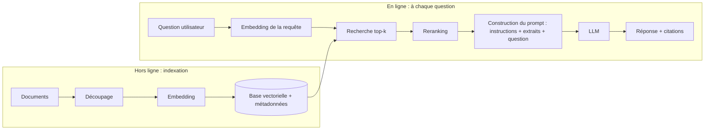

# Développement augmenté par l'IA

Notes pour un développeur. Les formats de fichiers concrets sont ceux de Claude Code ; les concepts s'appliquent à n'importe quelle stack.

Pour vous entraîner sur ces sujets sous forme de questions d'entretien, voir [Ingénierie IA & Claude Code](../interviews/claude-code.md).

## 1. Fondamentaux des LLM

Un LLM est un prédicteur de token suivant, entraîné sur un énorme corpus puis ajusté pour suivre des instructions. Il ne « cherche » rien et ne « connaît » pas les faits de façon fiable ; il génère la suite la plus plausible de son entrée.

| Concept | À retenir |
|---|---|
| **Token** | Unité de texte (~4 caractères / ¾ de mot en anglais). Vous payez et êtes limité par token, en entrée comme en sortie. Le code et le texte non anglais coûtent plus de tokens |
| **Fenêtre de contexte** | Nombre max de tokens que le modèle voit par appel (prompt + historique + résultats d'outils + sortie). La qualité se dégrade sur les contextes longs et bruités avant même la limite |
| **Sans état** | L'API ne retient rien. Vous renvoyez toute la conversation à chaque tour. La « mémoire » = ce que vous remettez dans le prompt |
| **Rôles** | `system` (règles durables, persona), `user`, `assistant`, résultats `tool` |
| **Temperature / top_p** | Aléa. Bas (0-0,3) pour l'extraction, le code, la classification. Plus haut pour le brainstorming |
| **Tokens de sortie max** | Plafond strict sur la réponse ; un JSON tronqué est un bug courant (vérifiez `stop_reason`) |
| **Hallucination** | Sortie assurée mais fausse. À atténuer par l'ancrage (RAG, outils), en demandant des citations, et par la vérification (tests, validation de schéma) |
| **Non-déterminisme** | Même prompt, réponse différente. Ne bâtissez jamais une logique qui suppose une sortie identique ; validez plutôt |
| **Prompt caching** | Réutilise un long préfixe statique (prompt système, docs) pour une fraction du coût et de la latence. Mettez le contenu stable en premier, le variable en dernier |
| **Latence / coût** | Croissent avec les tokens d'entrée + sortie. Petit modèle rapide pour les étapes simples, grand modèle pour le raisonnement difficile. Le streaming améliore la latence perçue |
| **Date limite des connaissances** | Le modèle ignore les événements récents et vos données privées ; injectez-les au moment de l'appel |

### Familles de modèles en pratique

Choisissez par tâche, pas par marque : petit/rapide (classification, routage, extraction), moyen (la plupart du code et du chat), grand/raisonnement (planification, débogage difficile, agents). Commencez par le moins cher qui passe vos évaluations.

### Appel d'API minimal (Python, SDK Anthropic)

```python
import anthropic
client = anthropic.Anthropic()          # lit ANTHROPIC_API_KEY dans l'environnement, ne codez jamais les clés en dur

resp = client.messages.create(
    model="claude-sonnet-5-5",
    max_tokens=1024,
    system="You are a code reviewer. Answer in JSON.",
    messages=[{"role": "user", "content": "Review: def add(a,b): return a-b"}],
)
print(resp.content[0].text, resp.stop_reason, resp.usage)
```

### Sortie structurée

Ne faites jamais de regex sur du texte libre. Demandez du JSON conforme à un schéma (ou forcez-le via un outil/`response_format`), **validez-le** (Pydantic, Zod, Jackson), et en cas d'échec réessayez une fois en renvoyant l'erreur de validation.

## 2. L'essentiel du prompting

- **Soyez précis sur la tâche, l'audience, le format, les contraintes.** Entrée vague, sortie vague.
- **Donnez le contexte que le modèle ne peut pas deviner** : chemins de fichiers, versions, conventions, ce que vous avez déjà essayé.
- **Montrez, ne dites pas** : 2-3 exemples few-shot fixent le format et les cas limites mieux que des paragraphes de règles.
- **Séparez les instructions des données** avec des délimiteurs/balises XML : `<document>...</document>`. Indispensable pour la sécurité (voir section 8).
- **Laissez-le réfléchir sur les problèmes difficiles** (extended thinking / « raisonne étape par étape, puis réponds »), mais demandez une réponse finale courte.
- **Dites quoi faire, pas seulement quoi éviter.** Donnez une issue : « En cas de doute, réponds "inconnu". »
- **Itérez comme pour du code** : versionnez les prompts dans git, gardez un petit jeu de tests, changez une seule chose à la fois.
- Prompt système = comportement durable. Tour utilisateur = la tâche.

Modèle :

```text
Role: senior Java reviewer.
Task: review the diff below for bugs and security issues only.
Constraints: max 5 findings, ordered by severity, cite file:line.
Output: JSON [{"file","line","severity","issue","fix"}]
<diff>...</diff>
```

- Plus d'exemples à copier-coller : [Prompts IA pour ingénieurs seniors](../best-practices/ai-prompts.md).

## 3. RAG (Retrieval-Augmented Generation)

**Problème** : le modèle ne connaît pas vos données privées/récentes et hallucine. **Idée** : au moment de la question, récupérer les passages pertinents dans vos données et les mettre dans le prompt pour que le modèle réponde à partir d'eux.



### Éléments clés

| Élément | Notes |
|---|---|
| **Embedding** | Un modèle transforme le texte en vecteur (ex. 768-3072 flottants). Sens proche → vecteurs proches (similarité cosinus). Utilisez le **même modèle** pour les documents et les requêtes |
| **Découpage (chunking)** | Découpez les docs en morceaux de 200-800 tokens, ~10-15 % de chevauchement, selon la structure (titres, paragraphes, fonctions de code) et non à l'aveugle. Gardez les métadonnées (source, titre, section, date, ACL) |
| **Base vectorielle** | pgvector (vous avez déjà Postgres ? commencez ici), Qdrant, Weaviate, Pinecone, OpenSearch. Type d'index HNSW/IVFFlat = plus proches voisins approximatifs |
| **Recherche hybride** | Combinez vectoriel (sémantique) + mots-clés BM25 (termes exacts, IDs, codes d'erreur), fusion par reciprocal rank fusion. Meilleur que chacun seul |
| **Reranker** | Un cross-encoder re-note les 20-50 premiers → gardez les 3-8 meilleurs. Gros gain de qualité pour un faible coût |
| **Assemblage du prompt** | « Réponds uniquement à partir du contexte. S'il manque, dis que tu ne sais pas. Cite [source]. » Mettez les extraits dans des balises |
| **Réécriture de requête** | Réécrivez les relances de chat en requêtes autonomes ; éventuellement, découpez les questions à plusieurs volets |

### Exemple pgvector

```sql
CREATE EXTENSION vector;
CREATE TABLE chunks (
  id bigserial PRIMARY KEY, source text, content text,
  embedding vector(1024));                      -- dimension = votre modèle d'embedding
CREATE INDEX ON chunks USING hnsw (embedding vector_cosine_ops);

-- les 5 extraits les plus proches de l'embedding d'une requête
SELECT source, content FROM chunks
ORDER BY embedding <=> :query_embedding LIMIT 5;
```

```python
def answer(question: str) -> str:
    q_vec = embed(question)                                  # API d'embedding
    rows = db.query(TOP_K_SQL, q_vec)                        # récupération
    context = "\n\n".join(f"[{r.source}] {r.content}" for r in rows)
    return llm(system="Answer only from <context>. Cite sources. Say 'I don't know' if absent.",
               user=f"<context>{context}</context>\n\nQuestion: {question}")
```

### Évaluer un RAG (séparément, récupération puis génération)

- **Récupération** : recall@k / taux de succès : le top-k contient-il le passage qui répond à la question ? Constituez 30-100 paires vraie question → source attendue.
- **Génération** : fidélité (réponse appuyée par le contexte ?), pertinence, refus correct quand le contexte ne contient pas la réponse. LLM-as-judge plus contrôles humains ponctuels.
- Changez un seul réglage à la fois (taille des chunks, k, reranker) et relancez le jeu de tests.

### Modes de défaillance courants

| Symptôme | Cause probable / correction |
|---|---|
| Le bon doc existe mais n'est pas récupéré | Mauvais découpage, embedding inadapté, besoin de recherche hybride / réécrire la requête |
| Récupéré mais la réponse l'ignore | Trop d'extraits/bruités (« lost in the middle »), réduire k, reranker, instruction plus claire |
| Réponse fausse mais assurée | Pas de règle « dis que tu ne sais pas », pas de citations exigées, index périmé |
| Fuite des données d'autres utilisateurs | Pas de filtre de métadonnées / ACL à la récupération (**filtrez avant le classement**) |
| Réponses périmées | Pas de pipeline de ré-indexation quand un document change |

### RAG vs fine-tuning vs contexte long

| Besoin | Solution |
|---|---|
| Connaissance fraîche/privée/changeante, citations, contrôle d'accès | **RAG** |
| Style, format ou comportement fixe sur une tâche étroite | Fine-tuning (dernier recours ; essayez d'abord prompting + exemples) |
| Petit corpus qui tient dans la fenêtre | Mettez-le simplement dans le prompt (+ prompt caching) |

## 4. Outils, function calling, MCP

Le modèle ne peut pas agir ; il **vous demande d'exécuter un outil** et vous lui renvoyez le résultat.

```text
user → LLM → "call get_weather(city='Tunis')"   (stop_reason = tool_use)
your code runs the function → sends the result back → LLM → final answer
```

- Un outil = nom + **description** + schéma JSON des entrées. La description est un prompt : le modèle choisit les outils en la lisant, donc distinguez clairement les outils similaires.
- Votre code exécute les outils, donc **c'est vous** qui imposez permissions, validation et limites.
- **MCP (Model Context Protocol)** : standard ouvert pour qu'un serveur d'outils (GitHub, Postgres, Jira, système de fichiers...) fonctionne avec n'importe quel client compatible. Utilisez MCP pour les capacités réutilisées entre applications, un simple outil interne pour une seule application.

## 5. Qu'est-ce qu'un agent ?

Un agent = un LLM dans une **boucle** qui décide de l'étape suivante, appelle des outils, observe les résultats, et s'arrête quand c'est terminé.

```text
while not done and steps < MAX:
    response = llm(messages, tools)
    if response wants tools: run them, append results to messages
    else: done, return response
```

- **Workflow vs agent** : si les étapes sont connues d'avance, écrivez un workflow fixe (chaînage de prompts, routage, appels parallèles). N'utilisez un agent autonome que si le chemin est inconnu. La structure la plus simple qui marche gagne (moins chère, testable, prévisible).
- Agent = modèle + outils + prompt système + boucle + garde-fous + gestion du contexte.

## 6. Étapes de construction, Claude Code

### 6.1 Skill (instructions réutilisables + scripts optionnels)

Un skill est un dossier que le modèle charge **à la demande** quand sa `description` correspond à la tâche. Seuls le nom et la description restent dans le contexte ; le corps se charge au déclenchement (contexte bon marché).

1. Choisissez une tâche répétable (notes de version, checklist de revue de PR, conventions de migration de BD).
2. Créez le dossier : `.claude/skills/<name>/` pour le projet ou `~/.claude/skills/<name>/` en personnel.
3. Écrivez `SKILL.md` :

```markdown
---
name: db-migration
description: Use when writing or reviewing a Flyway/Liquibase migration. Covers naming, backward-compatible changes, and lock-safe DDL.
---

# DB migration rules
1. File name `V<yyyyMMddHHmm>__<what>.sql`.
2. Never rename/drop a column in the same release as the code change (expand → migrate → contract).
3. Create indexes with `CREATE INDEX CONCURRENTLY`.
See [checklist](checklist.md). Run `scripts/lint.sh <file>` before finishing.
```

4. Ajoutez éventuellement `checklist.md`, `templates/`, `scripts/` à côté (référencés depuis `SKILL.md`, chargés seulement si besoin).
5. Testez : demandez une tâche censée le déclencher (`/db-migration` ou langage naturel). S'il ne se déclenche pas, **réécrivez la `description`** (c'est le déclencheur). S'il se déclenche à tort, rendez-la plus étroite.
6. Committez-le dans git pour que l'équipe le partage.

Conseils : la description dit *quoi* et *quand* ; gardez `SKILL.md` court, poussez le détail dans des fichiers liés ; travail déterministe → un script, pas de la prose.

### 6.2 Subagent (worker spécialisé avec son propre contexte)

Tourne dans une **fenêtre de contexte séparée** avec son propre prompt système et des outils restreints, puis ne renvoie qu'un résumé. Utilisez-le pour isoler un travail bruyant (grosses recherches, analyse de logs), pour exécuter des tâches en parallèle, ou pour imposer un rôle aux permissions limitées.

1. Créez `.claude/agents/<name>.md` (projet) ou `~/.claude/agents/<name>.md` (personnel), ou utilisez `/agents`.
2. Écrivez le frontmatter + le prompt système :

```markdown
---
name: security-reviewer
description: Use proactively after code changes to review for injection, authz, and secret-handling issues. Read-only.
tools: Read, Grep, Glob        # liste blanche ; à omettre pour hériter de tous les outils
model: sonnet                  # ou haiku pour bon marché/rapide, opus pour le difficile
---

You are a security reviewer. Review only the changed files (`git diff`).
Report findings as: severity, file:line, issue, fix. Do not modify files.
If nothing found, say so explicitly.
```

3. Invocation : automatique (Claude fait correspondre la `description`), par son nom (« use the security-reviewer agent on this diff »), ou depuis un autre agent.
4. Règles de conception : un seul rôle clair par subagent ; outils au moindre privilège ; une `description` précise (elle pilote la délégation) ; précisez le **format de sortie** car le parent ne voit que le message final ; les subagents ne voient pas la conversation du parent, donc passez le contexte nécessaire dans la tâche.

### 6.3 Plugin (empaqueter et distribuer)

Un plugin regroupe skills, subagents, commandes slash, hooks et serveurs MCP pour qu'une équipe les installe en une commande.

1. Structure :

```text
my-plugin/
├── .claude-plugin/
│   └── plugin.json          # manifeste (seul ce fichier va dans .claude-plugin/)
├── skills/db-migration/SKILL.md
├── agents/security-reviewer.md
├── commands/review.md       # /my-plugin:review
├── hooks/hooks.json         # automatisation déterministe
└── .mcp.json                # serveurs MCP
```

2. Manifeste :

```json
{
  "name": "my-plugin",
  "version": "1.0.0",
  "description": "Team conventions: migrations + security review",
  "author": { "name": "Your Team" }
}
```

3. Test en local : `claude --plugin-dir ./my-plugin`, puis essayez chaque composant.
4. Distribuez via une **marketplace** (un dépôt git avec `.claude-plugin/marketplace.json` listant les plugins) :

```json
{
  "name": "team-marketplace",
  "owner": { "name": "Your Team" },
  "plugins": [ { "name": "my-plugin", "source": "./my-plugin", "description": "Team conventions" } ]
}
```

5. Les utilisateurs installent : `/plugin marketplace add <org>/<repo>` puis `/plugin install my-plugin@team-marketplace`.
6. Incrémentez `version` à chaque release. Relisez les plugins tiers avant de les installer (ils exécutent du code et des hooks).

### 6.4 Hooks (garde-fous déterministes)

Commandes shell lancées par le harness sur des événements (`PreToolUse`, `PostToolUse`, `SessionStart`, `Stop`...), configurées dans `settings.json` ou le `hooks.json` d'un plugin. Utilisez-les pour ce qui doit **toujours** arriver (formater après édition, bloquer `rm -rf`, lancer les tests) ; les instructions d'un prompt sont consultatives, les hooks sont appliqués.

### 6.5 Votre propre agent (Agent SDK ou API brute)

1. **Définissez le travail et les critères de succès** (à quoi ressemble « terminé » ? comment le mesurer ?).
2. **Essayez d'abord un simple workflow** ; ne passez à l'agent que si les étapes ne peuvent pas être prédéterminées.
3. **Concevez les outils** : peu nombreux, bien nommés, descriptions claires, schémas JSON stricts, sorties petites et utiles, messages d'erreur exploitables. Préférez les outils en lecture seule ; contrôlez les destructifs.
4. **Écrivez le prompt système** : rôle, objectif, règles, quand s'arrêter, quand demander à un humain.
5. **Lancez la boucle** avec l'Agent SDK (gère boucle, outils, contexte, permissions, MCP, subagents) ou codez-la à la main (section 5). Fixez toujours un **nombre max d'étapes/budget** et un timeout.
6. **Gérez le contexte** : tronquez/résumez les grosses sorties d'outils, compactez l'historique, déléguez les sous-enquêtes à des subagents, gardez les notes durables dans des fichiers.
7. **Garde-fous** : moindre privilège, approbation humaine pour les actions irréversibles (paiements, suppressions, déploiements, messages externes), sandboxing, listes blanches, hooks/validateurs sur les appels d'outils.
8. **Évaluez** : un jeu de tâches réalistes avec vérifications réussite/échec (tests verts, fichier attendu modifié, bon état de BD), relancé à chaque changement de prompt/outil/modèle. Suivez taux de succès, étapes, tokens, coût, latence.
9. **Observez** : journalisez chaque prompt, appel d'outil, résultat, usage de tokens ; rendez les exécutions rejouables.
10. **Itérez à partir des échecs** : lisez les traces en échec, corrigez d'abord la description de l'outil ou le prompt, ajoutez l'échec au jeu d'évaluation.

Boucle minimale codée à la main :

```python
def run_agent(task, tools, max_steps=15):
    messages = [{"role": "user", "content": task}]
    for _ in range(max_steps):
        resp = client.messages.create(model=MODEL, max_tokens=2048, system=SYSTEM, tools=TOOL_SPECS, messages=messages)
        messages.append({"role": "assistant", "content": resp.content})
        if resp.stop_reason != "tool_use":
            return resp.content[0].text
        results = []
        for block in resp.content:
            if block.type == "tool_use":
                out = tools[block.name](**block.input)      # validez + autorisez ici
                results.append({"type": "tool_result", "tool_use_id": block.id, "content": str(out)})
        messages.append({"role": "user", "content": results})
    raise RuntimeError("step budget exhausted")
```

## 7. Lequel me faut-il ?

| Besoin | Choisir |
|---|---|
| **Instructions/conventions** réutilisables, chargées quand pertinent | **Skill** |
| Contexte isolé, travail parallèle, permissions restreintes, rôle spécialisé | **Subagent** |
| Connecter un système/API/base externe à n'importe quel client | **Serveur MCP** |
| Quelque chose qui doit arriver à chaque fois, sans exception | **Hook** |
| Règles de projet permanentes (commandes de build, style de code) | `CLAUDE.md` |
| Prompt raccourci que vous tapez (`/review`) | Commande slash |
| Partager tout ce qui précède avec une équipe | **Plugin** (+ marketplace) |
| Votre propre produit nécessitant de l'autonomie | **Agent** (Agent SDK) |
| Réponses à partir de docs privés/changeants | **RAG** |

`CLAUDE.md` est chargé à chaque session (gardez-le court : commandes de build/test, architecture, conventions, pièges). Les skills se chargent à la demande, donc mettez-y les procédures occasionnelles ou longues.

## 8. Habitudes de travail et sécurité

- **Vous êtes responsable de la sortie.** Lisez chaque diff. Le code de l'IA compile plus souvent qu'il n'est correct.
- **Vérifiez avec des contrôles exécutables** : tests, vérification de types, linter, build. Donnez à l'agent les commandes pour qu'il s'auto-vérifie. Le test d'abord marche très bien (écrivez/validez le test, laissez l'IA le faire passer).
- **Planifiez avant de coder** sur le travail non trivial (plan mode) : relisez le plan, puis exécutez. Petites étapes et commits relisables.
- **Hygiène du contexte** : une tâche par session, `/clear` entre tâches sans rapport, `/compact` sur les longues, pointez vers des fichiers plutôt que de coller, utilisez des subagents pour l'exploration.
- **Bonnes tâches pour l'IA** : boilerplate, tests, refactorings avec les tests comme filet de sécurité, migrations, explication de code inconnu, tri de logs/stack traces, docs, premiers jets de requêtes (puis `EXPLAIN`, voir [SQL](sql.md)). **Mauvaises tâches** : exigences floues, logique critique pour la sécurité sans relecture d'expert, tout ce que vous ne pouvez pas vérifier.
- **Prompt injection** : le texte de pages web, tickets, emails, fichiers ou docs récupérés peut contenir des instructions. Traitez-le comme des **données non fiables**, gardez-le séparé des instructions de confiance, donnez à l'agent le moindre privilège, et exigez une approbation pour les actions sensibles. Des modèles plus gros ou des prompts système polis ne sont pas une défense ; les permissions et les hooks, si.
- **Secrets & données** : ne mettez jamais de secrets dans les prompts, le code ou `CLAUDE.md` ; minimisez les données personnelles envoyées à un modèle ; connaissez les conditions de rétention des données de votre fournisseur.
- **Permissions** : mettez les commandes sûres en liste blanche, gardez les dangereuses sur confirmation. Ne lancez pas « skip all permissions » hors d'un sandbox/conteneur.
- **Maîtrise des coûts** : modèle moins cher pour les étapes simples, prompt caching, plafonnez la sortie, plafonnez les étapes de l'agent, surveillez l'usage de tokens.
- **Traitez prompts et skills comme du code** : versionnez-les, relisez-les, testez-les avec des évaluations.
- **Gardez vos fondamentaux solides** : vous devez pouvoir relire ce que l'IA écrit (conception, plans SQL, concurrence, sécurité).

## 9. Glossaire

| Terme | Signification |
|---|---|
| Embedding | Vecteur représentant le sens d'un texte |
| Base vectorielle | Stockage optimisé pour la recherche de plus proches voisins sur des embeddings |
| Grounding (ancrage) | Forcer les réponses à s'appuyer sur des sources fournies |
| Few-shot | Exemples inclus dans le prompt |
| Chain-of-thought / extended thinking | Le modèle raisonne avant la réponse finale |
| Tool use / function calling | Le modèle demande un appel de fonction, vous l'exécutez |
| MCP | Protocole ouvert pour exposer outils/données aux clients LLM |
| Agent | LLM + outils dans une boucle qui décide de son étape suivante |
| Orchestrator-worker | Un agent principal délègue à des subagents et fusionne les résultats |
| Eval | Jeu de tests répétable mesurant le comportement de l'IA |
| LLM-as-judge | Utiliser un modèle pour noter des sorties |
| Guardrail (garde-fou) | Limite appliquée (validation, permissions, hooks) |
| Prompt injection | Instructions malveillantes cachées dans des données lues par le modèle |
